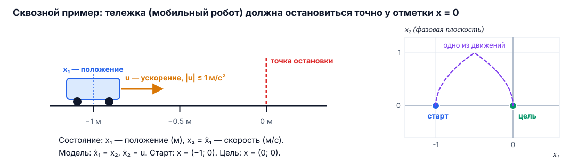
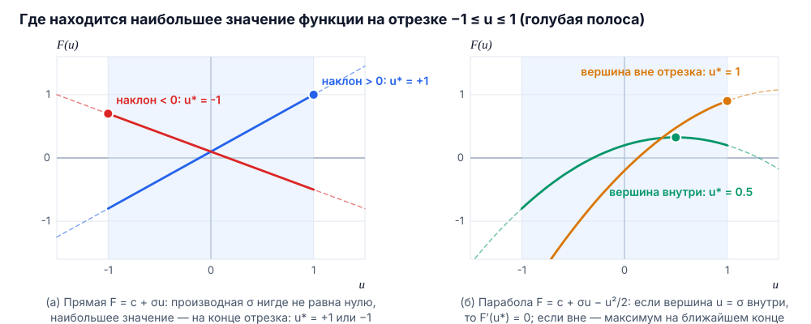
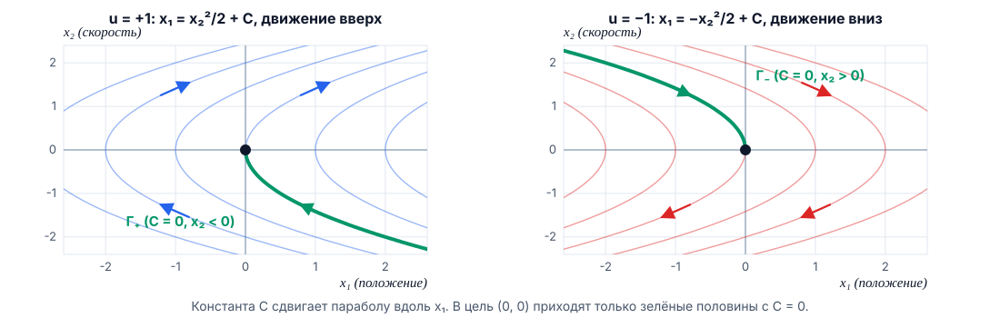
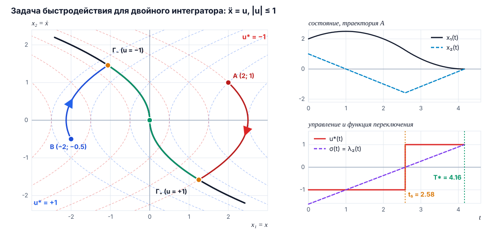
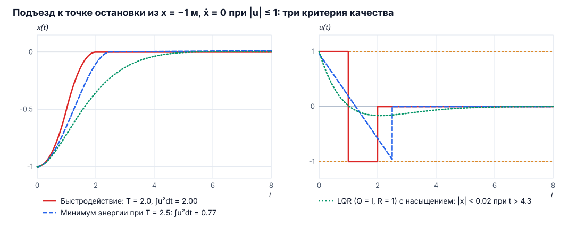
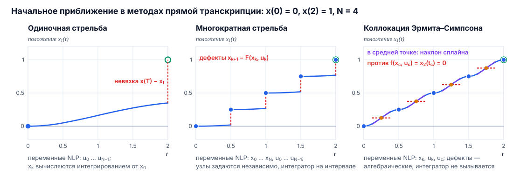
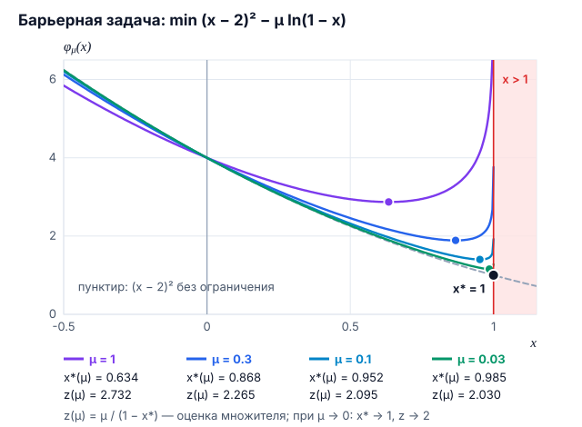
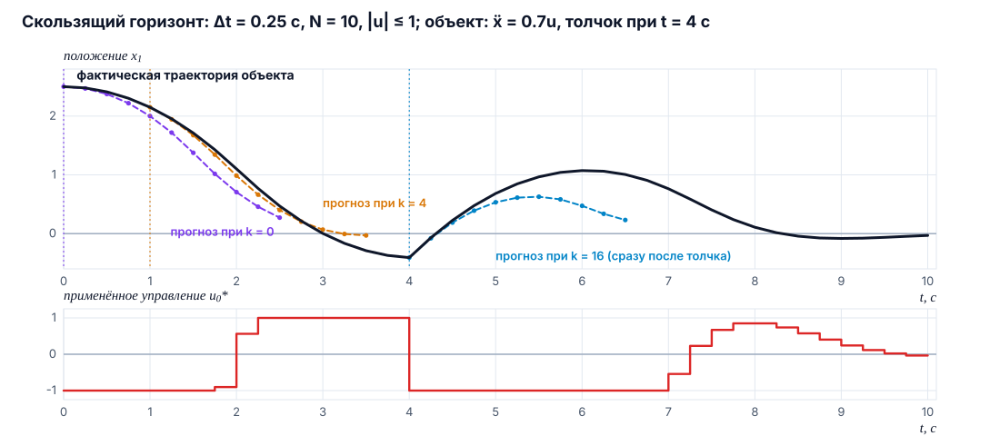

<!-- _class: lead -->
<!-- _header: "" -->
<!-- _footer: "" -->

# **Планирование движений мобильных роботов**
## Лекция 05: Оптимальное управление: от принципа максимума Понтрягина к численному решению и MPC

<div class="mt-4">

<span class="badge badge-blue">90 минут</span>
<span class="badge badge-green">Как найти наилучшее управление и как вычислять его на роботе</span>
<span class="badge badge-purple">постановка задачи • принцип максимума • численная оптимизация • MPC</span>

</div>

---

<!-- _class: fs-4 -->

## Место лекции в курсе <span class="badge badge-time">01–03 мин</span>

<div class="grid-2">
<div class="col">
<div class="card card-accent">

### Что уже умеем
- **Лекции 02–03.** Найти **путь** — геометрическую линию от старта к цели ($A^*$, PRM, RRT). Как по этой линии ехать, не обсуждалось.
- **Лекция 04.** Учесть, как робот реально движется: модель $\dot{x} = f(x, u)$. Методы DWA и MPPI перебирают **конечный набор** вариантов управления и выбирают лучший.

</div>
</div>
<div class="col">
<div class="card card-success">

### Вопрос этой лекции
Можно ли не перебирать варианты, а **вычислить** наилучшее управление?

Два ответа:
1. **Аналитический.** Принцип максимума Понтрягина даёт условия, которым обязано удовлетворять наилучшее управление. Для простых систем из них получается формула.
2. **Численный.** Задачу превращают в задачу оптимизации конечного числа переменных и решают на компьютере, повторяя решение на каждом такте (MPC).

</div>
</div>
</div>

---

<!-- _class: fs-4 -->

## План лекции <span class="badge badge-time">03–04 мин</span>

<div class="grid-2">
<div class="col">
<div class="card card-accent">

### Четыре части
1. **Постановка задачи** (04–18 мин): состояние, модель, критерий, ограничения.
2. **Принцип максимума** (18–53 мин): идея, рецепт из четырёх шагов, три примера на одной тележке.
3. **Численное решение** (53–74 мин): замена функции набором чисел, методы стрельбы и коллокации, как работает решатель.
4. **Управление с прогнозирующей моделью, MPC** (74–90 мин): пересчёт плана на каждом такте.

</div>
</div>
<div class="col">
<div class="card card-term">

### Как читать слайды
Каждый новый термин вводится в таком фиолетовом блоке: сначала смысл словами, затем формула, затем пример на тележке.

Сводка всех терминов лекции — на предпоследнем слайде.

</div>
<div class="card">

### Сквозной пример
Все рассуждения проверяются на одной задаче: тележка на рельсе должна остановиться точно у отметки. Её решение можно найти на бумаге, поэтому каждый численный результат лекции можно проверить.

</div>
</div>
</div>

---

## Часть 1. Сквозной пример: тележка у точки остановки <span class="badge badge-time">04–07 мин</span>

<div class="diagram-box">



</div>

<div class="grid-2 tight">
<div class="card">

**Задача.** Тележка стоит в 1 м перед отметкой. Двигатель создаёт ускорение $u$, не больше 1 м/с² по модулю. Нужно доехать и **остановиться** точно у отметки.

</div>
<div class="card card-alert">

**Вопросы.** Как сделать это быстрее всего? Как сделать это с наименьшими затратами энергии? Ответы различны, и лекция показывает почему.

</div>
</div>

---

<!-- _class: fs-4 -->

## Состояние и модель движения <span class="badge badge-time">07–10 мин</span>

<div class="grid-2">
<div class="col">
<div class="card card-term">

### Термин: состояние системы
Набор чисел $x$, который вместе с будущим управлением однозначно определяет будущее движение.

Для тележки одного положения мало: две тележки в одной точке, но с разными скоростями, поедут по-разному. Поэтому состояние — **положение и скорость**: $x = (x_1, x_2)$.

</div>
<div class="card card-term">

### Термин: фазовая плоскость
Плоскость с осями $x_1$ и $x_2$. Каждое состояние — точка, движение тележки — кривая на этой плоскости (справа на предыдущем слайде).

</div>
</div>
<div class="col">
<div class="card card-term">

### Термин: модель движения
Дифференциальные уравнения $\dot{x} = f(x, u)$: скорость изменения состояния при управлении $u$.

Для тележки скорость — производная положения, ускорение — производная скорости:
$$\dot{x}_1 = x_2, \qquad \dot{x}_2 = u.$$
Управление $u$ дважды интегрируется, прежде чем стать положением, поэтому такую модель называют **двойным интегратором**.

</div>
<div class="card">

**Проверка.** При $u = 0$ скорость не меняется, $x_2 = \text{const}$, и точка на фазовой плоскости движется горизонтально.

</div>
</div>
</div>

---

<!-- _class: fs-4 -->

## Критерий качества <span class="badge badge-time">10–13 мин</span>

<div class="grid-2">
<div class="col">
<div class="card card-term">

### Термин: критерий качества (функционал)
Число $J$, которое вычисляется по **всей** функции $u(t)$ и показывает, насколько хорошо выполнено движение. Чем меньше $J$, тем лучше. Обычная функция сопоставляет число числу, а функционал — число целой функции.

</div>
<div class="card">

### Три критерия для тележки
| Что важно | Критерий |
| :--- | :--- |
| время | $J = T$ |
| энергия | $J = \int_0^T u^2\,dt$ |
| точность и плавность | $J = \int_0^\infty (x_1^2 + x_2^2 + r u^2)\,dt$ |

</div>
</div>
<div class="col">
<div class="card card-accent">

### Пример: два способа доехать
**Способ 1.** Полный разгон $u = +1$ в течение 1 с, затем полное торможение $u = -1$ в течение 1 с.
Время $T = 2$ с, энергия $\int u^2 dt = 1 + 1 = 2$.

**Способ 2.** Плавно меняющееся ускорение (будет получено в примере 1) за $T = 2.5$ с.
Энергия $\int u^2 dt = 0.77$.

</div>
<div class="card card-success">

**Вывод.** Способ 1 быстрее, способ 2 экономнее. «Наилучшее управление вообще» не существует: оно наилучшее **по выбранному критерию**.

</div>
</div>
</div>

---

<!-- _class: fs-3 -->

## Общая постановка задачи оптимального управления <span class="badge badge-time">13–16 мин</span>

<div class="grid-2">
<div class="col">
<div class="card card-term">

### Термин: задача оптимального управления
Найти управление $u(t)$, при котором
$$J = \varphi\big(x(T)\big) + \int_0^T L\big(x(t), u(t)\big)\,dt \;\to\; \min$$
при условиях
- $\dot{x} = f(x, u)$, $\;x(0) = x_0$ — модель и начальное состояние;
- $u(t) \in \mathcal{U}$ — ограничения привода;
- $x(T) = x_T$ — где нужно оказаться;
- $g(x) \le 0$ — запреты на состояние (препятствия).

Управление, удовлетворяющее ограничениям, называют **допустимым**.

</div>
</div>
<div class="col">
<div class="card">

### Что означает каждый символ
| Символ | Смысл | Для тележки |
| :--- | :--- | :--- |
| $x$ | состояние | $(x_1, x_2)$ |
| $u$ | управление | ускорение |
| $f$ | модель | $(x_2,\; u)$ |
| $\mathcal{U}$ | допустимые значения $u$ | $[-1, 1]$ |
| $L$ | «стоимость» за единицу времени | $1$ или $u^2$ |
| $\varphi$ | стоимость конечного состояния | $0$ |
| $x_0,\, x_T$ | начало и конец | $(-1, 0)$, $(0, 0)$ |

</div>
<div class="card">

Если $T$ не задано заранее (как в задаче быстродействия), оно тоже неизвестно.

</div>
</div>
</div>

---

## Почему не работает правило «производная равна нулю» <span class="badge badge-time">16–19 мин</span>

<div class="grid-3 tight">
<div class="card">

**Шаг 1. Что мы знаем.** Минимум гладкой функции $F(u)$ ищут из условия $F'(u) = 0$.

</div>
<div class="card card-alert">

**Шаг 2. Граница.** Пусть нужно максимизировать $F(u) = u$ при $-1 \le u \le 1$. Ответ $u = 1$, но там $F'(1) = 1 \ne 0$. Наилучшая точка лежит на **границе** допустимого отрезка.

</div>
<div class="card card-alert">

**Шаг 3. Наш случай.** Ускорение ограничено, $|u| \le 1$, и, как увидим, наилучшее управление часто равно $\pm 1$ — тоже граница.

</div>
</div>

<div class="diagram-box">



</div>

**Вывод:** вместо условия «производная равна нулю» нужно условие «значение **наибольшее** среди всех допустимых $u$». Его и даёт принцип максимума.

---

<!-- _class: fs-4 -->

## Часть 2. Идея принципа максимума <span class="badge badge-time">19–23 мин</span>

<div class="grid-2">
<div class="col">
<div class="card">

### Рассуждение по шагам
1. Решение «какое $u$ выбрать сейчас» влияет на две вещи: на **текущую стоимость** $L(x, u)$ и на то, **куда сдвинется состояние**: $\dot{x} = f(x, u)$.
2. Сдвиг состояния важен тем, что меняет стоимость **оставшейся** части движения.
3. Если бы мы знали, насколько ценен сдвиг каждой координаты состояния, выбор $u$ свёлся бы к простой задаче: взвесить текущую стоимость и пользу от сдвига.
4. Эти «цены» сдвига обозначают $\lambda(t)$, а взвешенную сумму — $\mathcal{H}$.

</div>
</div>
<div class="col">
<div class="card card-term">

### Термин: сопряжённая переменная $\lambda(t)$
Вектор той же размерности, что состояние. Число $\lambda_i(t)$ показывает, на сколько **уменьшится** оставшаяся стоимость, если в момент $t$ сдвинуть $x_i$ на единицу.

</div>
<div class="card card-term">

### Термин: функция Гамильтона–Понтрягина
$$\mathcal{H}(x, u, \lambda) = -L(x, u) + \lambda^\top f(x, u).$$
Первое слагаемое — текущая стоимость со знаком минус, второе — польза от скорости изменения состояния. Наилучшее управление в каждый момент делает $\mathcal{H}$ **наибольшей**.

</div>
</div>
</div>

---

<!-- _class: fs-4 -->

## Принцип максимума: рецепт из четырёх шагов <span class="badge badge-time">23–27 мин</span>

<div class="grid-2">
<div class="col">
<div class="card card-success">

### Рецепт (Понтрягин и др., 1956–1961)
1. **Записать** функцию $\mathcal{H} = -L + \lambda^\top f$.
2. **Найти** управление, дающее максимум $\mathcal{H}$ по $u \in \mathcal{U}$ при фиксированных $x$ и $\lambda$:
   $$u^* = \arg\max_{u \in \mathcal{U}} \mathcal{H}(x, u, \lambda).$$
3. **Записать уравнения** для $\lambda$:
   $$\dot{\lambda} = -\frac{\partial \mathcal{H}}{\partial x}.$$
4. **Использовать краевые условия**: $x(0) = x_0$, $x(T) = x_T$. Если время $T$ свободно, добавить условие $\mathcal{H} = 0$.

</div>
</div>
<div class="col">
<div class="card card-term">

### Термин: необходимое условие
Каждое оптимальное управление удовлетворяет условиям рецепта. Обратное неверно: условиям могут удовлетворять и неоптимальные управления. Поэтому найденных кандидатов сравнивают между собой.

</div>
<div class="card">

### Замечания
- Шаг 2 не требует производной по $u$, поэтому рецепт работает и на границе $\mathcal{U}$.
- Строгая формулировка содержит множитель $\lambda_0 \ge 0$ при $L$: $\mathcal{H} = -\lambda_0 L + \lambda^\top f$. Во всех задачах лекции $\lambda_0 = 1$.
- В англоязычных книгах пишут $H = L + p^\top f$ с $p = -\lambda$ и ищут **минимум** $H$ («принцип минимума»). Это та же теорема.

</div>
</div>
</div>

---

<!-- _class: fs-4 -->

## Откуда берётся условие максимума <span class="badge badge-time">27–30 мин</span>

<div class="grid-2">
<div class="col">
<div class="card">

### Мысленный эксперимент
Для простоты оценивается только конечное состояние: $J = \varphi(x(T))$, $L = 0$.
1. Возьмём оптимальное управление $u^*(t)$ и заменим его другим значением $v$ на очень коротком отрезке длины $\varepsilon$ около момента $\tau$.
2. К концу этого отрезка состояние сдвинется на
   $$\delta x \approx \varepsilon\,\big[f(x, v) - f(x, u^*)\big].$$
3. Дальше система движется с прежним управлением, а сдвиг переносится до конца движения.

</div>
</div>
<div class="col">
<div class="card card-accent">

### Вывод
4. По смыслу $\lambda$ (предыдущий слайд) итоговая стоимость изменится на
   $$\Delta J \approx -\lambda(\tau)^\top \delta x = -\varepsilon\,\lambda^\top\big[f(x, v) - f(x, u^*)\big].$$
5. Управление $u^*$ оптимально, значит, никакая замена не уменьшает стоимость: $\Delta J \ge 0$. Отсюда
   $$\lambda^\top f(x, v) \le \lambda^\top f(x, u^*)$$
   для любого допустимого $v$. Это и есть условие максимума $\mathcal{H}$.

</div>
<div class="card card-success">

Замена на коротком отрезке называется **игольчатой вариацией**. Она меняет значение $u$ сколь угодно сильно, поэтому производная по $u$ не нужна.

</div>
</div>
</div>

---

<!-- _class: fs-4 -->

## Пример 1. Минимум энергии: шаги 1–3 <span class="badge badge-time">30–33 мин</span>

<div class="grid-2">
<div class="col">
<div class="card">

### Задача
Тележка из $(-1, 0)$ в $(0, 0)$ за **заданное** время $T$, критерий — энергия:
$$J = \tfrac12 \int_0^T u^2\,dt \to \min.$$
Пока считаем, что ограничения $|u| \le 1$ нет (проверим его в конце).

### Шаг 1. Функция $\mathcal{H}$
$$\mathcal{H} = -\tfrac12 u^2 + \lambda_1 x_2 + \lambda_2 u.$$

</div>
</div>
<div class="col">
<div class="card">

### Шаг 2. Максимум по $u$
$\mathcal{H}$ как функция $u$ — парабола ветвями вниз. Ограничений нет, поэтому вершина параболы находится из равенства нулю производной:
$$\frac{\partial\mathcal{H}}{\partial u} = -u + \lambda_2 = 0 \;\;\Rightarrow\;\; u = \lambda_2.$$

### Шаг 3. Уравнения для $\lambda$
$$\dot{\lambda}_1 = -\frac{\partial\mathcal{H}}{\partial x_1} = 0 \;\Rightarrow\; \lambda_1 = c_1,$$
$$\dot{\lambda}_2 = -\frac{\partial\mathcal{H}}{\partial x_2} = -\lambda_1 \;\Rightarrow\; \lambda_2 = c_2 - c_1 t.$$
**Итог:** $u(t) = c_2 - c_1 t$ — линейная функция времени. Осталось найти два числа $c_1$, $c_2$.

</div>
</div>
</div>

---

<!-- _class: fs-4 -->

## Пример 1. Шаг 4 и результат <span class="badge badge-time">33–36 мин</span>

<div class="grid-2">
<div class="col">
<div class="card">

### Шаг 4. Краевые условия
Интегрируем модель при $u = c_2 - c_1 t$, $x_1(0) = -1$, $x_2(0) = 0$:
$$x_2(t) = c_2 t - \tfrac12 c_1 t^2, \qquad x_1(t) = -1 + \tfrac12 c_2 t^2 - \tfrac16 c_1 t^3.$$
Требуем $x_2(T) = 0$ и $x_1(T) = 0$ — два уравнения на $c_1$, $c_2$. Решение: $c_1 = 12/T^3$, $c_2 = 6/T^2$.
$$u^*(t) = \frac{6}{T^2}\Big(1 - \frac{2t}{T}\Big).$$

</div>
</div>
<div class="col">
<div class="card card-success">

### Что получилось
- Ускорение плавно убывает: первую половину времени тележка разгоняется, вторую — тормозит.
- Затраты $\int_0^T u^2 dt = 12/T^3$. При $T = 2.5$ с это $0.77$ (способ 2 на слайде о критериях).
- Сократить время вдвое — значит увеличить затраты в 8 раз.

</div>
<div class="card card-alert">

### Проверка ограничения
Наибольшее ускорение $|u^*(0)| = 6/T^2$. Условие $6/T^2 \le 1$ даёт $T \ge \sqrt{6} \approx 2.45$ с. Быстрее этим способом доехать нельзя. Но, может быть, можно другим? Это вопрос примера 2.

</div>
</div>
</div>

---

<!-- _class: fs-4 -->

## Пример 2. Быстродействие: шаги 1–2 <span class="badge badge-time">36–39 мин</span>

<div class="grid-2">
<div class="col">
<div class="card">

### Задача
Та же тележка, $|u| \le 1$, время $T$ не задано, критерий — само время: $L = 1$, $J = T \to \min$.

### Шаг 1
$$\mathcal{H} = -1 + \lambda_1 x_2 + \lambda_2 u.$$

### Шаг 2
$\mathcal{H}$ зависит от $u$ **линейно**: это прямая с наклоном $\lambda_2$. Наибольшее значение прямой на отрезке $[-1, 1]$ — на конце:
$$u^*(t) = \begin{cases} +1, & \lambda_2(t) > 0, \\ -1, & \lambda_2(t) < 0. \end{cases}$$

</div>
</div>
<div class="col">
<div class="card card-term">

### Термин: релейное управление (bang-bang)
Управление, которое принимает только крайние значения $\pm u_{\max}$ и мгновенно переключается между ними, как реле.

</div>
<div class="card card-term">

### Термин: функция переключения
Величина, знак которой определяет управление. Здесь это $\sigma(t) = \lambda_2(t)$. Момент, когда $\sigma$ меняет знак, — **момент переключения** $t_s$.

</div>
<div class="card">

Здесь ограничение $|u| \le 1$ — главное: без него задача быстродействия не имеет решения (сколь угодно большое ускорение даёт сколь угодно малое время).

</div>
</div>
</div>

---

<!-- _class: fs-4 -->

## Пример 2. Шаг 3: сколько будет переключений <span class="badge badge-time">39–41 мин</span>

<div class="grid-2">
<div class="col">
<div class="card">

### Уравнения для $\lambda$ — те же, что в примере 1
$$\lambda_1 = c_1, \qquad \lambda_2(t) = c_2 - c_1 t.$$
Функция переключения **линейна** по времени. Прямая пересекает ноль не более одного раза, поэтому:

**управление переключается не более одного раза.**

Оптимальное движение — полный разгон, затем полное торможение (или только один из этих участков).

</div>
<div class="card card-term">

### Термин: особый участок
Интервал, на котором $\sigma(t) \equiv 0$ и шаг 2 не определяет $u$. Здесь его нет: из $\lambda_2 \equiv 0$ следует $\lambda_1 = 0$, и тогда $\mathcal{H} = -1 \ne 0$, что противоречит шагу 4.

</div>
</div>
<div class="col">
<div class="card card-success">

### Решение для тележки
Разгон $u = +1$ до момента $t_s$, затем торможение $u = -1$. Симметрия задачи подсказывает $t_s = 1$. Проверка:
- к $t = 1$: $x_2 = 1$, $x_1 = -1 + \tfrac12 = -0.5$;
- торможение 1 с: $x_2 = 1 - 1 = 0$, $x_1 = -0.5 + 1 - \tfrac12 = 0$.

**Минимальное время $T^* = 2$ с**, тогда как плавное решение примера 1 требует не меньше $2.45$ с.

</div>
<div class="card">

**Обобщение (теорема Фельдбаума).** Для линейной системы порядка $n$ с вещественными собственными значениями матрицы $A$ — не более $n - 1$ переключений.

</div>
</div>
</div>

---

## Фазовые траектории при $u = \pm 1$ <span class="badge badge-time">41–43 мин</span>

<div class="diagram-box">



</div>

<div class="grid-2 tight">
<div class="card">

**Вывод уравнения.** Разделим уравнения модели друг на друга, чтобы исключить время: $\dfrac{dx_1}{dx_2} = \dfrac{x_2}{u}$. При постоянном $u$ проинтегрируем: $x_1 = \dfrac{x_2^2}{2u} + C$ — парабола, открытая вправо при $u = +1$ и влево при $u = -1$; $C$ сдвигает её вдоль $x_1$.

</div>
<div class="card card-accent">

**Какие параболы ведут в цель.** В $(0, 0)$ приходят две половины с $C = 0$: $\Gamma_-$: $x_1 = -\tfrac12 x_2^2$, $x_2 > 0$ (едет вперёд, тормозит с $u = -1$) и $\Gamma_+$: $x_1 = \tfrac12 x_2^2$, $x_2 < 0$ (едет назад, тормозит с $u = +1$). Последний участок оптимального движения обязан лежать на одной из них.

</div>
</div>

---

<!-- _class: fs-4 -->

## Кривая переключения и закон обратной связи <span class="badge badge-time">43–45 мин</span>

<div class="grid-2">
<div class="col">
<div class="card card-term">

### Термин: кривая переключения $\Gamma$
Объединение $\Gamma_+$ и $\Gamma_-$:
$$\Gamma:\; x_1 + \tfrac12 x_2 |x_2| = 0.$$
**Смысл:** множество состояний, из которых полное торможение останавливает тележку точно в цели.

</div>
<div class="card card-term">

### Термин: закон обратной связи
Правило, вычисляющее управление по **текущему измеренному состоянию** $u = \kappa(x)$, а не по часам $u(t)$. Если тележку толкнут, закон сам выдаст правильную реакцию.

</div>
</div>
<div class="col">
<div class="card card-success">

### Закон быстродействия
- Состояние **левее** $\Gamma$ (тормозить рано): $u = +1$.
- Состояние **правее** $\Gamma$ (тормозить поздно): $u = -1$.
- Состояние **на** $\Gamma$: тормозить, $u = -\operatorname{sign} x_2$.

Формулой: $u^* = -\operatorname{sign}\big(x_1 + \tfrac12 x_2|x_2|\big)$ вне $\Gamma$.

### Проверка на тележке
Старт $(-1, 0)$ левее $\Gamma$: $u = +1$. Разгон до $(-0.5, 1)$ — точки на $\Gamma_-$; дальше торможение по $\Gamma_-$ в цель. Результат совпадает с предыдущим слайдом.

</div>
</div>
</div>

---

## Фазовый портрет задачи быстродействия <span class="badge badge-time">45–46 мин</span>

<div class="diagram-box">



</div>

<div class="grid-2 tight">
<div class="card">

**A** — наша тележка: разгон по синей параболе до $\Gamma$, торможение по $\Gamma$; $t_s = 1$, $T^* = 2$. Справа видно: $\sigma = \lambda_2$ — прямая, меняющая знак при $t_s$. **B** — тележка едет **от** цели со скоростью 1 м/с: сначала тормозит и разворачивается, переключение при $t_s = 2.58$, $T^* = 4.16$.

</div>
<div class="card card-alert">

**На практике.** Измерения зашумлены, а управление обновляется раз в такт. Вблизи $\Gamma$ знак $\sigma$ быстро меняется, и привод «дребезжит». Поэтому около цели релейный закон заменяют плавным (следующий слайд).

</div>
</div>

---

<!-- _class: fs-4 -->

## Пример 3. Линейно-квадратичный регулятор (LQR) <span class="badge badge-time">46–49 мин</span>

<div class="grid-2">
<div class="col">
<div class="card">

### Задача
Линейная модель $\dot{x} = Ax + Bu$, ограничений на $u$ нет, критерий штрафует отклонение и усилие:
$$J = \tfrac12\int_0^\infty \big(x^\top Q x + u^\top R u\big)\,dt.$$
Веса $Q$ и $R$ выбирает инженер: больше $Q$ — быстрее и точнее, больше $R$ — экономнее и плавнее.

### Шаги рецепта
1. $\mathcal{H} = -\tfrac12(x^\top Qx + u^\top Ru) + \lambda^\top(Ax + Bu)$.
2. Парабола по $u$: $\;u = R^{-1}B^\top\lambda$.
3. $\dot\lambda = Qx - A^\top\lambda$.

</div>
</div>
<div class="col">
<div class="card card-accent">

### Решение
Задача линейная, поэтому ищем $\lambda$ пропорциональной состоянию: $\lambda = -Px$. Подстановка в шаг 3 даёт **алгебраическое уравнение Риккати** для матрицы $P$:
$$A^\top P + PA - PBR^{-1}B^\top P + Q = 0,$$
и **линейную обратную связь** $u = -Kx$, $K = R^{-1}B^\top P$.

### Для тележки
При $Q = \operatorname{diag}(q_1, q_2)$, $R = r$:
$$k_1 = \sqrt{q_1/r}, \qquad k_2 = \sqrt{q_2/r + 2k_1}.$$
При $Q = I$, $R = 1$: $u = -x_1 - \sqrt{3}\,x_2$.

</div>
<div class="card card-alert">

LQR не знает об ограничении $|u| \le 1$. Обрезание команды делает её допустимой, но уже не оптимальной.

</div>
</div>
</div>

---

## Три закона на одной задаче <span class="badge badge-time">49–50 мин</span>

<div class="diagram-box">



</div>

<div class="grid-3 tight">
<div class="card">

**Быстродействие:** $T = 2$ с, энергия 2. Управление разрывно: рывок при переключении.

</div>
<div class="card">

**Минимум энергии** ($T = 2.5$ с): энергия 0.77, в 2.6 раза меньше. Ускорение меняется плавно.

</div>
<div class="card">

**LQR** с обрезанием: цель достигается плавно, без заданного времени; $|x_1| < 0.02$ после 4.3 с.

</div>
</div>

---

## Интерактивная модель: тележка на фазовой плоскости <span class="badge badge-time">50–53 мин</span>

<div class="interactive-container">
<div class="interactive-header">
<span><i class="interactive-dot"></i> Быстродействие, минимум энергии и LQR</span>
<span>Выберите сценарий; каждый показывает одно свойство решения</span>
</div>
<iframe src="http://localhost:5599/widgets/bang-bang-simulator/index.html" class="interactive-frame"></iframe>
</div>

---

<!-- _class: fs-4 -->

## Итоги части 2 и пределы аналитического решения <span class="badge badge-time">53–55 мин</span>

<div class="grid-2">
<div class="col">
<div class="card card-success">

### Что дал принцип максимума
- Вид наилучшего управления определяется критерием: линейная по $u$ функция $\mathcal{H}$ даёт релейное управление, «параболическая» — плавное.
- Для тележки получены точные ответы: формула $u^*(t)$, число переключений, закон обратной связи, минимальное время.

</div>
<div class="card card-term">

### Термин: функция цены $V(x)$
Наименьшая стоимость, которую ещё придётся заплатить, начиная из состояния $x$. Связь с $\lambda$: $\lambda = -\nabla V$. Функция цены — центральное понятие лекции 06.

</div>
</div>
<div class="col">
<div class="card card-alert">

### Почему для реального робота этого мало
- Уравнения для $x$ и $\lambda$ образуют **краевую задачу**: часть условий задана в начале, часть в конце. Начальное $\lambda(0)$ неизвестно и не имеет наглядного смысла, подбирать его трудно.
- Препятствия $g(x) \le 0$ сильно усложняют условия.
- Для нелинейной модели с препятствиями формулы, как у тележки, обычно не существует.

**Вывод:** нужна численная оптимизация. Принцип максимума при этом подсказывает, какой вид решения ожидать.

</div>
</div>
</div>

---

<!-- _class: fs-4 -->

## Часть 3. Идея: заменить функцию набором чисел <span class="badge badge-time">55–58 мин</span>

<div class="grid-2">
<div class="col">
<div class="card">

### Шаг 1. Сетка по времени
Делим $[0, T]$ на $N$ равных интервалов длины $h = T/N$, узлы $t_k = kh$.

### Шаг 2. Управление — ступенька
На каждом интервале $u$ постоянно: $u(t) = u_k$. Вместо функции — $N$ чисел $u_0, \dots, u_{N-1}$.

### Шаг 3. Модель — шаг вперёд
Состояние в следующем узле вычисляется численным интегрированием, например методом Эйлера:
$$x_{k+1} = x_k + h\,f(x_k, u_k).$$
Точнее — методом Рунге–Кутты 4-го порядка (RK4).

</div>
</div>
<div class="col">
<div class="card">

### Для тележки (метод Эйлера)
$$x_{1,k+1} = x_{1,k} + h\,x_{2,k}, \qquad x_{2,k+1} = x_{2,k} + h\,u_k.$$
Критерий «энергия» становится суммой: $J = h\sum_k u_k^2$.

</div>
<div class="card card-term">

### Термин: задача нелинейного программирования (NLP)
Найти **вектор чисел** $w$, минимизирующий функцию $F(w)$ при ограничениях-равенствах $G(w) = 0$ и неравенствах $H(w) \le 0$. Для её решения есть готовые программы — **решатели**.

</div>
<div class="card card-success">

**Итог:** задача оптимального управления превратилась в NLP. Этот подход называют **прямой транскрипцией**.

</div>
</div>
</div>

---

<!-- _class: fs-4 -->

## Одиночная стрельба <span class="badge badge-time">58–60 мин</span>

<div class="grid-2">
<div class="col">
<div class="card card-term">

### Термин: метод стрельбы
Название пришло из артиллерии: меняем «прицел» (управление), моделируем «полёт» (движение) и смотрим, куда попали. Затем исправляем прицел.

</div>
<div class="card">

### Как устроена одиночная стрельба
- **Переменные:** только управления $w = (u_0, \dots, u_{N-1})$.
- Состояния вычисляются последовательно от $x_0$ по модели: $x_1 = F(x_0, u_0)$, $x_2 = F(x_1, u_1)$, …
- **Ограничение:** конечное состояние совпадает с целью, $x_N(w) = x_T$.

</div>
</div>
<div class="col">
<div class="card card-success">

### Плюсы
- Мало переменных: для тележки при $N = 20$ — всего 20 чисел.
- Модель выполняется точно на каждой итерации.

</div>
<div class="card card-alert">

### Минусы
- Небольшое изменение $u_0$ влияет на **всю** последующую траекторию. Для неустойчивой системы (перевёрнутый маятник) это влияние растёт экспоненциально, и решатель «промахивается».
- Нельзя подсказать решателю форму пути: путь всегда получается из управлений.

</div>
</div>
</div>

---

<!-- _class: fs-4 -->

## Многократная стрельба <span class="badge badge-time">60–62 мин</span>

<div class="grid-2">
<div class="col">
<div class="card">

### Как устроена
- **Переменные:** и управления, и состояния во всех узлах: $w = (x_0, u_0, x_1, u_1, \dots, x_N)$.
- Модель интегрируется **на каждом интервале отдельно**, от своего узла $x_k$.
- **Ограничения:** конец каждого интервала совпадает со следующим узлом.

</div>
<div class="card card-term">

### Термин: дефект
Разрыв между тем, куда пришла модель из узла $x_k$, и тем, где стоит следующий узел:
$$c_k = x_{k+1} - F(x_k, u_k).$$
Во время итераций дефекты не равны нулю. В решении все $c_k = 0$, и траектория непрерывна.

</div>
</div>
<div class="col">
<div class="card card-success">

### Почему это удобно
- Ошибка на одном интервале не растёт по всей траектории: каждый интервал короткий.
- Начальное приближение можно задать прямо **в состояниях**: например, положить узлы на путь, найденный $A^*$ или RRT (лекции 02–03), даже если он не согласован с моделью.
- Интервалы можно интегрировать параллельно.

</div>
<div class="card">

**Цена:** больше переменных. Для тележки при $N = 20$: $21 \cdot 2 + 20 = 62$ числа. Зато каждое ограничение связывает только соседние узлы, и решатель использует эту структуру.

</div>
</div>
</div>

---

<!-- _class: fs-3 -->

## Прямая коллокация <span class="badge badge-time">62–63 мин</span>

<div class="grid-2">
<div class="col">
<div class="card card-term">

### Термин: коллокация
Траекторию на интервале заменяют многочленом и требуют, чтобы его производная совпадала с моделью $f(x, u)$ в выбранных точках — **точках коллокации**. Интегрирование модели не нужно: остаются алгебраические равенства.

</div>
<div class="card">

### Простейший вариант: метод трапеций
Приращение состояния на интервале равно площади трапеции под графиком скорости:
$$x_{k+1} - x_k - \tfrac{h}{2}\,\big(f(x_k, u_k) + f(x_{k+1}, u_{k+1})\big) = 0.$$

</div>
</div>
<div class="col">
<div class="card card-accent">

### Сравнение трёх методов
| | одиночная стрельба | многократная стрельба | коллокация |
| :--- | :--- | :--- | :--- |
| переменные | $u$ | $x$ и $u$ | $x$ и $u$ |
| модель | интегрирование | интегрирование на интервалах | равенства в точках |
| приближение для пути | нельзя | можно | можно |
| размер задачи | мал | средний | велик, но структура простая |

Точнее трапеций метод Эрмита–Симпсона (многочлен 3-й степени); ещё точнее псевдоспектральные методы.

</div>
</div>
</div>

---

## Начальное приближение в трёх методах <span class="badge badge-time">63–64 мин</span>

<div class="diagram-box">



</div>

Задача: тележка из $x_1 = 0$ в $x_1 = 1$ за 2 с, $N = 4$ интервала, решатель ещё не запускался. В одиночной стрельбе ошибка видна только в конце: траектория «не долетела». В многократной стрельбе и коллокации узлы сразу поставлены на прямую от старта к цели, а несогласованность с моделью видна как дефекты (красные отрезки). Решатель сводит их к нулю.

---

## Интерактивная модель: методы транскрипции <span class="badge badge-time">64–67 мин</span>

<div class="interactive-container">
<div class="interactive-header">
<span><i class="interactive-dot"></i> Одиночная и многократная стрельба, коллокация</span>
<span>Выполняйте итерации решателя по одной и следите за дефектами и промахом</span>
</div>
<iframe src="http://localhost:5599/widgets/shooting-collocation-simulator/index.html" class="interactive-frame"></iframe>
</div>

---

<!-- _class: fs-4 -->

## Как решатель находит минимум <span class="badge badge-time">67–70 мин</span>

<div class="grid-2">
<div class="col">
<div class="card">

### Шаг 1. Без ограничений: метод Ньютона
В текущей точке $w$ заменяем $F$ параболой (по первой и второй производным) и переходим в её вершину. Повторяем, пока шаг не станет малым.

### Шаг 2. Равенства: множители Лагранжа
Как в курсе математического анализа: составляем функцию Лагранжа
$$\mathcal{L}(w, \nu) = F(w) + \nu^\top G(w)$$
и ищем точку, где её производная по $w$ равна нулю и $G(w) = 0$.

</div>
</div>
<div class="col">
<div class="card card-term">

### Термин: условия Каруша–Куна–Таккера (ККТ)
Условия оптимальности при неравенствах $H(w) \le 0$ с множителями $z$:
1. производная $F + \nu^\top G + z^\top H$ по $w$ равна нулю;
2. все ограничения выполнены;
3. $z \ge 0$: ограничение может только «упираться», но не «притягивать»;
4. $z_i H_i = 0$: множитель не равен нулю только у **активного** ограничения.

</div>
<div class="card card-term">

### Термин: активное ограничение
Неравенство, выполненное как равенство: робот касается границы препятствия, привод работает на пределе.

</div>
</div>
</div>

---

## Два семейства решателей: SQP и метод внутренней точки <span class="badge badge-time">70–72 мин</span>

<div class="grid-2">
<div class="col">
<div class="card card-accent">

### Последовательное квадратичное программирование (SQP)
1. В текущей точке заменить критерий параболой, а ограничения — линейными.
2. Решить получившуюся простую (квадратичную) задачу — найти шаг.
3. Сделать шаг и повторить.

Хорошо использует **тёплый старт** — начало с решения, найденного на предыдущем такте. Реализации: acados, SNOPT.

</div>
<div class="card">

**Скорость.** Каждое ограничение связывает только соседние узлы, поэтому время одной итерации растёт **линейно** с числом интервалов $N$. Это делает длинные горизонты практичными.

</div>
</div>
<div class="col">
<div class="card card-success">

### Метод внутренней точки
«Стену» ограничения $H(w) \le 0$ заменяют плавным «барьером»: к критерию добавляют $-\mu\ln(-H)$, который растёт до бесконечности у границы. Решают задачу при уменьшающихся $\mu$; решение приближается к границе изнутри.

</div>
<div class="diagram-box">



</div>
</div>
</div>

---

## Инструментарий: CasADi и IPOPT <span class="badge badge-time">72–74 мин</span>

<!-- _class: fs-3 -->

<div class="grid-2">
<div class="col">

```python
import casadi as ca, numpy as np
N, T = 40, 8.0;  h = T / N
opti = ca.Opti()
X = opti.variable(3, N + 1)       # (p_x, p_y, θ) в узлах
U = opti.variable(2, N)           # (v, ω) на интервалах
f = lambda x, u: ca.vertcat(u[0]*ca.cos(x[2]),
                            u[0]*ca.sin(x[2]), u[1])
for k in range(N):                # многократная стрельба, RK4
    x, u = X[:, k], U[:, k]
    k1 = f(x, u); k2 = f(x + h/2*k1, u)
    k3 = f(x + h/2*k2, u); k4 = f(x + h*k3, u)
    opti.subject_to(X[:, k+1] == x + h/6*(k1 + 2*k2 + 2*k3 + k4))
opti.subject_to(X[:, 0] == ca.DM([0, 0, 0]))
opti.subject_to(X[:, N] == ca.DM([4, 2, 0]))
opti.subject_to(opti.bounded(0, U[0, :], 1.0))
opti.subject_to(opti.bounded(-1.5, U[1, :], 1.5))
opti.subject_to((X[0, :] - 2)**2 + (X[1, :] - 1.3)**2 >= 0.5**2)
opti.minimize(h * ca.sumsqr(U))
opti.set_initial(X[0, :], np.linspace(0, 4, N + 1))
opti.set_initial(X[1, :], np.linspace(0, 2, N + 1))
opti.solver('ipopt');  sol = opti.solve()
```

</div>
<div class="col">
<div class="card card-accent">

### Программа по шагам
1. **Переменные** `X`, `U`: состояния в узлах и управления — многократная стрельба.
2. **Модель** `f`: робот с дифференциальным приводом из лекции 04 (скорость $v$, угловая скорость $\omega$).
3. **Дефекты** в цикле: следующий узел равен шагу RK4 от предыдущего.
4. **Ограничения:** старт, цель, пределы $v$ и $\omega$, круглое препятствие радиуса 0.5.
5. **Критерий:** энергия управления.
6. **Начальное приближение:** узлы на прямой от старта к цели.
7. **Решатель** IPOPT (метод внутренней точки): 38 итераций (проверено, CasADi 3.8); ограничение препятствия в решении активно.

</div>
<div class="card">

CasADi сам вычисляет все производные (автоматическое дифференцирование). Для робота: генерация кода на C, пакет acados.

</div>
</div>
</div>

---

<!-- _class: fs-4 -->

## Часть 4. Почему одного плана недостаточно <span class="badge badge-time">74–76 мин</span>

<div class="grid-2">
<div class="col">
<div class="card card-alert">

### Проблема
Оптимальный план рассчитан **по модели**. Реальный робот от неё отличается: другая масса, трение, проскальзывание колёс, внешние толчки. Если исполнять план «вслепую», ошибка накапливается.

</div>
<div class="card card-term">

### Термин: управление с прогнозирующей моделью (MPC)
На каждом такте заново решать задачу оптимального управления на коротком отрезке будущего, начиная из **измеренного** состояния, и исполнять только первый шаг решения.

</div>
</div>
<div class="col">
<div class="card card-success">

### Алгоритм на каждом такте
1. Измерить состояние $\hat{x}$.
2. Решить задачу на $N$ шагов вперёд:
   $$\min \sum_{k=0}^{N-1} \ell(x_k, u_k) + V_f(x_N), \quad x_0 = \hat{x},$$
   с моделью и ограничениями.
3. Подать на привод **только** $u_0$.
4. На следующем такте сдвинуть окно и повторить.

</div>
<div class="card card-term">

### Термин: горизонт прогноза
Число шагов $N$ (или время $N h$), на которое заглядывает MPC. Окно «скользит» вместе со временем: **скользящий горизонт**.

</div>
</div>
</div>

---

## Прогноз и фактическое движение <span class="badge badge-time">76–78 мин</span>

<div class="diagram-box">



</div>

<div class="grid-2 tight">
<div class="card">

**Что изображено.** Модель регулятора: $\ddot{x} = u$. Настоящий объект слабее: $\ddot{x} = 0.7u$. При $t = 4$ с объект толкают. Пунктиры — прогнозы, построенные на разных тактах.

</div>
<div class="card card-success">

**Вывод.** Прогнозы неточны, но каждый такт начинается с измерения, поэтому MPC приводит объект к цели. План, рассчитанный один раз (красный), после толчка уводит объект прочь.

</div>
</div>

---

<!-- _class: fs-4 -->

## Горизонт, терминальная стоимость и устойчивость <span class="badge badge-time">78–80 мин</span>

<div class="grid-2">
<div class="col">
<div class="card card-alert">

### Опасность короткого горизонта
Пример: тележке нужно 1 с на торможение, а горизонт — 0.5 с. В прогнозе тормозить «ещё рано», и тележка проскакивает цель. MPC видит только то, что внутри окна.

</div>
<div class="card card-term">

### Термин: терминальная стоимость $V_f(x_N)$
Оценка стоимости **оставшегося** пути после конца горизонта. Она «сообщает» короткому окну о том, что будет дальше. Удобный выбор: $V_f = x^\top P x$ из уравнения Риккати (LQR).

</div>
</div>
<div class="col">
<div class="card card-term">

### Термин: рекурсивная допустимость
Если задача имела решение на этом такте, она будет иметь решение и на следующем. Без этого свойства MPC может однажды не найти ни одного допустимого управления.

</div>
<div class="card card-success">

### Теоретический результат (Mayne и др., 2000)
Если $V_f$ и **терминальное множество** $\mathbb{X}_f$ (куда должен попасть $x_N$) выбраны согласованно с некоторым регулятором вблизи цели, то MPC обладает рекурсивной допустимостью и система устойчива.

На практике часто достаточно длинного горизонта и $V_f$ из LQR.

</div>
</div>
</div>

---

<!-- _class: fs-4 -->

## Препятствия и работа в реальном времени <span class="badge badge-time">80–82 мин</span>

<div class="grid-2">
<div class="col">
<div class="card card-accent">

### Препятствия
- **Напрямую:** $\lVert p_k - o_j \rVert \ge r_j + r_{\text{робота}}$ на каждом шаге. Ограничение невыпуклое: решатель может «застрять» перед препятствием (локальный минимум).
- **Через коридор:** глобальный планировщик строит путь, вокруг него выделяют выпуклые свободные области, и на шаге $k$ требуется $A_k p_k \le b_k$. Задача становится проще и надёжнее.

</div>
<div class="card card-term">

### Термин: мягкое ограничение
Ограничение, которое разрешено нарушить за большой штраф в критерии. Задача тогда всегда имеет решение, даже если датчики «увидели» препятствие слишком близко.

</div>
</div>
<div class="col">
<div class="card card-success">

### Как успеть за один такт
- **Тёплый старт:** начинать с решения предыдущего такта, сдвинутого на один шаг. Оно уже почти верно.
- **Итерация реального времени (RTI, Diehl и др., 2005):** на каждом такте выполнять **одну** итерацию SQP. Подготовка (вычисление производных) делается до прихода измерения; после измерения остаётся решить одну квадратичную задачу.
- Типичная частота MPC для мобильного робота — десятки герц.

</div>
</div>
</div>

---

## Интерактивная модель: MPC с препятствиями <span class="badge badge-time">82–85 мин</span>

<div class="interactive-container">
<div class="interactive-header">
<span><i class="interactive-dot"></i> MPC для робота на плоскости</span>
<span>Сценарии: длина горизонта, неточная модель, толчок, препятствие на пути</span>
</div>
<iframe src="http://localhost:5599/widgets/mpc-interactive-solver/index.html" class="interactive-frame"></iframe>
</div>

---

## Сравнение локальных методов и место MPC в системе управления <span class="badge badge-time">85–87 мин</span>

<!-- _class: compact fs-4 -->

<div class="grid-2">
<div class="col">

| | DWA | MPPI | MPC |
| :--- | :--- | :--- | :--- |
| Что перебирается | сетка постоянных $(v, \omega)$ | случайные последовательности $u$ | ничего: оптимизация |
| Ограничения | отбрасывание вариантов | штрафы | явно, в задаче NLP |
| Требования к критерию | любой | любой | гладкий |
| Результат | лучший из сетки | приближённый оптимум | локальный оптимум |
| Вычисления | малые | много выборок (GPU) | решатель на каждом такте |

</div>
<div class="col">
<div class="card card-accent">

### Многоуровневая система управления
1. **Глобальный планировщик** ($A^*$, RRT*, лекции 02–03): путь, обновляется редко.
2. **Оптимизация траектории:** гладкая исполнимая траектория по модели; начальное приближение — найденный путь.
3. **MPC** (десятки герц): следование траектории с учётом ограничений и текущего измерения.
4. **Регуляторы приводов** (около килогерца): отработка заданных скоростей и моментов.

MPC — локальный метод: он не заменяет глобальный планировщик, а дополняет его.

</div>
</div>
</div>

---

<!-- _class: fs-3 -->

## Итоги лекции и контрольные вопросы <span class="badge badge-time">87–89 мин</span>

<div class="grid-2">
<div class="col">
<div class="card card-accent">

### Итоги
- Задача оптимального управления: модель, ограничения, критерий. Ответ зависит от критерия.
- Принцип максимума: выбирать $u$, дающее наибольшее $\mathcal{H} = -L + \lambda^\top f$. Работает и на границе ограничений.
- Для тележки: минимум энергии — линейное ускорение; быстродействие — разгон и торможение с одним переключением; LQR — линейная обратная связь.
- Численно задачу сводят к NLP (стрельба, коллокация) и решают SQP или методом внутренней точки.
- MPC повторяет решение на каждом такте от измеренного состояния.

</div>
</div>
<div class="col">
<div class="card">

### Контрольные вопросы
1. Почему для состояния тележки недостаточно одного положения?
2. Почему в задаче быстродействия условие $\partial\mathcal{H}/\partial u = 0$ не помогает найти $u$?
3. Тележка стоит в 4 м перед отметкой. Найдите минимальное время и момент переключения.
4. Сколько переменных в одиночной и многократной стрельбе для тележки при $N = 50$?
5. Что произойдёт с MPC, если горизонт короче времени торможения?

</div>
</div>
</div>

---

## Словарь терминов лекции

<!-- _class: fs-3 -->

<div class="grid-3">
<div class="card card-term">

### Постановка задачи
- **Состояние** — числа, определяющие будущее движение.
- **Модель движения** $\dot{x} = f(x, u)$.
- **Фазовая плоскость** — оси «положение — скорость».
- **Двойной интегратор** — $\ddot{x} = u$.
- **Критерий (функционал)** — число по всей функции $u(t)$.
- **Допустимое управление** — удовлетворяющее ограничениям.

</div>
<div class="card card-term">

### Принцип максимума
- **Сопряжённая переменная** $\lambda$ — «цена» сдвига состояния.
- **Функция Гамильтона–Понтрягина** $\mathcal{H} = -L + \lambda^\top f$.
- **Необходимое условие** — выполнено для любого оптимума.
- **Релейное управление**, **функция переключения**, **особый участок**.
- **Кривая переключения**, **закон обратной связи**.
- **LQR**, **уравнение Риккати**, **функция цены** $V$.

</div>
<div class="card card-term">

### Численные методы и MPC
- **Прямая транскрипция**, **NLP**, **решатель**.
- **Одиночная / многократная стрельба**, **дефект**, **коллокация**.
- **Условия ККТ**, **активное ограничение**.
- **SQP**, **метод внутренней точки**, **тёплый старт**.
- **MPC**, **горизонт**, **терминальная стоимость**.
- **Рекурсивная допустимость**, **мягкое ограничение**.

</div>
</div>

---

<!-- _class: fs-2 -->

## Литература

<div class="grid-2">
<div class="col">
<div class="card card-accent">

### Теория оптимального управления
- Понтрягин Л. С., Болтянский В. Г., Гамкрелидзе Р. В., Мищенко Е. Ф. *Математическая теория оптимальных процессов.* — М.: Физматгиз, 1961.
- Фельдбаум А. А. *Основы теории оптимальных автоматических систем.* — М.: Наука, 1966.
- Kirk D. E. *Optimal Control Theory: An Introduction.* — Dover, 2004. (Начальный уровень, много примеров.)
- Liberzon D. *Calculus of Variations and Optimal Control Theory: A Concise Introduction.* — Princeton University Press, 2012.

</div>
</div>
<div class="col">
<div class="card">

### Численные методы и MPC
- Betts J. T. *Practical Methods for Optimal Control Using Nonlinear Programming.* 2nd ed. — SIAM, 2010.
- Nocedal J., Wright S. *Numerical Optimization.* 2nd ed. — Springer, 2006.
- Rawlings J. B., Mayne D. Q., Diehl M. *Model Predictive Control: Theory, Computation, and Design.* 2nd ed. — Nob Hill, 2017.
- Mayne D. Q. et al. Constrained model predictive control: Stability and optimality // Automatica. 2000. Vol. 36.
- Diehl M., Bock H. G., Schlöder J. P. A real-time iteration scheme for nonlinear optimization in optimal feedback control // SIAM J. Control Optim. 2005. Vol. 43.
- Andersson J. et al. CasADi // Math. Prog. Comp. 2019. Vol. 11.

</div>
</div>
</div>
