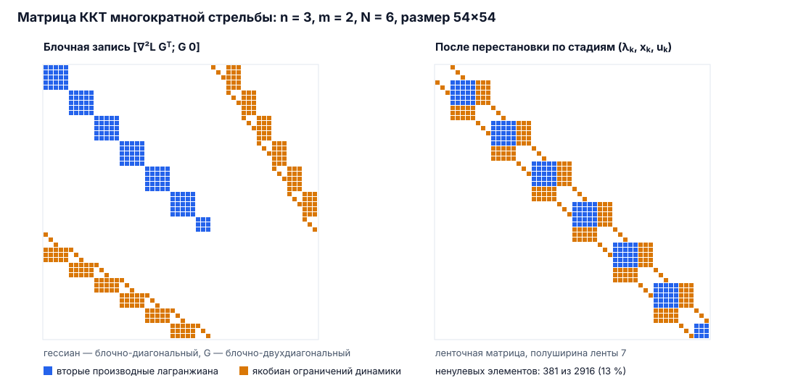

<!-- _class: lead -->
<!-- _header: "" -->
<!-- _footer: "" -->

# **Планирование движений мобильных роботов**
## Лекция 05: Оптимальное управление: от принципа максимума Понтрягина к численному решению и MPC

<div class="mt-4">

<span class="badge badge-blue">90 минут</span>
<span class="badge badge-green">Необходимые условия оптимальности и численные методы</span>
<span class="badge badge-purple">ПМП • быстродействие • LQR • прямая транскрипция • SQP • метод внутренней точки • MPC</span>

</div>

---

## Место лекции в курсе <span class="badge badge-time">01–04 мин</span>

<div class="grid-2">
<div class="col">
<div class="card card-accent">

### Что уже рассмотрено
- Лекции 02–03: поиск **пути** в конфигурационном пространстве без учёта динамики ($A^*$, PRM, RRT).
- Лекция 04: учёт модели движения $\dot{x} = f(x, u)$; методы DWA и MPPI выбирают управление **перебором** или **выборкой** конечного числа вариантов.

</div>
</div>
<div class="col">
<div class="card card-success">

### Основной вопрос лекции
Как найти управление $u(t)$, которое **точно** минимизирует заданный критерий при дифференциальных связях и ограничениях на приводы, и как сделать это достаточно быстро для работы в контуре обратной связи?

- **Часть 1.** Необходимые условия оптимальности: принцип максимума Понтрягина (ПМП), аналитический синтез.
- **Часть 2.** Численные методы: прямая транскрипция, нелинейное программирование, управление с прогнозирующей моделью (MPC).

</div>
</div>
</div>

---

## План лекции <span class="badge badge-time">04–05 мин</span>

<div class="grid-2">
<div class="col">
<div class="card card-accent">

### Часть 1. Принцип максимума (05–48 мин)
1. Постановка задачи оптимального управления.
2. Почему не хватает классического вариационного исчисления.
3. Функция Гамильтона–Понтрягина, формулировка ПМП, идея доказательства.
4. Сопряжённые переменные и уравнение Беллмана.
5. Примеры: минимум энергии, быстродействие, LQR.

</div>
</div>
<div class="col">
<div class="card card-success">

### Часть 2. Численное решение и MPC (48–90 мин)
6. Непрямые и прямые методы.
7. Одиночная и многократная стрельба, коллокация.
8. Условия ККТ, SQP, метод внутренней точки, разреженность.
9. Инструментарий: CasADi, IPOPT, acados.
10. MPC: постановка, устойчивость, ограничения, схема RTI.

</div>
</div>
</div>

---

## 1. Постановка задачи оптимального управления <span class="badge badge-time">05–09 мин</span>

<div class="grid-2">
<div class="col">
<div class="card card-accent">

### Задача в форме Больца
$$J = \varphi\big(x(t_f), t_f\big) + \int_{t_0}^{t_f} L\big(x(t), u(t), t\big)\,dt \;\to\; \min_{u(\cdot)}$$

при ограничениях
- динамика: $\dot{x} = f(x, u, t)$, $\;x(t_0) = x_0$, $\;x \in \mathbb{R}^n$;
- допустимые управления: $u(t) \in \mathcal{U} \subset \mathbb{R}^m$ — замкнутое ограниченное множество; $u(\cdot)$ кусочно-непрерывна;
- терминальные условия: $\psi\big(x(t_f), t_f\big) = 0$;
- фазовые ограничения: $g\big(x(t)\big) \le 0$.

Момент $t_f$ может быть задан или свободен.

</div>
</div>
<div class="col">
<div class="card">

### Пример: робот с дифференциальным приводом
Состояние $x = (p_x, p_y, \theta)$, управление $u = (v, \omega)$:
$$\dot{p}_x = v\cos\theta,\quad \dot{p}_y = v\sin\theta,\quad \dot{\theta} = \omega$$

- $\mathcal{U} = \{\,|v| \le v_{\max},\; |\omega| \le \omega_{\max}\,\}$;
- препятствие — круг радиуса $r_j$ с центром $o_j$:
  $g_j(x) = r_j^2 - \lVert p - o_j \rVert^2 \le 0$;
- критерий, например $J = \int_0^{t_f} (1 + \rho\,\omega^2)\,dt$ — время со штрафом за поворот.

</div>
</div>
</div>

---

## Формы критерия и типовые функционалы <span class="badge badge-time">09–12 мин</span>

<div class="grid-2">
<div class="col">
<div class="card card-accent">

### Эквивалентность форм
- **Лагранжа:** $\varphi \equiv 0$. **Майера:** $L \equiv 0$. **Больца:** общий случай.
- Задача Лагранжа сводится к задаче Майера введением координаты
  $\dot{x}_{n+1} = L(x, u, t)$, $x_{n+1}(t_0) = 0$, $J = x_{n+1}(t_f)$.
- Обратный переход: $\varphi(x(t_f)) = \varphi(x(t_0)) + \int_{t_0}^{t_f} \nabla\varphi^\top f\,dt$.

Поэтому теория строится для одной формы, а результаты переносятся на остальные.

</div>
</div>
<div class="col">
<div class="card">

### Критерии в задачах робототехники

| Цель | Подынтегральная функция $L$ |
| :--- | :--- |
| Быстродействие | $L = 1$ |
| Энергозатраты привода | $L = \tfrac12 u^\top R u$ |
| Слежение за эталоном | $L = \tfrac12 e^\top Q e + \tfrac12 u^\top R u$, $\;e = x - x_{\text{ref}}$ |
| Плавность | штраф на $\dot{u}$ (вводится как новое состояние) |

Выбор $L$ определяет **структуру** оптимального управления, что видно уже на простейшем примере.

</div>
</div>
</div>

---

## 2. Почему не хватает классического вариационного исчисления <span class="badge badge-time">12–16 мин</span>

<div class="grid-2">
<div class="card card-alert">

**Граница множества $\mathcal{U}$.** Условие стационарности $\partial \mathcal{H}/\partial u = 0$ выводится для вариаций, допустимых в обе стороны, то есть для внутренней точки $\mathcal{U}$. При $|u| \le 1$ оптимум часто лежит на границе, где производная не равна нулю.

</div>
<div class="card card-alert">

**Линейность по управлению.** Для $f = a(x) + B(x)u$ и $L$, не зависящей от $u$, функция $\mathcal{H}$ линейна по $u$: $\partial\mathcal{H}/\partial u = B^\top\lambda$ не содержит $u$, и условие стационарности не определяет управление.

</div>
</div>

<div class="diagram-box">


</div>

Выход: заменить условие стационарности условием **максимума** $\mathcal{H}$ на всём множестве $\mathcal{U}$.

---

## 3. Принцип максимума Понтрягина <span class="badge badge-time">16–21 мин</span>

Функция Гамильтона–Понтрягина: $\;\mathcal{H}(x, u, \lambda, \lambda_0) = -\lambda_0 L(x, u) + \lambda^\top f(x, u)$, $\;\lambda_0 \ge 0$.

<div class="grid-2">
<div class="col">
<div class="card card-success">

### Теорема (автономная задача)
Пусть $(x^*, u^*)$ — оптимальная пара. Тогда существуют число $\lambda_0 \ge 0$ и абсолютно непрерывная функция $\lambda(t)$, причём $(\lambda_0, \lambda(t)) \ne 0$, такие что:
1. $\dot{\lambda} = -\partial\mathcal{H}/\partial x$ (сопряжённая система);
2. для почти всех $t$:
   $$\mathcal{H}(x^*, u^*, \lambda, \lambda_0) = \max_{v \in \mathcal{U}} \mathcal{H}(x^*, v, \lambda, \lambda_0);$$
3. условия трансверсальности на правом конце (при свободном $x(t_f)$: $\lambda(t_f) = -\lambda_0 \nabla\varphi$);
4. $\mathcal{H} = \text{const}$ вдоль оптимальной траектории; если $t_f$ свободно, то $\mathcal{H} \equiv 0$.

</div>
</div>
<div class="col">
<div class="card card-accent">

### Комментарии
- Теорема даёт **необходимые** условия: им удовлетворяет оптимальное управление, но могут удовлетворять и неоптимальные (экстремали).
- Случай $\lambda_0 > 0$ называют нормальным; нормировкой полагают $\lambda_0 = 1$. Случай $\lambda_0 = 0$ (анормальный) встречается и должен исключаться отдельно.
- Множество $\mathcal{U}$ может быть произвольным, в том числе дискретным; дифференцируемость по $u$ не требуется.
- В англоязычной литературе принят **принцип минимума**: $H = L + p^\top f$, $p = -\lambda$. Обе записи эквивалентны.

</div>
</div>
</div>

---

## Идея доказательства: игольчатая вариация <span class="badge badge-time">21–24 мин</span>

<div class="grid-2">
<div class="col">
<div class="card">

### Построение
Задача Майера $J = \varphi(x(t_f))$ с фиксированным $t_f$. Заменим управление на малом интервале:
$$u_\varepsilon(t) = \begin{cases} v, & t \in [\tau - \varepsilon, \tau), \\ u^*(t), & \text{иначе}. \end{cases}$$
Вариация **сильная** (по величине $u$), но малая по длительности. Тогда
$$\delta x(\tau) = \varepsilon\,\big[f(x^*, v) - f(x^*, u^*)\big]_{t=\tau} + o(\varepsilon),$$
а далее $\delta x(t) = \Phi(t, \tau)\,\delta x(\tau)$, где $\Phi$ — фундаментальная матрица системы $\dot{y} = f_x y$.

</div>
</div>
<div class="col">
<div class="card card-success">

### Вывод условия максимума
Определим $\lambda(t) = -\Phi(t_f, t)^\top \nabla\varphi$. Эта функция удовлетворяет
$\dot{\lambda} = -f_x^\top \lambda$, $\;\lambda(t_f) = -\nabla\varphi$. Из оптимальности:
$$0 \le \Delta J = \nabla\varphi^\top \delta x(t_f) = -\varepsilon\,\lambda(\tau)^\top\big[f(x^*, v) - f(x^*, u^*)\big] + o(\varepsilon).$$
Отсюда $\lambda^\top f(x^*, v) \le \lambda^\top f(x^*, u^*)$ для любого $v \in \mathcal{U}$, то есть $u^*$ максимизирует $\mathcal{H} = \lambda^\top f$.

Ни внутренность $\mathcal{U}$, ни гладкость по $u$ не использовались.

</div>
</div>
</div>

---

## Каноническая система и краевая задача <span class="badge badge-time">24–27 мин</span>

<div class="grid-2">
<div class="col">
<div class="card card-accent">

### Система уравнений
$$\dot{x} = \frac{\partial \mathcal{H}}{\partial \lambda} = f(x, u^*), \qquad \dot{\lambda} = -\frac{\partial \mathcal{H}}{\partial x},$$
$$u^* = \bar{u}(x, \lambda) = \arg\max_{u \in \mathcal{U}} \mathcal{H}(x, u, \lambda).$$

### Подсчёт условий
- $2n$ дифференциальных уравнений первого порядка;
- $n$ условий на левом конце: $x(t_0) = x_0$;
- $n$ условий на правом конце: $x(t_f) = x_f$ или трансверсальность;
- свободное $t_f$ — ещё одна неизвестная и условие $\mathcal{H}(t_f) = 0$.

</div>
</div>
<div class="col">
<div class="card card-alert">

### Двухточечная краевая задача
Условия заданы на **разных** концах интервала, поэтому задача Коши не получается. Стандартный приём — метод стрельбы: подобрать $\lambda(t_0)$ так, чтобы
$$x\big(t_f;\, \lambda(t_0)\big) = x_f$$
($n$ уравнений с $n$ неизвестными).

Трудность: собственные значения линеаризации гамильтоновой системы расположены симметрично относительно мнимой оси, поэтому при интегрировании в любом направлении есть растущие составляющие. Решение очень чувствительно к начальному приближению $\lambda(t_0)$, у которого нет наглядного физического смысла.

</div>
</div>
</div>

---

## Сопряжённые переменные и уравнение Беллмана <span class="badge badge-time">27–30 мин</span>

<div class="grid-2">
<div class="col">
<div class="card">

### Функция цены и уравнение Гамильтона–Якоби–Беллмана
$V(x, t)$ — минимальная стоимость перехода из состояния $x$ в момент $t$:
$$-\frac{\partial V}{\partial t} = \min_{u \in \mathcal{U}} \Big[L(x, u) + \nabla_x V^\top f(x, u)\Big], \quad V(x, t_f) = \varphi(x).$$
Если $V$ дифференцируема вдоль оптимальной траектории, то в нормальном случае
$$\lambda(t) = -\nabla_x V\big(x^*(t), t\big),$$
а минимизация в правой части совпадает с максимизацией $\mathcal{H}$.

</div>
</div>
<div class="col">
<div class="card card-accent">

### Интерпретация
- $\lambda_i(t)$ — чувствительность оптимальной стоимости к возмущению $x_i$: сдвиг $x_i$ на $\delta$ меняет $V$ на $-\lambda_i\,\delta + o(\delta)$.
- ПМП — условия вдоль **одной** траектории: $2n$ ОДУ.
- HJB — уравнение в частных производных на **всём** пространстве состояний: даёт закон обратной связи и достаточные условия, но сетка из 100 узлов по каждой из $n = 6$ координат содержит $10^{12}$ узлов («проклятие размерности»).
- Дискретный аналог уравнения Беллмана — основа динамического программирования и обучения с подкреплением (лекция 06).

</div>
</div>
</div>

---

## Пример 1. Перевод с минимумом энергии <span class="badge badge-time">30–33 мин</span>

<div class="grid-2">
<div class="col">
<div class="card">

### Постановка
Двойной интегратор $\ddot{x} = u$ ($x_1 = x$, $x_2 = \dot{x}$), перевод из $(0, 0)$ в $(d, 0)$ за заданное время $T$:
$$J = \tfrac12 \int_0^T u^2\,dt \to \min.$$
$\mathcal{H} = -\tfrac12 u^2 + \lambda_1 x_2 + \lambda_2 u$ строго вогнута по $u$, ограничения на $u$ нет, поэтому
$$\frac{\partial\mathcal{H}}{\partial u} = -u + \lambda_2 = 0 \;\Rightarrow\; u = \lambda_2.$$
Сопряжённая система: $\dot{\lambda}_1 = 0$, $\dot{\lambda}_2 = -\lambda_1$, следовательно $\lambda_2$ и $u$ — линейные функции времени.

</div>
</div>
<div class="col">
<div class="card card-success">

### Решение
Из четырёх краевых условий:
$$u^*(t) = \frac{6d}{T^2}\Big(1 - \frac{2t}{T}\Big), \qquad x^*(t) = d\,\big(3s^2 - 2s^3\big),\; s = \tfrac{t}{T}.$$
- Оптимальная траектория — кубический полином, управление непрерывно.
- Затраты: $J^* = 6d^2/T^3$; сокращение времени вдвое увеличивает затраты в 8 раз.
- Наибольшее управление $|u^*(0)| = 6d/T^2$. При ограничении $|u| \le 1$ это решение допустимо только при $T \ge \sqrt{6d}$. При $d = 1$ это $T \ge 2.45$, тогда как минимально возможное время равно $2$ (пример 2).

</div>
</div>
</div>

---

## Пример 2. Задача быстродействия <span class="badge badge-time">33–35 мин</span>

<div class="grid-2">
<div class="col">
<div class="card">

### Постановка
$$\dot{x}_1 = x_2, \quad \dot{x}_2 = u, \quad |u| \le 1,$$
перевести систему из $(x_{10}, x_{20})$ в $(0, 0)$ за минимальное время: $L = 1$, $t_f$ свободно.

$$\mathcal{H} = -\lambda_0 + \lambda_1 x_2 + \lambda_2 u.$$

</div>
</div>
<div class="col">
<div class="card card-success">

### Условие максимума
$\mathcal{H}$ линейна по $u$, максимум на отрезке $[-1, 1]$ достигается на конце:
$$u^*(t) = \operatorname{sign}\lambda_2(t) \quad \text{при } \lambda_2(t) \ne 0.$$
Функция $\sigma(t) = \lambda_2(t)$ называется **функцией переключения**.

### Отсутствие особых участков
Если $\lambda_2 \equiv 0$ на интервале, то $\dot{\lambda}_2 = -\lambda_1 = 0$, то есть $\lambda \equiv 0$. Из $\mathcal{H} \equiv 0$ тогда $\lambda_0 = 0$, что противоречит условию $(\lambda_0, \lambda) \ne 0$. Следовательно, $u^*$ принимает только значения $\pm 1$ (релейное управление, bang-bang).

</div>
</div>
</div>

---

## Число переключений. Теорема Фельдбаума <span class="badge badge-time">35–37 мин</span>

<div class="grid-2">
<div class="col">
<div class="card">

### Интегрирование сопряжённой системы
$$\dot{\lambda}_1 = -\frac{\partial\mathcal{H}}{\partial x_1} = 0 \;\Rightarrow\; \lambda_1 = c_1,$$
$$\dot{\lambda}_2 = -\frac{\partial\mathcal{H}}{\partial x_2} = -c_1 \;\Rightarrow\; \lambda_2(t) = c_2 - c_1 t.$$
Аффинная функция, не равная тождественно нулю, имеет не более одного корня. Поэтому управление меняет знак **не более одного раза**: оптимальное движение — разгон и торможение с предельным ускорением (или один из этих участков).

</div>
</div>
<div class="col">
<div class="card card-accent">

### Теорема Фельдбаума об $n$ интервалах
Для линейной управляемой системы $\dot{x} = Ax + bu$, $|u| \le 1$, все собственные значения матрицы $A$ которой вещественны, оптимальное по быстродействию управление кусочно-постоянно, принимает значения $\pm 1$ и имеет **не более $n - 1$ переключений**.

- Двойной интегратор: $n = 2$, собственные значения $0, 0$, не более одного переключения.
- При комплексных собственных значениях (например, для осциллятора $\ddot{x} + x = u$) число переключений заранее не ограничено.

</div>
</div>
</div>

---

## Кривая переключения и синтез обратной связи <span class="badge badge-time">37–39 мин</span>

<div class="grid-2">
<div class="col">
<div class="card">

### Фазовые траектории
При $u = \pm 1$: $x_2\,dx_2 = u\,dx_1$, откуда $x_1 = \dfrac{x_2^2}{2u} + C$ — семейства парабол.

В начало координат приходят только две полупараболы:
$\Gamma_+ = \{x_1 = \tfrac12 x_2^2,\; x_2 < 0\}$ при $u = +1$ и
$\Gamma_- = \{x_1 = -\tfrac12 x_2^2,\; x_2 > 0\}$ при $u = -1$.
Их объединение — кривая переключения
$$\Gamma:\; x_1 + \tfrac12 x_2 |x_2| = 0.$$

</div>
</div>
<div class="col">
<div class="card card-success">

### Закон обратной связи и минимальное время
$$u^*(x) = \begin{cases} -\operatorname{sign}\big(x_1 + \tfrac12 x_2|x_2|\big), & x \notin \Gamma, \\ -\operatorname{sign} x_2, & x \in \Gamma. \end{cases}$$
$$T^*(x) = \begin{cases} x_2 + 2\sqrt{x_1 + \tfrac12 x_2^2}, & x_1 + \tfrac12 x_2|x_2| > 0, \\ -x_2 + 2\sqrt{-x_1 + \tfrac12 x_2^2}, & x_1 + \tfrac12 x_2|x_2| < 0. \end{cases}$$
Проверка: из $(1, 0)$ получаем $T^* = 2$: одна секунда разгона, одна — торможения.

</div>
</div>
</div>

---

## Фазовый портрет задачи быстродействия <span class="badge badge-time">39–41 мин</span>

<div class="diagram-box">


</div>

Траектория A: $u = -1$ до точки $(1.25;\,-1.58)$ на $\Gamma_+$, затем $u = +1$; $t_s = 2.58$, $T^* = 1 + 2\sqrt{2.5} = 4.16$. Функция переключения $\lambda_2(t)$ линейна и меняет знак в момент $t_s$. На практике разрывный закон при шумах измерений и дискретном времени вызывает дребезг вблизи $\Gamma$; его подавляют зоной линейности ($\operatorname{sat}$ вместо $\operatorname{sign}$) или переходом к линейному регулятору у цели.

---

## Частный случай: линейно-квадратичный регулятор <span class="badge badge-time">41–43 мин</span>

<div class="grid-2">
<div class="col">
<div class="card">

### Вывод через ПМП
$\dot{x} = Ax + Bu$, $\;J = \tfrac12\int_0^\infty (x^\top Q x + u^\top R u)\,dt$, $\;Q \succeq 0$, $R \succ 0$, ограничений на $u$ нет.

$\partial\mathcal{H}/\partial u = -Ru + B^\top\lambda = 0 \Rightarrow u = R^{-1}B^\top\lambda.$

Подстановка $\lambda = -Px$ в $\dot{\lambda} = Qx - A^\top\lambda$ даёт алгебраическое уравнение Риккати
$$A^\top P + PA - PBR^{-1}B^\top P + Q = 0,$$
и закон обратной связи $u = -Kx$, $K = R^{-1}B^\top P$; функция цены $V(x) = \tfrac12 x^\top P x$.

</div>
</div>
<div class="col">
<div class="card card-accent">

### Двойной интегратор
При $Q = \operatorname{diag}(q_1, q_2)$, $R = r$:
$$k_1 = \sqrt{q_1/r}, \qquad k_2 = \sqrt{q_2/r + 2k_1}.$$
Характеристический полином замкнутой системы $s^2 + k_2 s + k_1$.

### Ограничения метода
- Решение — гладкая линейная обратная связь, вычисляемая заранее.
- Ограничение $|u| \le 1$ не учитывается. Насыщение $\operatorname{sat}(-Kx)$ делает закон допустимым, но уже не оптимальным.
- Систематический учёт ограничений — задача численных методов и MPC (часть 2).

</div>
</div>
</div>

---

## Сравнение критериев на одной задаче <span class="badge badge-time">43–45 мин</span>

<div class="diagram-box">


</div>

Перевод из $(1, 0)$ в $(0, 0)$. Быстродействие: $T^* = 2$, $\int u^2 dt = 2$. Минимум энергии при $T = 2.5$: $\int u^2 dt = 12/T^3 = 0.77$ — в 2.6 раза меньше при времени на 25 % больше. LQR ($Q = I$, $R = 1$) с насыщением даёт гладкое асимптотическое затухание: $|x| < 0.02$ при $t > 4.3$.

---

## Интерактивная модель: фазовая плоскость <span class="badge badge-time">45–48 мин</span>

<div class="interactive-container">
<div class="interactive-header">
<span><i class="interactive-dot"></i> Двойной интегратор: быстродействие и LQR</span>
<span>Задайте начальное состояние и веса LQR; сравните траектории, время и энергозатраты</span>
</div>
<iframe src="http://localhost:5599/widgets/bang-bang-simulator/index.html" class="interactive-frame"></iframe>
</div>

---

## Пределы аналитического синтеза <span class="badge badge-time">48–50 мин</span>

<div class="grid-2">
<div class="col">
<div class="card card-alert">

### Трудности непосредственного применения ПМП
- **Краевая задача.** Требуется начальное приближение для $\lambda(t_0)$; область сходимости метода стрельбы узка.
- **Фазовые ограничения** $g(x) \le 0$. Сопряжённые переменные могут иметь скачки в точках входа на границу; последовательность участков на границе и внутри области заранее неизвестна.
- **Особые участки**, на которых функция переключения тождественно равна нулю, требуют условий высшего порядка.

</div>
</div>
<div class="col">
<div class="card card-accent">

### Что остаётся за ПМП
- Замкнутые решения известны для линейных систем, систем малой размерности и отдельных нелинейных задач (например, кривые Дубинса и Ридса–Шеппа из лекции 04 могут быть выведены из ПМП: Sussmann, Tang, 1991).
- Для нелинейной модели робота с невыпуклыми препятствиями задача решается численно.
- При этом ПМП сохраняет значение: он указывает структуру решения (релейные участки, насыщения), а множители численных методов являются дискретными аналогами $\lambda(t)$.

</div>
</div>
</div>

---

## 4. Непрямые и прямые методы <span class="badge badge-time">50–52 мин</span>

<div class="grid-2">
<div class="col">
<div class="card">

### Непрямые методы: «сначала оптимизировать, затем дискретизировать»
- Выписываются условия ПМП, затем численно решается краевая задача (стрельба по $\lambda(t_0)$, коллокация гамильтоновой системы).
- Высокая точность; известна структура решения.
- Нужны аналитический вывод условий, приближение для $\lambda$ и заранее известная последовательность участков (насыщение, граница фазового ограничения).

</div>
</div>
<div class="col">
<div class="card card-success">

### Прямые методы: «сначала дискретизировать, затем оптимизировать»
- Управление и (или) состояние параметризуются конечным числом переменных; OCP превращается в задачу нелинейного программирования (NLP).
- Ограничения-неравенства учитываются непосредственно.
- Начальное приближение задаётся в физических переменных $x, u$, например путём, найденным $A^*$ или RRT (лекции 02–03).
- Используются универсальные решатели NLP.

В робототехнике преобладают прямые методы.

</div>
</div>
</div>

---

## 5. Дискретизация задачи <span class="badge badge-time">52–55 мин</span>

<div class="grid-2">
<div class="col">
<div class="card card-accent">

### Дискретная задача оптимального управления
Сетка $t_k = kh$, $h = T/N$, управление кусочно-постоянно: $u(t) = u_k$ при $t \in [t_k, t_{k+1})$.
$$\min_{x, u}\; \sum_{k=0}^{N-1} \ell(x_k, u_k) + V_f(x_N)$$
при $x_0 = \hat{x}_0$, $\;x_{k+1} = F(x_k, u_k)$, $\;u_k \in \mathcal{U}$, $\;g(x_k) \le 0$, $\;x_N \in \mathbb{X}_f$.

$F$ — численный интегратор на шаге $h$:
- явный метод Эйлера $F = x + h f(x, u)$, порядок 1;
- метод Рунге–Кутты 4-го порядка (RK4), порядок 4.

</div>
</div>
<div class="col">
<div class="card">

### Пример: дифференциальный привод, метод Эйлера
$$\begin{aligned} p_{x,k+1} &= p_{x,k} + h\,v_k\cos\theta_k, \\ p_{y,k+1} &= p_{y,k} + h\,v_k\sin\theta_k, \\ \theta_{k+1} &= \theta_k + h\,\omega_k. \end{aligned}$$

### Свободное время
Если $T$ не задано, его включают в число переменных: $h = T/N$, и к критерию добавляют $T$ (или $T$ становится критерием). Сетка растягивается вместе с траекторией.

</div>
</div>
</div>

---

## Одиночная и многократная стрельба <span class="badge badge-time">55–58 мин</span>

<div class="grid-2">
<div class="col">
<div class="card">

### Одиночная стрельба (single shooting)
- Переменные: $w = (u_0, \dots, u_{N-1})$, размерность $Nm$.
- Состояния исключаются рекурсией $x_{k+1} = F(x_k, u_k)$ от $x_0$: $x_k = x_k(w)$.
- Малое число переменных, но якобиан ограничений плотный, а зависимость $x_N(w)$ для неустойчивых или сильно нелинейных систем крайне нелинейна.
- Нельзя задать начальное приближение для траектории состояний.

</div>
</div>
<div class="col">
<div class="card card-success">

### Многократная стрельба (multiple shooting)
- Переменные: $w = (x_0, u_0, x_1, u_1, \dots, x_N)$, размерность $N(n+m)+n$.
- Связь интервалов — ограничения-равенства (дефекты):
  $$c_k = x_{k+1} - F(x_k, u_k) = 0.$$
- Во время итераций дефекты могут быть ненулевыми, поэтому допустимо физически осмысленное, но не согласованное с динамикой приближение.
- Интегрирование на интервалах независимо и выполняется параллельно; матрицы задачи разреженные.

</div>
</div>
</div>

---

## Прямая коллокация <span class="badge badge-time">58–60 мин</span>

<div class="grid-2">
<div class="col">
<div class="card card-accent">

### Идея
Траектория состояния на каждом интервале приближается полиномом; уравнение динамики требуется выполнить в отдельных точках (точках коллокации). Интегратор не вызывается: дефекты — алгебраические выражения от $x_k$, $u_k$.

**Трапеции** (порядок 2), $f_k = f(x_k, u_k)$:
$$x_{k+1} - x_k - \tfrac{h}{2}\,(f_k + f_{k+1}) = 0.$$

</div>
</div>
<div class="col">
<div class="card">

**Эрмит–Симпсон** (порядок 4): кубический сплайн Эрмита, проверка в средней точке
$$x_c = \tfrac12(x_k + x_{k+1}) + \tfrac{h}{8}\,(f_k - f_{k+1}),$$
$$x_{k+1} - x_k - \tfrac{h}{6}\,\big(f_k + 4 f(x_c, u_c) + f_{k+1}\big) = 0.$$

- Много переменных, но каждое ограничение связывает только соседние узлы, и матрицы разреженные.
- Высокого порядка точности достигают псевдоспектральные методы (узлы Лежандра–Гаусса–Радо) с полиномами высокой степени.

</div>
</div>
</div>

---

## Начальное приближение в трёх методах <span class="badge badge-time">60–61 мин</span>

<div class="diagram-box">


</div>

Одна задача: двойной интегратор, $x_1(0) = 0$, $x_1(2) = 1$, $N = 4$. В одиночной стрельбе невязка видна только в конце; в многократной стрельбе и коллокации узлы задаются линейной интерполяцией, а несогласованность с динамикой выражена дефектами, которые решатель NLP сводит к нулю.

---

## Интерактивная модель: методы транскрипции <span class="badge badge-time">61–63 мин</span>

<div class="interactive-container">
<div class="interactive-header">
<span><i class="interactive-dot"></i> Одиночная, многократная стрельба и коллокация</span>
<span>Сравните сходимость итераций при различных начальных приближениях</span>
</div>
<iframe src="http://localhost:5599/widgets/shooting-collocation-simulator/index.html" class="interactive-frame"></iframe>
</div>

---

## 6. Задача NLP и условия Каруша–Куна–Таккера <span class="badge badge-time">63–66 мин</span>

<div class="grid-2">
<div class="col">
<div class="card card-accent">

### Задача и функция Лагранжа
$$\min_w F(w) \quad \text{при} \quad G(w) = 0,\;\; H(w) \le 0,$$
$$\mathcal{L}(w, \nu, z) = F(w) + \nu^\top G(w) + z^\top H(w).$$

### Условия ККТ (при регулярности ограничений)
1. $\nabla_w \mathcal{L} = \nabla F + \nabla G\,\nu + \nabla H\,z = 0$;
2. $G(w) = 0$, $\;H(w) \le 0$;
3. $z \ge 0$;
4. $z_i H_i(w) = 0$ (дополняющая нежёсткость).

</div>
</div>
<div class="col">
<div class="card">

### Связь с ПМП
Для дискретной задачи с ограничениями $x_{k+1} - F(x_k, u_k) = 0$ и множителями $\nu_{k+1}$ условие стационарности по $x_k$ даёт
$$\nu_k = \nabla_x \ell(x_k, u_k) + F_x^\top \nu_{k+1}$$
— дискретное сопряжённое уравнение. Множители ограничений динамики являются дискретным аналогом сопряжённых переменных (с точностью до знака: $\nu_k \approx -\lambda(t_k)$).

### Регулярность
Обычно требуют линейной независимости градиентов активных ограничений (LICQ); тогда множители существуют и единственны.

</div>
</div>
</div>

---

## Последовательное квадратичное программирование (SQP) <span class="badge badge-time">66–68 мин</span>

<div class="grid-2">
<div class="col">
<div class="card card-accent">

### Итерация
В текущей точке $w$ решается квадратичная подзадача относительно шага $\Delta w$:
$$\min_{\Delta w}\; \nabla F^\top \Delta w + \tfrac12 \Delta w^\top B\, \Delta w$$
$$G + \nabla G^\top \Delta w = 0, \qquad H + \nabla H^\top \Delta w \le 0,$$
где $B \approx \nabla^2_{ww}\mathcal{L}$. Множители подзадачи — новые оценки $\nu$, $z$. Шаг принимается с поиском по прямой (функция выигрыша или фильтр).

</div>
</div>
<div class="col">
<div class="card">

### Выбор $B$ и свойства
- точный гессиан — квадратичная локальная сходимость;
- квазиньютоновская оценка (BFGS) — сверхлинейная;
- для критерия наименьших квадратов $F = \tfrac12\lVert r(w)\rVert^2$ — метод Гаусса–Ньютона $B = J_r^\top J_r \succeq 0$, не требующий вторых производных.

Множество активных ограничений меняется от итерации к итерации мало, поэтому SQP хорошо использует **тёплый старт** — решение предыдущего такта. Реализации: SNOPT, acados (SQP с решателем QP HPIPM), qpOASES для подзадач.

</div>
</div>
</div>

---

## Метод внутренней точки <span class="badge badge-time">68–71 мин</span>

<div class="grid-2">
<div class="col">
<div class="card card-accent">

### Барьерная задача
Неравенства переписываются с невязками $s \ge 0$: $H(w) + s = 0$. Решается последовательность задач
$$\min_{w, s}\; F(w) - \mu \sum_i \ln s_i \quad \text{при } G = 0,\; H + s = 0,$$
$\mu \to 0$. Условия ККТ барьерной задачи совпадают с исходными, кроме дополняющей нежёсткости:
$$z_i s_i = \mu \quad \text{вместо} \quad z_i s_i = 0.$$
Каждая система решается методом Ньютона; решения при разных $\mu$ образуют **центральную траекторию**.

</div>
</div>
<div class="col">
<div class="diagram-box">


</div>

Решатель IPOPT. Хорошо масштабируется на большие разреженные задачи; тёплый старт затруднён, так как итерации должны оставаться внутри допустимой области.

</div>
</div>

---

## Разреженность и вычислительная сложность <span class="badge badge-time">71–73 мин</span>

<div class="grid-2" style="grid-template-columns: 3fr 2fr;">
<div class="col">
<div class="diagram-box">



</div>
</div>
<div class="col">
<div class="card card-accent">

### Структура по стадиям
Каждое ограничение динамики связывает только $(x_k, u_k)$ и $x_{k+1}$, а критерий аддитивен по стадиям. После перестановки переменных по стадиям матрица ККТ становится ленточной: для $n = 3$, $m = 2$, $N = 6$ ненулевых 13 % элементов, полуширина ленты 7.

### Следствия для трудоёмкости шага Ньютона
- разложение с учётом структуры (рекурсия Риккати, HPIPM): $O\big(N(n+m)^3\big)$;
- исключение состояний (конденсация) и плотный решатель: $O(N^3 m^3)$.

Линейный рост по $N$ делает возможными длинные горизонты.

</div>
</div>
</div>

---

## Инструментарий: CasADi и IPOPT <span class="badge badge-time">73–75 мин</span>

<!-- _class: compact -->

<div class="grid-2">
<div class="col">

```python
import casadi as ca, numpy as np
N, T = 40, 8.0;  h = T / N
opti = ca.Opti()
X = opti.variable(3, N + 1)       # (p_x, p_y, θ)
U = opti.variable(2, N)           # (v, ω)
f = lambda x, u: ca.vertcat(u[0]*ca.cos(x[2]),
                            u[0]*ca.sin(x[2]), u[1])
for k in range(N):                # многократная стрельба, RK4
    x, u = X[:, k], U[:, k]
    k1 = f(x, u); k2 = f(x + h/2*k1, u)
    k3 = f(x + h/2*k2, u); k4 = f(x + h*k3, u)
    opti.subject_to(X[:, k+1] == x + h/6*(k1 + 2*k2 + 2*k3 + k4))
opti.subject_to(X[:, 0] == ca.DM([0, 0, 0]))
opti.subject_to(X[:, N] == ca.DM([4, 2, 0]))
opti.subject_to(opti.bounded(0, U[0, :], 1.0))
opti.subject_to(opti.bounded(-1.5, U[1, :], 1.5))
opti.subject_to((X[0, :] - 2)**2 + (X[1, :] - 1.3)**2 >= 0.5**2)
opti.minimize(h * ca.sumsqr(U))
opti.set_initial(X[0, :], np.linspace(0, 4, N + 1))
opti.set_initial(X[1, :], np.linspace(0, 2, N + 1))
opti.solver('ipopt');  sol = opti.solve()
```

</div>
<div class="col">
<div class="card card-accent">

### Что делает программа
- Переход дифференциального привода из $(0, 0, 0)$ в $(4, 2, 0)$ за 8 с с обходом круглого препятствия; критерий — энергия управления.
- CasADi строит символьный граф выражений и вычисляет точные производные алгоритмическим (автоматическим) дифференцированием; разреженность якобиана и гессиана определяется автоматически.
- IPOPT находит решение за 38 итераций (проверено с CasADi 3.8); ограничение препятствия в решении активно.

</div>
<div class="card">

### Для работы в реальном времени
- генерация кода на C (`codegen`) для встраиваемого вычислителя;
- acados: многократная стрельба, SQP-RTI, решатель HPIPM;
- обученные модели динамики (PyTorch) подключаются через L4CasADi.

</div>
</div>
</div>

---

## 7. Управление с прогнозирующей моделью (MPC) <span class="badge badge-time">75–78 мин</span>

<div class="grid-2">
<div class="col">
<div class="card card-accent">

### Задача на такте
По измерению (оценке) состояния $\hat{x}$ решается дискретная OCP на горизонте $N$:
$$V_N^*(\hat{x}) = \min_{x, u} \sum_{k=0}^{N-1} \ell(x_k, u_k) + V_f(x_N)$$
$$x_0 = \hat{x},\;\; x_{k+1} = F(x_k, u_k),\;\; (x_k, u_k) \in \mathbb{Z},\;\; x_N \in \mathbb{X}_f.$$

### Алгоритм скользящего горизонта
1. Измерить (оценить) $\hat{x}$.
2. Решить задачу, получить $u_0^*, \dots, u_{N-1}^*$.
3. Подать на привод только $u_0^*$.
4. На следующем такте повторить, сдвинув горизонт.

</div>
</div>
<div class="col">
<div class="card">

### Свойства
- Получается неявно заданный закон обратной связи $u = \kappa_N(\hat{x}) = u_0^*(\hat{x})$.
- Ограничения на состояния и управления учитываются явно, в отличие от LQR.
- Решение повторно вычисляется по новому измерению, поэтому ошибки модели и возмущения частично компенсируются обратной связью.
- MPC находит **локально** оптимальное решение на конечном горизонте; глобальную задачу маршрута он не решает.
- Отличие от MPPI (лекция 04): та же схема скользящего горизонта, но задача решается градиентными методами ньютоновского типа, а не выборкой.

</div>
</div>
</div>

---

## Устойчивость и рекурсивная допустимость <span class="badge badge-time">78–80 мин</span>

<div class="grid-2">
<div class="col">
<div class="card card-alert">

### Проблема конечного горизонта
Оптимизация на конечном горизонте сама по себе не гарантирует ни устойчивости замкнутой системы, ни того, что задача останется разрешимой на следующем такте.

### Терминальные компоненты
Подбираются локальный регулятор $\kappa_f$, множество $\mathbb{X}_f$ и функция $V_f$ такие, что
- $\mathbb{X}_f$ инвариантно при $u = \kappa_f(x)$ и ограничения на нём выполнены;
- $V_f\big(F(x, \kappa_f(x))\big) - V_f(x) \le -\ell\big(x, \kappa_f(x)\big)$ на $\mathbb{X}_f$.

</div>
</div>
<div class="col">
<div class="card card-success">

### Следствия (Mayne и др., 2000)
- **Рекурсивная допустимость:** сдвинутое решение, дополненное $\kappa_f(x_N)$, допустимо на следующем такте.
- **Устойчивость:** $V_N^*$ — функция Ляпунова замкнутой системы:
  $$V_N^*(x^+) \le V_N^*(x) - \ell\big(x, \kappa_N(x)\big).$$

### Практика
- $V_f(x) = x^\top P x$ из уравнения Риккати для линеаризации в целевой точке, $\mathbb{X}_f$ — линия уровня $V_f$, на которой ограничения не активны;
- без терминального ограничения устойчивость обеспечивается достаточно длинным горизонтом.

</div>
</div>
</div>

---

## Скользящий горизонт: прогноз и фактическое движение <span class="badge badge-time">80–81 мин</span>

<div class="diagram-box">


</div>

Модель регулятора $\ddot{x} = u$, объект $\ddot{x} = 0.7u$, при $t = 4$ с объект получает толчок. Прогнозы (пунктир) расходятся с фактическим движением, но на каждом такте задача решается заново от измеренного состояния, и обратная связь компенсирует и ошибку модели, и возмущение. Управление остаётся в пределах $|u| \le 1$.

---

## Препятствия, мягкие ограничения и схема RTI <span class="badge badge-time">81–84 мин</span>

<div class="grid-2">
<div class="col">
<div class="card card-accent">

### Учёт препятствий
- Непосредственно: $\lVert p_k - o_j \rVert^2 \ge (r_j + r_{\text{роб}})^2$ — гладкое, но невыпуклое ограничение, возможны локальные минимумы.
- Через выпуклый коридор: свободное пространство вдоль опорного пути разбивается на выпуклые многогранники (safe flight corridors), и на стадии $k$ требуется $A_k p_k \le b_k$. Ограничения линейны, подзадача остаётся выпуклой.

### Мягкие ограничения
$g(x_k) \le s_k$, $s_k \ge 0$, к критерию добавляется $\rho\lVert s\rVert_1$. При $\rho$, большем модуля множителей, решение совпадает с решением жёсткой задачи, если оно существует; иначе задача остаётся разрешимой.

</div>
</div>
<div class="col">
<div class="card card-success">

### Итерация реального времени (RTI; Diehl, Bock, Schlöder, 2005)
- На каждом такте выполняется **одна** итерация SQP с тёплым стартом от сдвинутого решения предыдущего такта.
- **Фаза подготовки** (до измерения): интегрирование и линеаризация, сборка подзадачи QP.
- **Фаза обратной связи** (после измерения): $\hat{x}$ входит в QP линейно, через $x_0 = \hat{x}$; решается одна QP, и $u_0$ сразу подаётся на привод.
- Задержка между измерением и управлением равна времени решения одной QP, а решение отслеживает оптимум по мере движения системы.
- Реализация: acados (SQP-RTI).

</div>
</div>
</div>

---

## Интерактивная модель: нелинейный MPC <span class="badge badge-time">84–86 мин</span>

<div class="interactive-container">
<div class="interactive-header">
<span><i class="interactive-dot"></i> Нелинейный MPC со скользящим горизонтом</span>
<span>Длина горизонта, обход препятствий, реакция на возмущения</span>
</div>
<iframe src="http://localhost:5599/widgets/mpc-interactive-solver/index.html" class="interactive-frame"></iframe>
</div>

---

## Сравнение локальных методов и место MPC в системе управления <span class="badge badge-time">86–88 мин</span>

<!-- _class: compact -->

<div class="grid-2">
<div class="col">

| | DWA | MPPI | MPC (градиентный) |
| :--- | :--- | :--- | :--- |
| Пространство поиска | сетка $(v, \omega)$, постоянное управление | выборки последовательностей $u$ | последовательность $u$ (и $x$) |
| Ограничения | отбор вариантов | штрафы | явно, ограничения NLP |
| Требования к критерию | любой | любой, без производных | дважды дифференцируемый |
| Оптимальность | на сетке | приближённая | локальный оптимум |
| Вычисления | малые | параллельные выборки (GPU) | NLP или QP на такт |

</div>
<div class="col">
<div class="card card-accent">

### Многоуровневая структура
1. **Глобальный планировщик** ($A^*$, RRT*, лекции 02–03): путь в конфигурационном пространстве, обновляется редко.
2. **Оптимизация траектории** (OCP): гладкая исполнимая траектория с учётом модели, начальное приближение — найденный путь.
3. **MPC** (десятки герц): слежение за траекторией с учётом ограничений и текущего измерения.
4. **Регуляторы приводов** (порядка килогерца): отработка заданных скоростей и моментов.

</div>
</div>
</div>

---

## Итоги лекции и контрольные вопросы <span class="badge badge-time">88–90 мин</span>

<div class="grid-2">
<div class="col">
<div class="card card-accent">

### Итоги
- ПМП заменяет условие стационарности условием максимума $\mathcal{H}$ на множестве $\mathcal{U}$ и применим при ограничениях на приводы.
- Структура решения определяется критерием: линейная по $u$ функция $\mathcal{H}$ даёт релейное управление, строго вогнутая — непрерывное.
- Прямая транскрипция сводит OCP к разреженной задаче NLP, которая решается SQP или методом внутренней точки за время, линейное по длине горизонта.
- MPC повторно решает OCP от измеренного состояния и тем самым реализует обратную связь с явным учётом ограничений.

</div>
</div>
<div class="col">
<div class="card">

### Контрольные вопросы
1. Почему для задачи быстродействия с $|u| \le 1$ условие $\partial\mathcal{H}/\partial u = 0$ не определяет управление?
2. Найдите $T^*$ и момент переключения для начального состояния $(1, 0)$.
3. Почему в задаче быстродействия для двойного интегратора нет особых участков?
4. Сколько переменных у NLP в одиночной и многократной стрельбе при $n = 3$, $m = 2$, $N = 50$?
5. Какие условия на $V_f$ и $\mathbb{X}_f$ гарантируют устойчивость MPC?

</div>
</div>
</div>

---

## Литература

<div class="grid-2">
<div class="col">
<div class="card card-accent">

### Теория оптимального управления
- Понтрягин Л. С., Болтянский В. Г., Гамкрелидзе Р. В., Мищенко Е. Ф. *Математическая теория оптимальных процессов.* — М.: Физматгиз, 1961.
- Фельдбаум А. А. *Основы теории оптимальных автоматических систем.* — М.: Наука, 1966.
- Kirk D. E. *Optimal Control Theory: An Introduction.* — Dover, 2004.
- Liberzon D. *Calculus of Variations and Optimal Control Theory: A Concise Introduction.* — Princeton University Press, 2012.

</div>
</div>
<div class="col">
<div class="card">

### Численные методы и MPC
- Betts J. T. *Practical Methods for Optimal Control Using Nonlinear Programming.* 2nd ed. — SIAM, 2010.
- Nocedal J., Wright S. *Numerical Optimization.* 2nd ed. — Springer, 2006.
- Rawlings J. B., Mayne D. Q., Diehl M. *Model Predictive Control: Theory, Computation, and Design.* 2nd ed. — Nob Hill, 2017.
- Mayne D. Q. et al. Constrained model predictive control: Stability and optimality // Automatica. 2000. Vol. 36.
- Diehl M., Bock H. G., Schlöder J. P. A real-time iteration scheme for nonlinear optimization in optimal feedback control // SIAM J. Control Optim. 2005. Vol. 43.
- Andersson J. et al. CasADi // Math. Prog. Comp. 2019. Vol. 11.

</div>
</div>
</div>
