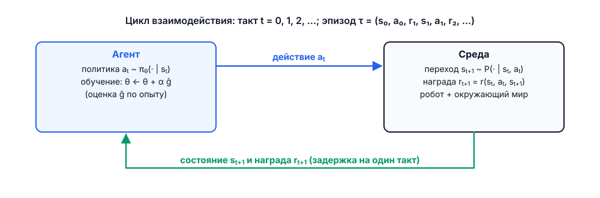
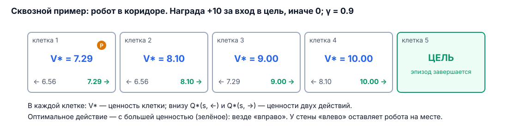
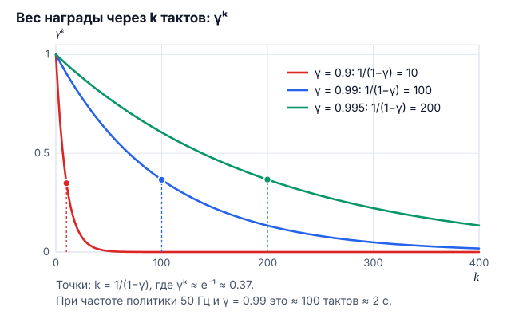
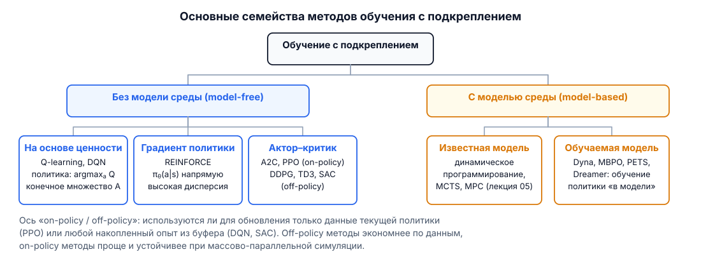
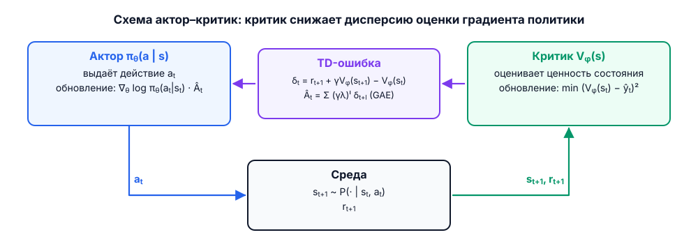
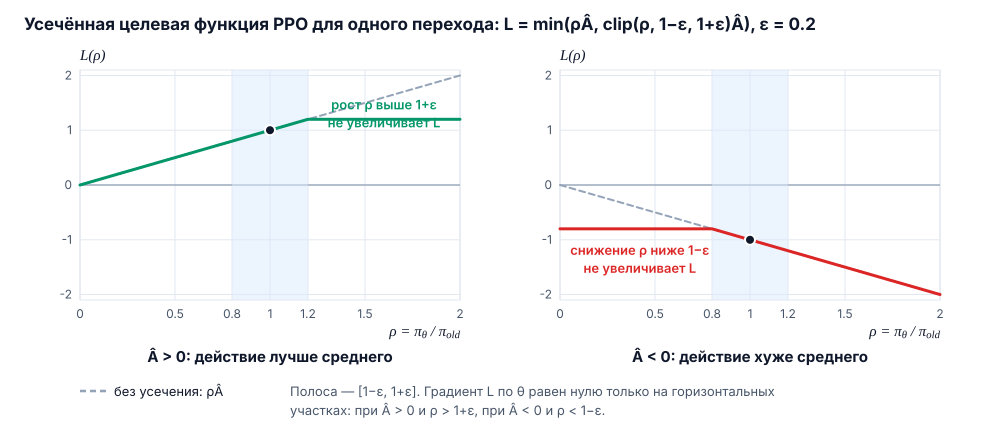
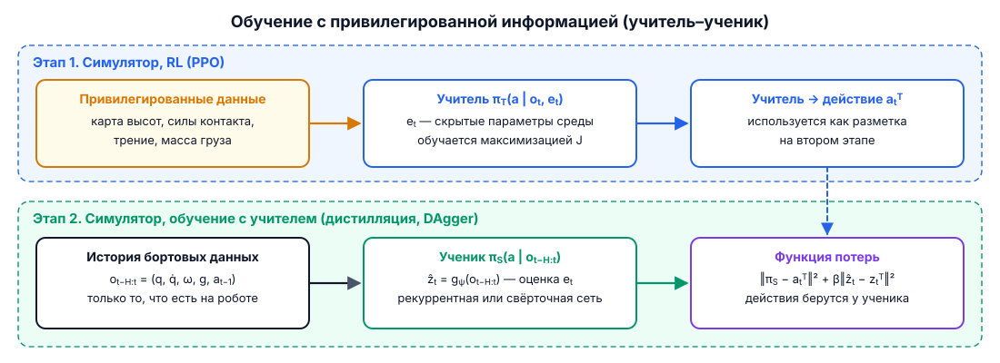
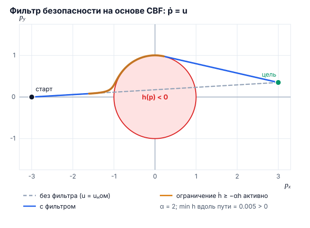

<!-- _class: lead -->
<!-- _header: "" -->
<!-- _footer: "" -->

# **Планирование движений мобильных роботов**
## Лекция 06: Обучение с подкреплением в робототехнике: от марковских процессов к переносу политик на реальных роботов

<div class="mt-4">

<span class="badge badge-blue">90 минут</span>
<span class="badge badge-green">Как робот учится управлению на собственном опыте</span>
<span class="badge badge-purple">MDP • ценность • уравнение Беллмана • Q-learning • градиент политики • PPO • перенос на робота</span>

</div>

---

<!-- _class: fs-4 -->

## Место лекции в курсе <span class="badge badge-time">01–03 мин</span>

<div class="grid-2">
<div class="col">
<div class="card card-accent">

### Что дала лекция 05
- Если **модель** $\dot{x} = f(x, u)$ известна, наилучшее управление можно найти: формулой (принцип максимума) или численно (MPC).
- Функция цены $V(x)$ — наименьшая стоимость оставшегося пути из состояния $x$.

</div>
<div class="card card-alert">

### Где это трудно
Шагающий робот на камнях, захват мягкого предмета, колесо на льду. Модель контактов и трения неточна, а MPC с такой моделью ошибается.

</div>
</div>
<div class="col">
<div class="card card-success">

### Вопрос этой лекции
Можно ли получить закон управления, **не записывая модель**, а пробуя действовать и оценивая результат?

**Обучение с подкреплением** (reinforcement learning, RL) — да: робот (чаще его копия в симуляторе) совершает миллионы попыток, получает за каждую числовую оценку — награду — и постепенно улучшает своё правило выбора действий.

Задача оптимизации решается **заранее**, при обучении. На роботе остаётся быстро вычислить готовую функцию.

</div>
</div>
</div>

---

<!-- _class: fs-4 -->

## План лекции <span class="badge badge-time">03–04 мин</span>

<div class="grid-2">
<div class="col">
<div class="card card-accent">

### Три части
1. **Основные понятия** (04–30 мин): агент, среда, награда, политика, ценность, уравнение Беллмана. Всё — на примере робота в коридоре.
2. **Обучение без модели** (30–60 мин): TD-ошибка, Q-learning, нейронные сети, градиент политики, актор–критик, PPO.
3. **Практика** (60–90 мин): обучение ходьбе, выбор награды, перенос из симулятора на робота, безопасность, сочетание с MPC.

</div>
</div>
<div class="col">
<div class="card card-term">

### Как читать слайды
Каждый новый термин вводится в фиолетовом блоке: смысл словами, формула, пример. Сводка терминов — на предпоследнем слайде.

</div>
<div class="card">

### Сквозной пример
Робот в коридоре из пяти клеток. Он настолько прост, что все величины лекции можно вычислить вручную, и каждое правило проверяется на числах.

</div>
</div>
</div>

---

<!-- _class: fs-4 -->

## Когда обучение с подкреплением уместно <span class="badge badge-time">04–06 мин</span>

<div class="grid-2">
<div class="col">
<div class="card card-success">

### Сильные стороны
- **Не нужна формула модели.** Достаточно симулятора или самого робота: можно сделать действие и увидеть результат. Удары, проскальзывание, люфты не мешают.
- **Быстро на борту.** Готовый закон — нейронная сеть; её вычисление занимает около миллисекунды.
- **Учится на том, что измеряет робот**, а не на идеальном состоянии.

</div>
</div>
<div class="col">
<div class="card card-alert">

### Ограничения
- **Много опыта:** от миллионов до миллиардов шагов. Поэтому обучают в симуляторе.
- **Награду задаёт человек**, и робот может найти способ получить её не так, как задумано.
- **Нет гарантий** безопасности: их проверяют испытаниями.
- **Симулятор отличается от реальности**, нужен специальный перенос.

**Правило выбора:** есть хорошая модель и важны ограничения — MPC (лекция 05). Главная трудность — модель — RL.

</div>
</div>
</div>

---

## Часть 1. Агент и среда <span class="badge badge-time">06–09 мин</span>

<div class="diagram-box">



</div>

<div class="grid-3 tight">
<div class="card card-term">

**Агент** — тот, кто выбирает действия (регулятор робота). **Среда** — всё остальное: тело робота и окружающий мир.

</div>
<div class="card card-term">

**Состояние** $s_t$ — описание ситуации в момент $t$. **Действие** $a_t$ — команда агента. **Награда** $r_{t+1}$ — число, оценка последнего шага.

</div>
<div class="card card-term">

**Такт** — один шаг цикла. **Эпизод** — одна попытка от начала до конца: до достижения цели, падения или истечения времени.

</div>
</div>

---

## Сквозной пример: робот в коридоре <span class="badge badge-time">09–11 мин</span>

<div class="diagram-box">



</div>

<div class="grid-2 tight">
<div class="card">

**Правила.** Состояние — номер клетки 1–4. Действия: «влево» и «вправо». Вход в клетку 5 даёт награду $+10$ и завершает эпизод, остальные шаги — награду 0. У левой стены «влево» оставляет робота на месте.

</div>
<div class="card card-alert">

Числа в клетках будут объяснены на следующих слайдах. Пока важно одно: робот **не знает** правил, он узнаёт их только из опыта.

</div>
</div>

---

<!-- _class: fs-4 -->

## Политика и траектория <span class="badge badge-time">11–13 мин</span>

<div class="grid-2">
<div class="col">
<div class="card card-term">

### Термин: политика
Правило выбора действия по состоянию. Это и есть закон управления.
- **Детерминированная:** $a = \pi(s)$, например «всегда вправо».
- **Стохастическая:** $\pi(a \mid s)$ — вероятность выбрать действие $a$ в состоянии $s$, например «вправо с вероятностью 0.8, влево — 0.2».

</div>
<div class="card">

### Зачем случайность
Чтобы узнать, хорошо ли действие, его нужно попробовать. Случайный выбор позволяет **исследовать** — пробовать новые действия. Готовая политика на роботе обычно детерминирована.

</div>
</div>
<div class="col">
<div class="card card-term">

### Термин: траектория
Запись одного эпизода — последовательность состояний, действий и наград:
$$\tau = (s_0, a_0, r_1, s_1, a_1, r_2, \dots).$$

</div>
<div class="card card-accent">

### Пример
Робот стартует в клетке 1, политика «всегда вправо»:
| $t$ | $s_t$ | $a_t$ | $r_{t+1}$ |
| :--- | :--- | :--- | :--- |
| 0 | 1 | → | 0 |
| 1 | 2 | → | 0 |
| 2 | 3 | → | 0 |
| 3 | 4 | → | 10 |

Эпизод завершён: робот в цели.

</div>
</div>
</div>

---

## Отдача и дисконтирование <span class="badge badge-time">13–16 мин</span>

<div class="grid-2">
<div class="col">
<div class="card card-term">

### Термин: отдача
Сумма наград от момента $t$ до конца, где награда через $k$ шагов умножается на $\gamma^k$:
$$G_t = r_{t+1} + \gamma\, r_{t+2} + \gamma^2 r_{t+3} + \dots$$
Число $\gamma \in [0, 1)$ — **коэффициент дисконтирования**.

</div>
<div class="card card-accent">

### Пример ($\gamma = 0.9$)
Траектория с предыдущего слайда, отдача из начала:
$$G_0 = 0 + 0.9 \cdot 0 + 0.9^2 \cdot 0 + 0.9^3 \cdot 10 = 7.29.$$
Из клетки 3: $G = 0 + 0.9 \cdot 10 = 9$.
Чем дальше цель, тем меньше отдача.

</div>
</div>
<div class="col">
<div class="card">

### Зачем множитель $\gamma$
1. Сумма бесконечного числа наград остаётся конечной: $|G_t| \le r_{\max}/(1-\gamma)$.
2. Агент предпочитает **быстрее** получить награду.
3. Число $1/(1-\gamma)$ — «горизонт» агента в тактах: награды дальше этого почти не учитываются. При $\gamma = 0.99$ это 100 тактов.

</div>
<div class="diagram-box">



</div>
</div>
</div>

---

<!-- _class: fs-4 -->

## Марковский процесс принятия решений (MDP) <span class="badge badge-time">16–19 мин</span>

<div class="grid-2">
<div class="col">
<div class="card card-term">

### Термин: MDP
Математическая модель задачи RL — набор из пяти частей:
| Символ | Смысл | В коридоре |
| :--- | :--- | :--- |
| $\mathcal{S}$ | состояния | клетки 1–4 |
| $\mathcal{A}$ | действия | ←, → |
| $P(s' \mid s, a)$ | вероятность перехода | 1 для соседней клетки |
| $r(s, a)$ | награда | 10 у цели, иначе 0 |
| $\gamma$ | дисконтирование | 0.9 |

**Цель агента:** найти политику с наибольшей средней отдачей.

</div>
</div>
<div class="col">
<div class="card card-term">

### Термин: марковское свойство
Следующее состояние зависит только от текущего состояния и действия, но не от того, как агент сюда попал. Состояние должно содержать **всё нужное** для предсказания.

</div>
<div class="card card-alert">

### Когда оно нарушено
Один кадр камеры показывает, **где** мяч, но не **куда** он летит. Агент видит не состояние, а **наблюдение** $o_t$. Такую задачу называют **частично наблюдаемой** (POMDP).

**Практический приём:** подавать на вход несколько последних наблюдений или использовать рекуррентную сеть, которая «помнит» прошлое.

</div>
</div>
</div>

---

<!-- _class: fs-4 -->

## Функции ценности <span class="badge badge-time">19–22 мин</span>

<div class="grid-2">
<div class="col">
<div class="card card-term">

### Термин: ценность состояния $V^\pi(s)$
Средняя отдача, если стартовать из $s$ и действовать по политике $\pi$:
$$V^\pi(s) = \mathbb{E}_\pi\big[G_t \mid s_t = s\big].$$
Аналог функции цены из лекции 05, но со знаком «плюс»: чем больше, тем лучше.

</div>
<div class="card card-term">

### Термин: ценность действия $Q^\pi(s, a)$
Средняя отдача, если в $s$ сначала выполнить $a$, а дальше действовать по $\pi$.

</div>
</div>
<div class="col">
<div class="card card-accent">

### Пример: политика «всегда вправо»
- $V(4) = 10$, $V(3) = 9$, $V(2) = 8.1$, $V(1) = 7.29$ — это числа $V^*$ в клетках на рисунке коридора.
- $Q(3, \rightarrow) = 0 + 0.9 \cdot V(4) = 9$.
- $Q(3, \leftarrow) = 0 + 0.9 \cdot V(2) = 7.29$: шаг влево, потом вправо до цели.

</div>
<div class="card card-term">

### Термин: преимущество $A^\pi(s, a)$
Насколько действие лучше, чем обычно делает политика:
$$A^\pi(s, a) = Q^\pi(s, a) - V^\pi(s).$$
Пример: $A(3, \leftarrow) = 7.29 - 9 = -1.71 < 0$ — действие «влево» хуже обычного.

</div>
</div>
</div>

---

<!-- _class: fs-4 -->

## Уравнение Беллмана <span class="badge badge-time">22–25 мин</span>

<div class="grid-2">
<div class="col">
<div class="card">

### Вывод в два шага
1. Отдача раскладывается на первую награду и отдачу со следующего шага:
   $$G_t = r_{t+1} + \gamma\,(r_{t+2} + \gamma r_{t+3} + \dots) = r_{t+1} + \gamma\,G_{t+1}.$$
2. Усредним обе части при старте из $s$. Среднее от $G_{t+1}$ — это ценность следующего состояния:
   $$V^\pi(s) = \mathbb{E}\big[r_{t+1} + \gamma\,V^\pi(s_{t+1}) \mid s_t = s\big].$$

**Смысл:** ценность клетки = награда за шаг + дисконтированная ценность клетки, куда попадём.

</div>
</div>
<div class="col">
<div class="card card-accent">

### Проверка на коридоре
$V(2) = 0 + 0.9 \cdot V(3) = 0.9 \cdot 9 = 8.1$ ✓
$V(4) = 10 + 0.9 \cdot 0 = 10$ ✓ (после цели наград нет)

</div>
<div class="card card-term">

### Термин: оптимальная политика
Политика с наибольшей ценностью во всех состояниях; её ценности обозначают $V^*$ и $Q^*$. Для них выполнено **уравнение оптимальности Беллмана**:
$$Q^*(s, a) = r(s, a) + \gamma \sum_{s'} P(s' \mid s, a)\,\max_{a'} Q^*(s', a').$$
Зная $Q^*$, действовать просто: $\pi^*(s) = \arg\max_a Q^*(s, a)$ — выбрать действие с наибольшей ценностью (зелёные числа в коридоре).

</div>
</div>
</div>

---

<!-- _class: fs-4 -->

## Итерация по ценности: решение при известной модели <span class="badge badge-time">25–28 мин</span>

<div class="grid-2">
<div class="col">
<div class="card card-term">

### Термин: итерация по ценности
Начать с $V_0 \equiv 0$ и много раз применить уравнение оптимальности как правило обновления:
$$V_{k+1}(s) = \max_a \Big[r(s, a) + \gamma\,V_k(s')\Big].$$
Это **динамическое программирование**: задача решается по частям, от конца к началу.

</div>
<div class="card card-success">

**Почему сходится.** Каждая итерация уменьшает ошибку не менее чем в $1/\gamma$ раз: $\max_s|V_k - V^*| \le \gamma^k \max_s|V_0 - V^*|$.

</div>
</div>
<div class="col">
<div class="card card-accent">

### Итерации в коридоре
| итерация $k$ | $V(1)$ | $V(2)$ | $V(3)$ | $V(4)$ |
| :--- | :--- | :--- | :--- | :--- |
| 0 | 0 | 0 | 0 | 0 |
| 1 | 0 | 0 | 0 | **10** |
| 2 | 0 | 0 | **9** | 10 |
| 3 | 0 | **8.1** | 9 | 10 |
| 4 | **7.29** | 8.1 | 9 | 10 |

Информация о награде распространяется от цели назад на одну клетку за итерацию — как волна в волновом алгоритме из лекции 02.

</div>
<div class="card card-alert">

**Ограничение:** нужно знать $P$ и $r$ и перебирать все состояния. В RL модель неизвестна — об этом часть 2.

</div>
</div>
</div>

---

<!-- _class: fs-4 -->

## Связь с оптимальным управлением <span class="badge badge-time">28–30 мин</span>

<div class="grid-2">
<div class="col">

| Лекция 05 | Лекция 06 |
| :--- | :--- |
| состояние $x$, управление $u$ | состояние $s$, действие $a$ |
| стоимость $L$, минимизация | награда $r = -L$, максимизация |
| модель $f$ известна | переходы $P$ неизвестны, есть опыт |
| функция цены $V(x)$ | ценность $V^*(s)$ (со знаком минус) |
| уравнение HJB | уравнение Беллмана |
| MPC: оптимизация на каждом такте | политика: оптимизация заранее |

</div>
<div class="col">
<div class="card card-accent">

### Главное
- Задача та же: найти закон управления, оптимальный по критерию. Отличается способ: **по модели** или **по опыту**.
- Уравнение Беллмана — дискретный (по времени) аналог уравнения HJB из лекции 05.
- Для линейной модели и квадратичной награды оптимальная политика — LQR, $a = -Kx$. Методы RL могут найти её, не зная матриц $A$ и $B$.

</div>
<div class="card">

К сочетанию MPC и RL вернёмся в конце лекции.

</div>
</div>
</div>

---

## Часть 2. Как учиться без модели: обзор методов <span class="badge badge-time">30–31 мин</span>

<div class="diagram-box">



</div>

**Маршрут части 2.** Сначала оценим ценности по опыту (TD-ошибка, Q-learning). Затем заменим таблицу нейронной сетью (DQN). Для непрерывных действий будем улучшать политику напрямую (градиент политики), а ценность использовать как подсказку (актор–критик, PPO).

---

<!-- _class: fs-4 -->

## Оценка ценности по опыту: TD-ошибка <span class="badge badge-time">31–34 мин</span>

<div class="grid-2">
<div class="col">
<div class="card card-term">

### Термин: опыт (переход)
Четвёрка $(s, a, r, s')$: где был, что сделал, какую награду получил, куда попал. Модель $P$ не нужна: переходы просто записываются во время попыток.

</div>
<div class="card card-term">

### Термин: TD-ошибка (временна́я разность)
Разница между «новой оценкой по одному шагу» и старой оценкой:
$$\delta = r + \gamma\,V(s') - V(s).$$
Обновление: сдвинуть $V(s)$ в сторону новой оценки:
$$V(s) \leftarrow V(s) + \alpha\,\delta,$$
где $\alpha \in (0, 1]$ — **скорость обучения**.

</div>
</div>
<div class="col">
<div class="card card-accent">

### Пример ($\gamma = 0.9$, $\alpha = 0.5$, вначале $V \equiv 0$)
**Эпизод 1**, переход $4 \to 5$, $r = 10$:
$\delta = 10 + 0 - 0 = 10$, $\;V(4) = 0 + 0.5 \cdot 10 = 5$.

**Эпизод 2**, переход $3 \to 4$, $r = 0$:
$\delta = 0 + 0.9 \cdot 5 - 0 = 4.5$, $\;V(3) = 2.25$.

С каждым эпизодом оценки приближаются к $V(4) = 10$, $V(3) = 9$, как в итерации по ценности, но **без знания правил**.

</div>
<div class="card">

Альтернатива — метод Монте-Карло: ждать конца эпизода и усреднять настоящие отдачи $G$. Он точнее в среднем, но его оценки сильно «скачут» и обновляются реже.

</div>
</div>
</div>

---

<!-- _class: fs-4 -->

## Q-learning и исследование <span class="badge badge-time">34–37 мин</span>

<div class="grid-2">
<div class="col">
<div class="card card-term">

### Термин: Q-learning (Watkins, 1989)
Та же идея для ценностей действий, но новая оценка берёт **лучшее** действие в следующем состоянии:
$$Q(s, a) \leftarrow Q(s, a) + \alpha\Big[r + \gamma\,\max_{a'} Q(s', a') - Q(s, a)\Big].$$
Так оценивается сразу $Q^*$, даже если агент пока действует неоптимально.

</div>
<div class="card card-accent">

**Пример.** $Q(3, \rightarrow) = 0$, переход в клетку 4, $r = 0$, в клетке 4 лучшая оценка $\max Q(4, \cdot) = 8$, $\alpha = 0.5$:
$Q(3, \rightarrow) = 0 + 0.5\,(0 + 0.9 \cdot 8 - 0) = 3.6$.

</div>
</div>
<div class="col">
<div class="card card-term">

### Термин: исследование и использование
- **Использование** — выбирать действие, лучшее по текущим оценкам.
- **Исследование** — пробовать другие действия: вдруг они лучше, а оценки просто ещё неточны.

Без исследования агент может навсегда застрять на первом найденном неплохом решении.

</div>
<div class="card card-term">

### Термин: ε-жадная политика
С вероятностью $1 - \varepsilon$ выбрать лучшее действие, с вероятностью $\varepsilon$ — случайное. Обычно $\varepsilon$ уменьшают по ходу обучения, например от 1 до 0.05.

</div>
</div>
</div>

---

## Интерактивная модель: Q-learning на клеточном поле <span class="badge badge-time">37–40 мин</span>

<div class="interactive-container">
<div class="interactive-header">
<span><i class="interactive-dot"></i> Q-learning: робот ищет путь к цели</span>
<span>Сравните с итерацией по ценности; меняйте ε и γ, включите скользкий пол</span>
</div>
<iframe src="http://localhost:5599/widgets/rl-policy-shaping/index.html?scenario=basics" class="interactive-frame"></iframe>
</div>

---

<!-- _class: fs-3 -->

## От таблицы к нейронной сети: DQN <span class="badge badge-time">40–42 мин</span>

<div class="grid-2">
<div class="col">
<div class="card card-alert">

### Почему таблица не годится
У робота состояние — десятки вещественных чисел (углы, скорости, изображение). Таблицу на все сочетания не построить, а похожие состояния должны получать похожие оценки.

</div>
<div class="card card-term">

### Термин: аппроксимация функцией
Таблицу $Q(s, a)$ заменяют нейронной сетью $Q_\phi(s, a)$ с параметрами $\phi$. Сеть обобщает: оценивает и те состояния, в которых агент не был.

</div>
</div>
<div class="col">
<div class="card card-accent">

### DQN (Mnih и др., 2015)
Сеть обучается как обычная регрессия: подгоняет $Q_\phi(s, a)$ к цели
$$y = r + \gamma\,\max_{a'} Q_{\bar\phi}(s', a'),$$
минимизируя $(y - Q_\phi(s, a))^2$.

Два приёма для устойчивости:
- **Буфер опыта:** переходы хранятся, а для обучения выбираются случайно — так соседние, очень похожие переходы не идут подряд.
- **Целевая сеть** $Q_{\bar\phi}$: копия сети, обновляемая редко, чтобы цель $y$ не менялась на каждом шаге.

</div>
<div class="card card-alert">

DQN требует перебрать все действия для $\max$, поэтому подходит для небольшого **конечного** набора действий.

</div>
</div>
</div>

---

<!-- _class: fs-4 -->

## Непрерывные действия и стохастическая политика <span class="badge badge-time">42–44 мин</span>

<div class="grid-2">
<div class="col">
<div class="card card-alert">

### Трудность
Действие четвероногого робота — 12 заданных углов суставов, $a \in \mathbb{R}^{12}$. Даже 5 вариантов на сустав дают $5^{12} \approx 2.4 \cdot 10^8$ сочетаний: найти $\max_a Q(s, a)$ перебором невозможно.

**Выход:** учить не ценности, а саму политику — сеть, которая сразу выдаёт действие.

</div>
</div>
<div class="col">
<div class="card card-term">

### Термин: гауссова политика
Сеть $\mu_\theta(s)$ выдаёт **среднее** действие, а фактическое действие выбирается случайно вокруг него:
$$a = \mu_\theta(s) + \sigma\,\xi, \qquad \xi \sim \mathcal{N}(0, 1).$$
- $\theta$ — параметры сети (веса), их и подбирает обучение.
- $\sigma$ — разброс, отвечает за исследование; по ходу обучения уменьшается.
- На роботе обычно используют только среднее $\mu_\theta(s)$.

</div>
<div class="card">

Пределы приводов учитывают обрезанием действия или функцией $\tanh$, которая переводит любое число в интервал $(-1, 1)$.

</div>
</div>
</div>

---

<!-- _class: fs-4 -->

## Градиент политики: идея <span class="badge badge-time">44–47 мин</span>

<div class="grid-2">
<div class="col">
<div class="card">

### Цель и трудность
Критерий: средняя отдача $J(\theta) = \mathbb{E}[G_0]$. Его нужно увеличивать градиентным подъёмом $\theta \leftarrow \theta + \alpha\nabla_\theta J$. Но $G_0$ зависит от $\theta$ через среду, а производных среды у нас нет.

### Приём с логарифмом
Вероятность траектории — произведение вероятностей действий политики и переходов среды. После логарифма произведение становится суммой, и **слагаемые среды не зависят от $\theta$** — их производная равна нулю. Остаётся
$$\nabla_\theta J = \mathbb{E}\Big[\sum_t \nabla_\theta \ln \pi_\theta(a_t \mid s_t)\; G_t\Big].$$

</div>
</div>
<div class="col">
<div class="card card-term">

### Термин: градиент политики (REINFORCE, Williams, 1992)
Алгоритм:
1. Сыграть эпизод текущей политикой.
2. Для каждого шага вычислить отдачу $G_t$.
3. Сдвинуть $\theta$ так, чтобы **увеличить вероятность** действий с большой отдачей.

</div>
<div class="card card-accent">

### Смысл формулы
$\nabla_\theta \ln\pi_\theta(a_t \mid s_t)$ — направление, в котором растёт вероятность выбранного действия. Множитель $G_t$ говорит, насколько сильно двигаться. Для гауссовой политики шаг сдвигает среднее $\mu_\theta(s)$ **к** опробованному действию.

**Модель среды не нужна.**

</div>
</div>
</div>

---

<!-- _class: fs-4 -->

## Базовая функция и преимущество <span class="badge badge-time">47–49 мин</span>

<div class="grid-2">
<div class="col">
<div class="card card-alert">

### Проблема
В коридоре награда только $+10$, поэтому все отдачи положительны. Формула предыдущего слайда увеличивает вероятность **всех** опробованных действий, только с разной силой. Обучение идёт, но медленно и с большим разбросом.

</div>
<div class="card card-term">

### Термин: базовая функция $b(s)$
Число, которое вычитают из отдачи: $G_t - b(s_t)$. Если $b$ зависит только от состояния, среднее направление градиента не меняется, а разброс уменьшается. Лучший простой выбор — ценность: $b(s) = V(s)$.

</div>
</div>
<div class="col">
<div class="card card-accent">

### Пример в клетке 3
$V(3) = 8$ (оценка). Опробованы два действия:
- «вправо»: $G = 9$, $\;G - V = +1$ → вероятность **растёт**;
- «влево»: $G = 7.29$, $\;G - V = -0.71$ → вероятность **уменьшается**.

Величина $G_t - V(s_t)$ — оценка **преимущества** $A$: насколько исход лучше ожидаемого из того же состояния.

</div>
<div class="card">

**Почему не появляется ошибки.** Сумма вероятностей всех действий равна 1 при любых $\theta$, поэтому $\mathbb{E}_a[\nabla_\theta \ln\pi_\theta(a \mid s)] = \nabla_\theta 1 = 0$, и вычитание $b(s)$ не меняет среднего.

</div>
</div>
</div>

---

## Актор–критик <span class="badge badge-time">49–52 мин</span>

<div class="diagram-box">



</div>

<div class="grid-3 tight">
<div class="card card-term">

**Актор** — сеть политики $\pi_\theta$: выбирает действия, обучается градиентом политики.

</div>
<div class="card card-term">

**Критик** — сеть ценности $V_\phi$: обучается по TD-ошибке, как на слайде 15, и подсказывает актору преимущество.

</div>
<div class="card">

**Оценка преимущества.** По одному шагу: $\delta_t$ (быстро, но зависит от точности критика). По всей траектории: $G_t - V_\phi$ (точнее, но разброс больше). **GAE** смешивает их с параметром $\lambda$ — это не $\lambda$ из лекции 05.

</div>
</div>

---

## PPO: осторожный шаг обучения <span class="badge badge-time">52–55 мин</span>

<div class="grid-2" style="grid-template-columns: 2fr 3fr;">
<div class="col">
<div class="card card-alert">

### Проблема слишком большого шага
Опыт собран старой политикой $\pi_{\text{old}}$. Если обновить политику слишком сильно, она начнёт вести себя иначе, чем в собранных данных, и оценки станут неверными. Обучение может «сорваться»: робот, который уже ходил, начнёт падать.

</div>
<div class="card card-term">

### Термин: PPO (Schulman и др., 2017)
Ограничить изменение вероятности каждого действия. Отношение $\rho = \pi_\theta(a \mid s)/\pi_{\text{old}}(a \mid s)$ учитывается только в пределах $[1-\varepsilon,\, 1+\varepsilon]$, обычно $\varepsilon = 0.2$:
$$L = \mathbb{E}\big[\min\big(\rho\hat{A},\; \operatorname{clip}(\rho, 1{-}\varepsilon, 1{+}\varepsilon)\hat{A}\big)\big].$$

</div>
</div>
<div class="col">
<div class="diagram-box">



</div>

**Как читать график.** Хорошее действие ($\hat{A} > 0$): выгодно увеличивать его вероятность, но не более чем в 1.2 раза — дальше график плоский и не тянет. Плохое ($\hat{A} < 0$): уменьшать, но не более чем до 0.8.

</div>
</div>

---

<!-- _class: fs-4 -->

## PPO: алгоритм и параметры <span class="badge badge-time">55–57 мин</span>

<div class="grid-2">
<div class="col">

```text
повторять:
  1. собрать T шагов в каждой из M копий среды
     текущей политикой π_old
  2. по собранным данным вычислить
     преимущества Â (GAE) и цели для критика
  3. K раз пройти по данным мини-пакетами:
       обновить актора по усечённой функции L,
       обновить критика регрессией к целям
  4. π_old ← π_θ, старые данные выбросить
```

</div>
<div class="col">
<div class="card card-accent">

### Типичные параметры для ходьбы
Rudin и др., 2021 (библиотека rsl_rl): $M = 4096$ копий робота в симуляторе на GPU, $T = 24$ шага — около $10^5$ переходов за итерацию; $K = 5$ проходов, 4 мини-пакета, $\varepsilon = 0.2$, $\gamma = 0.99$, $\lambda = 0.95$.

</div>
<div class="card card-term">

### Термин: обучение по политике (on-policy)
Данные используются только для обновления той политики, которая их собрала, затем выбрасываются. PPO — метод по политике.

</div>
<div class="card">

**Почему PPO популярен в робототехнике:** прост, устойчив, мало чувствителен к настройкам, хорошо распараллеливается на тысячи копий робота.

</div>
</div>
</div>

---

<!-- _class: fs-4 -->

## SAC и выбор алгоритма <span class="badge badge-time">57–60 мин</span>

<div class="grid-2">
<div class="col">
<div class="card card-term">

### Термин: обучение вне политики (off-policy)
Опыт хранится в буфере и используется многократно, даже если его собирала старая политика. Так учатся Q-learning, DQN и SAC.

</div>
<div class="card card-accent">

### SAC (Haarnoja и др., 2018)
Актор–критик вне политики. К награде добавляется бонус за **разнообразие** действий (энтропию политики) с весом $\alpha$:
$$J = \mathbb{E}\Big[\sum_t \gamma^t \big(r_t + \alpha\,\mathcal{H}(\pi(\cdot \mid s_t))\big)\Big].$$
Бонус поддерживает исследование и делает политику устойчивее к возмущениям. Два критика, берётся меньшая оценка — против завышения ценностей.

</div>
</div>
<div class="col">
<div class="card card-success">

### Что выбрать
| Ситуация | Метод |
| :--- | :--- |
| опыт дешёвый: тысячи копий в симуляторе | PPO |
| опыт дорогой: реальный робот, медленный симулятор | SAC, TD3 |
| мало дискретных действий | DQN |

SAC позволил обучить ходьбу четвероногого робота за несколько часов на реальном роботе (Haarnoja и др., 2019).

</div>
<div class="card">

**Методы с моделью среды.** Модель переходов можно обучить по опыту и планировать по ней (например, MPC с обученной моделью). Трудность: ошибки модели накапливаются. Подробнее — в лекции 07.

</div>
</div>
</div>

---

<!-- _class: fs-4 -->

## Часть 3. Постановка задачи ходьбы <span class="badge badge-time">60–64 мин</span>

<div class="grid-2">
<div class="col">
<div class="card card-accent">

### Наблюдение (по Rudin и др., 2021) — 48 чисел
- скорости корпуса (линейная и угловая);
- направление силы тяжести в системе корпуса — по нему видно наклон;
- команда оператора: желаемые скорости $(v_x, v_y, \omega_z)$;
- углы и скорости 12 суставов, предыдущее действие;
- для неровной поверхности — высоты рельефа вокруг робота.

</div>
<div class="card card-term">

### Термин: действие как уставка
Сеть выдаёт **желаемые углы** суставов, а не моменты: $q^{\text{des}} = q^{\text{nom}} + k\,a_t$. Их отрабатывает обычный ПД-регулятор $\tau = K_p(q^{\text{des}} - q) - K_d\dot{q}$. Политика работает с частотой 50 Гц.

</div>
</div>
<div class="col">
<div class="card">

### Награда
$$r = \underbrace{w_1 e^{-\lVert v^{\text{cmd}} - v\rVert^2/\sigma}}_{\text{едем с заданной скоростью}} - \underbrace{\textstyle\sum_j w_j c_j}_{\text{штрафы}}$$
Штрафы $c_j$: большие моменты и ускорения суставов, резкие изменения действия, раскачивание корпуса, удары коленями о землю.

</div>
<div class="card card-term">

### Термин: учебный план (curriculum)
Сначала ровная поверхность, затем всё сложнее: робот, который проходит участок, переводится на более трудный рельеф. Ходьба по ровному полу обучается за минуты, по сложному рельефу — за десятки минут на одном GPU.

</div>
</div>
</div>

---

<!-- _class: fs-2 -->

## Конструирование награды <span class="badge badge-time">64–67 мин</span>

<div class="grid-2">
<div class="col">
<div class="card card-term">

### Термины: разреженная и плотная награда
- **Разреженная** — только за результат (дошёл до цели). Точно выражает задачу, но агент долго не получает никакого сигнала.
- **Плотная** — на каждом шаге (например, за приближение к цели). Учит быстрее, но **меняет задачу**: агент оптимизирует то, что написано.

</div>
<div class="card card-term">

### Термин: формирование через потенциал (Ng и др., 1999)
Безопасный способ сделать награду плотной:
$$\tilde{r} = r + \gamma\,\Phi(s') - \Phi(s),$$
где $\Phi$ — любая функция состояния, например $-$расстояние до цели. Оптимальная политика при этом **не меняется**.

</div>
</div>
<div class="col">
<div class="card card-alert">

### Термин: взлом награды (reward hacking)
Агент находит способ получить много награды, не решая задачу:
- награда «за близость к цели» на каждом шаге — выгоднее **стоять рядом** с целью, чем войти в неё и закончить эпизод (6);
- бонус за приближение без штрафа за удаление — выгодно **ходить туда-сюда** (7);
- штраф за каждый шаг и конец эпизода при падении — выгоднее **упасть сразу** (9);
- слишком большой штраф за энергию — выгоднее **не двигаться** (10);
- нет штрафа за резкую смену действия — привод дёргается между крайними значениями (как релейное управление в лекции 05).

В скобках — номер сценария следующей модели; потенциальная награда — сценарий 8.

</div>
</div>
</div>

---

## Интерактивная модель: как награда меняет поведение <span class="badge badge-time">67–70 мин</span>

<div class="interactive-container">
<div class="interactive-header">
<span><i class="interactive-dot"></i> Q-learning с разными наградами</span>
<span>Разреженная, плотная, потенциальная награда и взлом награды на одном поле</span>
</div>
<iframe src="http://localhost:5599/widgets/rl-policy-shaping/index.html?scenario=shaping" class="interactive-frame"></iframe>
</div>

---

<!-- _class: fs-4 -->

## Перенос из симулятора на робота (sim-to-real) <span class="badge badge-time">70–74 мин</span>

<div class="grid-2">
<div class="col">
<div class="card card-alert">

### Почему политика из симулятора может не работать
- приводы: запаздывание, люфт, трение в редукторе, предел тока;
- задержка в цепи «датчик — вычислитель — привод»;
- контакт и трение моделируются приближённо;
- массы, центр масс, жёсткости известны неточно;
- шум датчиков, другой рельеф.

</div>
<div class="card">

**Массово-параллельная симуляция** (Isaac Lab, MuJoCo MJX): тысячи копий робота на одном GPU. Без неё обучение по политике (PPO) заняло бы недели.

</div>
</div>
<div class="col">
<div class="card card-term">

### Термин: идентификация
Уточнение параметров симулятора по измерениям на реальном роботе. Например, модель привода обучают по записям настоящего двигателя (Hwangbo и др., 2019).

</div>
<div class="card card-term">

### Термин: рандомизация среды (domain randomization)
В каждом эпизоде параметры симулятора (масса, трение, задержки, толчки) выбираются **случайно** из заданных диапазонов. Политика учится работать на всём семействе роботов, и реальный робот оказывается «одним из них».

**Цена:** слишком широкие диапазоны делают политику излишне осторожной.

</div>
</div>
</div>

---

## Учитель и ученик <span class="badge badge-time">74–77 мин</span>

<div class="diagram-box">



</div>

<div class="grid-3 tight">
<div class="card card-term">

**Привилегированная информация** — то, что известно в симуляторе, но не измеряется на роботе: трение, точный рельеф, силы в контактах.

</div>
<div class="card">

**Шаг 1.** **Учитель** получает привилегированную информацию и обучается RL — это проще. **Шаг 2.** **Ученик** видит только датчики робота и учится повторять действия учителя по истории измерений.

</div>
<div class="card">

На робот переносится только ученик (Lee и др., 2020; Miki и др., 2022). Похожие приёмы: RMA (Kumar и др., 2021), асимметричный актор–критик.

</div>
</div>

---

## Фильтр безопасности для обученной политики <span class="badge badge-time">77–81 мин</span>

<div class="grid-2">
<div class="col">
<div class="card card-term">

### Термин: барьерная функция $h(x)$
Функция, положительная в безопасной области и равная нулю на её границе. Пример: $h$ = расстояние до стены минус запас.

</div>
<div class="card card-accent">

### Условие безопасности (CBF)
Скорость приближения к границе должна убывать по мере приближения:
$$\dot{h} \ge -\alpha\, h, \quad \alpha > 0.$$
Далеко от стены можно приближаться быстро, у самой стены — только медленно. Тогда $h$ никогда не станет отрицательной.

</div>
<div class="card card-term">

### Термин: фильтр безопасности
На каждом такте найти команду, **ближайшую** к команде политики и удовлетворяющую условию:
$$u = \arg\min_u \lVert u - u_{\text{RL}}\rVert^2 \;\text{ при }\; \dot{h}(x, u) \ge -\alpha h.$$
Если команда политики безопасна, она проходит без изменений.

</div>
</div>
<div class="col">
<div class="diagram-box">



</div>

Нужна модель, чтобы вычислить $\dot{h}$. Предиктивный вариант того же приёма — MPC в роли фильтра.

</div>
</div>

---

## MPC и RL: сравнение и сочетание <span class="badge badge-time">81–86 мин</span>

<!-- _class: fs-3 -->

<div class="grid-2">
<div class="col">

| | MPC (лекция 05) | RL |
| :--- | :--- | :--- |
| Модель | нужна явная, гладкая | нужен симулятор |
| Вычисления на роботе | решатель на каждом такте | вычисление сети |
| Вычисления заранее | малые | миллионы попыток, часы GPU |
| Ограничения | выполняются на каждом такте | через награду, не гарантируются |
| Контакты, удары | трудно | естественно в симуляторе |
| Гарантии | устойчивость при условиях лекции 05 | проверка испытаниями |
| Новая задача | изменить критерий | обучать заново |

</div>
<div class="col">
<div class="card card-success">

### Гибридные схемы
- **Добавка к MPC:** $u = u_{\text{MPC}} + u_{\text{RL}}$; обученная часть исправляет неточность модели.
- **Разделение уровней:** RL выбирает, куда ставить ноги, MPC отрабатывает движение с ограничениями (RLOC, Gangapurwala и др., 2022).
- **Ценность как терминальная стоимость:** обученная $V$ позволяет укоротить горизонт MPC.
- **Фильтр безопасности:** CBF или MPC проверяет команду политики.
- **Подражание:** сеть учится повторять MPC и заменяет его на слабом вычислителе.

</div>
</div>
</div>

---

<!-- _class: fs-3 -->

## Итоги лекции и контрольные вопросы <span class="badge badge-time">86–89 мин</span>

<div class="grid-2">
<div class="col">
<div class="card card-accent">

### Итоги
- RL решает ту же задачу, что оптимальное управление, но по опыту, а не по модели.
- Ценность $V$ и $Q$ — средняя будущая отдача; её связывает уравнение Беллмана.
- TD-ошибка и Q-learning оценивают ценность без модели; DQN заменяет таблицу сетью.
- Градиент политики увеличивает вероятность действий, оказавшихся лучше ожидаемого; критик подсказывает «ожидаемое».
- PPO — стандарт для обучения в массово-параллельном симуляторе.
- Перенос на робота: рандомизация, учитель–ученик, фильтр безопасности.

</div>
</div>
<div class="col">
<div class="card">

### Контрольные вопросы
1. Робот в коридоре стартует в клетке 2. Чему равна отдача при политике «всегда вправо», $\gamma = 0.9$?
2. Политика работает с частотой 50 Гц, и награды на 2 с вперёд должны учитываться с весом не меньше $e^{-1}$. Каким выбрать $\gamma$?
3. Чем исследование отличается от использования? Что будет без исследования?
4. Почему вычитание $V(s)$ из отдачи не портит направление обучения?
5. Какие параметры симулятора стоит рандомизировать для колёсного робота на скользком полу?

</div>
</div>
</div>

---

## Словарь терминов лекции

<!-- _class: fs-2 -->

<div class="grid-3">
<div class="card card-term">

### Основные понятия
- **Агент**, **среда**, **такт**, **эпизод**.
- **Состояние** $s$, **действие** $a$, **награда** $r$.
- **Политика** $\pi$: детерминированная и стохастическая.
- **Траектория**, **отдача** $G$, **дисконтирование** $\gamma$.
- **MDP**, **марковское свойство**, **наблюдение**, POMDP.
- **Ценность** $V$, $Q$, **преимущество** $A$.
- **Уравнение Беллмана**, **оптимальная политика**.
- **Итерация по ценности** (динамическое программирование).

</div>
<div class="card card-term">

### Алгоритмы
- **Опыт** $(s, a, r, s')$, **TD-ошибка**, **скорость обучения**.
- **Q-learning**, **исследование и использование**, **ε-жадная политика**.
- **Аппроксимация функцией**, **DQN**, **буфер опыта**, **целевая сеть**.
- **Гауссова политика**, **градиент политики**.
- **Базовая функция**, **актор**, **критик**, GAE.
- **PPO**, обучение **по политике** и **вне политики**, SAC.

</div>
<div class="card card-term">

### Практика
- **Действие как уставка** ПД-регулятора.
- **Учебный план**.
- **Разреженная и плотная награда**, **формирование через потенциал**, **взлом награды**.
- **Sim-to-real**, **идентификация**, **рандомизация среды**.
- **Привилегированная информация**, **учитель и ученик**.
- **Барьерная функция**, **фильтр безопасности**.

</div>
</div>

---

<!-- _class: fs-3 -->

## Литература

<div class="grid-2">
<div class="col">
<div class="card card-accent">

### Учебники и основные работы
- Sutton R. S., Barto A. G. *Reinforcement Learning: An Introduction.* 2nd ed. — MIT Press, 2018. (Главы 3–6 — по материалу частей 1–2.)
- Bertsekas D. P. *Reinforcement Learning and Optimal Control.* — Athena Scientific, 2019.
- Murphy K. P. *Reinforcement Learning: A Comprehensive Overview.* — arXiv:2412.05265.
- Mnih V. et al. Human-level control through deep reinforcement learning // Nature. 2015.
- Schulman J. et al. Proximal policy optimization algorithms. — arXiv:1707.06347, 2017.
- Haarnoja T. et al. Soft actor-critic // ICML. 2018.
- Ng A., Harada D., Russell S. Policy invariance under reward transformations // ICML. 1999.

</div>
</div>
<div class="col">
<div class="card">

### Робототехника
- Hwangbo J. et al. Learning agile and dynamic motor skills for legged robots // Science Robotics. 2019.
- Lee J. et al. Learning quadrupedal locomotion over challenging terrain // Science Robotics. 2020.
- Kumar A. et al. RMA: Rapid motor adaptation for legged robots // RSS. 2021.
- Rudin N. et al. Learning to walk in minutes using massively parallel deep reinforcement learning // CoRL. 2021.
- Miki T. et al. Learning robust perceptive locomotion for quadrupedal robots in the wild // Science Robotics. 2022.
- Ames A. D. et al. Control barrier functions: Theory and applications // ECC. 2019.

</div>
</div>
</div>
