<!-- _class: lead -->
<!-- _header: "" -->
<!-- _footer: "" -->

# **Планирование движений мобильных роботов**
## Лекция 07: Продвинутые алгоритмы: профиль скорости, планирование в координатах Френе, диффузионные политики и NoMaD

90 минут
Как превратить путь в движение и как учиться движению по примерам
временная параметризация • координаты Френе • имитация • диффузия • NoMaD

---

## Место лекции в курсе 01–03 мин

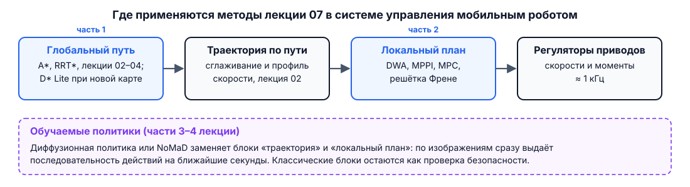

**Что уже умеем.** Найти путь ($A^*$, RRT, лекции 02–04), ехать с учётом модели (DWA, MPPI, лекция 04), оптимизировать движение (MPC, лекция 05), обучать политику пробами и ошибками (RL, лекция 06).

**Чего не хватает.** Как быстро ехать по уже найденному пути? Как обгонять на дороге? Как научить робота по **примерам** человека, а не по награде?

---

## План лекции 03–04 мин

### Четыре части
1. **Профиль скорости по пути** (04–28 мин): кривизна, предел скорости, алгоритм двух проходов, рывок.
2. **Планирование в координатах Френе** (28–50 мин): дорога как прямая полоса, полиномы, веер вариантов.
3. **Обучение по демонстрациям и диффузия** (50–78 мин): почему копировать трудно, как генерировать действия из шума.
4. **NoMaD: навигация по изображениям** (78–85 мин): диффузионная политика на реальном роботе.

### Как читать слайды
Как и в лекциях 05–06, каждый новый термин вводится в фиолетовом блоке: смысл словами, формула, пример.

Части 1–2 — классические методы с точным расчётом. Части 3–4 — обучаемые методы последних лет.

### Три интерактивные модели
Профиль скорости по пути, планировщик Френе на дороге, диффузионная политика объезда препятствия. Все расчёты в них — точные, без заготовленных картинок.

---

## Часть 1. Путь и траектория 04–07 мин

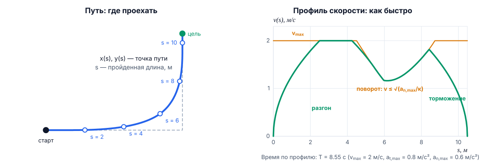

**Термин: путь.** Линия на плоскости без времени: $x(s), y(s)$. Параметр $s$ — **пройденная длина** вдоль линии, м.

**Термин: траектория.** Путь плюс время: где робот будет в каждый момент $t$. Задаётся функцией $s(t)$.

**Термин: временная параметризация.** Выбор $s(t)$, то есть профиля скорости $v(s) = \dot{s}$ по готовому пути.

---

## Почему путь нельзя исполнить как есть: кривизна 07–10 мин

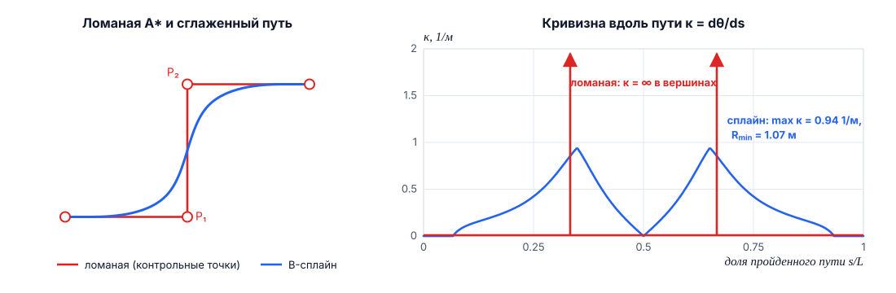

**Термин: кривизна** $\kappa = d\theta/ds$ — как быстро поворачивает направление на метр пути. **Радиус** поворота $R = 1/\kappa$.

У ломаной $A^*$ в вершине направление меняется **скачком**: $\kappa = \infty$. Проехать её можно только с остановкой и разворотом на месте.

**Термин: B-сплайн.** Гладкая кривая, которую «тянут» контрольные точки (вершины ломаной). Кривизна конечна и непрерывна.

---

## Ограничения скорости на пути 10–14 мин

### Термин: касательное ускорение $a_t$
Изменение величины скорости: разгон и торможение, $a_t = \dot{v}$. Ограничено мощностью мотора и сцеплением: $|a_t| \le a_{t,\max}$.

### Термин: нормальное ускорение $a_n$
Ускорение «вбок» при повороте, как в машине на вираже:
$$a_n = \frac{v^2}{R} = v^2 \kappa.$$
Ограничено сцеплением колёс и устойчивостью: $a_n \le a_{n,\max}$.

### Предел скорости в каждой точке пути
Из $v^2 \kappa \le a_{n,\max}$ получаем
$$v_{lim}(s) = \min\left(v_{\max},\ \sqrt{\frac{a_{n,\max}}{\kappa(s)}}\right).$$
На прямой ($\kappa = 0$) действует только $v_{\max}$. В крутом повороте предел меньше.

**Пример.** $a_{n,\max} = 0.6$ м/с², поворот радиусом 1 м: $v_{lim} = \sqrt{0.6} \approx 0.77$ м/с. Радиус 4 м: $\approx 1.55$ м/с.

---

## Алгоритм двух проходов 14–19 мин

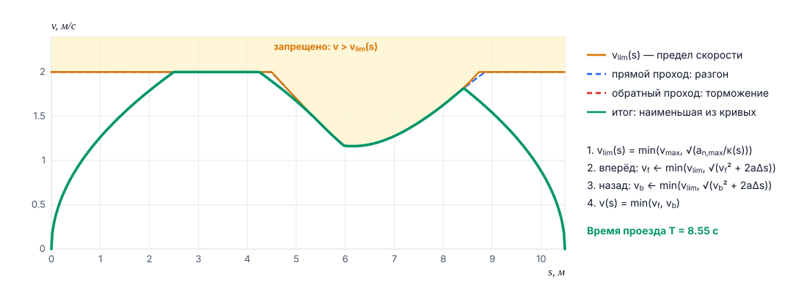

**Откуда формула прохода.** При постоянном ускорении $a$ на отрезке $\Delta s$: $v_{i+1}^2 = v_i^2 + 2 a \Delta s$ (школьная кинематика). Прямой проход разгоняется изо всех сил, обратный — тормозит изо всех сил, начиная с конца.

**Почему берём минимум.** Прямой проход гарантирует, что успеем разогнаться; обратный — что успеем остановиться перед поворотом и в конце. Минимум удовлетворяет обоим и пределу $v_{lim}$.

---

## Почему профиль двух проходов — самый быстрый 19–22 мин

### Связь с лекцией 05
Время проезда $T = \int_0^L \frac{ds}{v(s)}$. Чем выше скорость в каждой точке, тем меньше время. Профиль двух проходов в каждой точке даёт **наибольшую** скорость, которую допускают ограничения.

Результат: на каждом участке либо полный разгон, либо полное торможение, либо езда на пределе $v_{lim}$. Это **релейное управление** из задачи быстродействия лекции 05, только вдоль заданного пути.

### Термин: задача оптимальной по времени параметризации
Найти $s(t)$ с наименьшим временем проезда при ограничениях на скорость и ускорения. Для манипуляторов её решили Bobrow и др. и Shin, McKay (1985); современный быстрый вариант — TOPP-RA (2018).

**Для мобильного робота** ограничения проще, и задача решается двумя проходами за время $O(N)$, где $N$ — число точек пути.

---

## Рывок: трапеция и S-профиль 22–25 мин

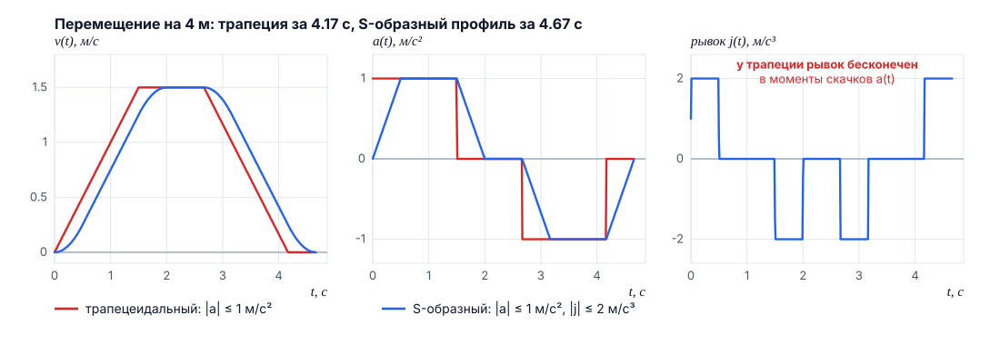

**Термин: рывок** $j = \dot{a}$ — скорость изменения ускорения, м/с³. Скачок ускорения — это бесконечный рывок: груз дёргается, колёса проскальзывают.

**Термин: трапецеидальный профиль** скорости: разгон, равномерная езда, торможение. Самый быстрый, но рывок бесконечен.

**S-профиль** ограничивает рывок ($j_{\max} = 2$ м/с³). Плата — время: 4.67 с вместо 4.17 с на 4 м.

---

## Интерактивная модель: профиль скорости по пути 25–28 мин

<i class="interactive-dot"></i> Предел скорости, два прохода, сравнение с постоянной скоростью
Сценарии: поворот, змейка, прямая с разворотом, ломаная против сплайна

<iframe src="http://localhost:5599/widgets/velocity-profile/index.html" class="interactive-frame"></iframe>

---

## Часть 2. Задача: движение по дороге 28–30 мин

### Новая задача
Робот-автомобиль едет по полосе. Впереди медленная или стоящая машина. Нужно решить: тормозить, перестроиться, вернуться в полосу. Решение пересчитывается **10 раз в секунду**: другие участники движутся.

### Почему в координатах $(x, y)$ неудобно
Дорога изгибается. Фраза «держись в 0.5 м левее середины полосы» в $(x, y)$ — сложная кривая, своя на каждом повороте.

### Идея
Ввести координаты, **привязанные к дороге**: сколько проехали вдоль неё и насколько сместились вбок. Тогда любая дорога выглядит как прямая полоса, а манёвр «перестроиться» — это изменение одного числа.

Метод предложили Werling, Ziegler, Kammel, Thrun (2010) для беспилотных автомобилей; он стал стандартным учебным примером планировщика манёвров.

---

## Координаты Френе 30–33 мин

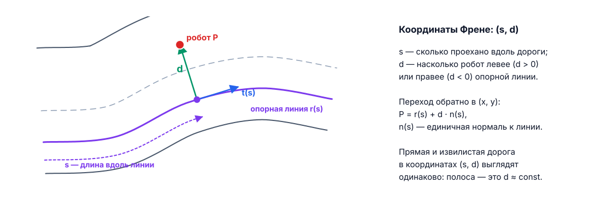

**Термин: опорная линия** $r(s)$ — середина полосы, заданная картой. Параметр $s$ — длина вдоль неё.

**Термин: координаты Френе** $(s, d)$: $s$ — продольная координата, $d$ — поперечное смещение со знаком (влево $d > 0$).

**Ограничение.** Пересчёт в $(x, y)$ ломается при $d = 1/\kappa_r$ — в центре кривизны опорной линии. На крутых поворотах и парковках метод неудобен.

---

## Полином 5-й степени для перестроения 33–37 мин

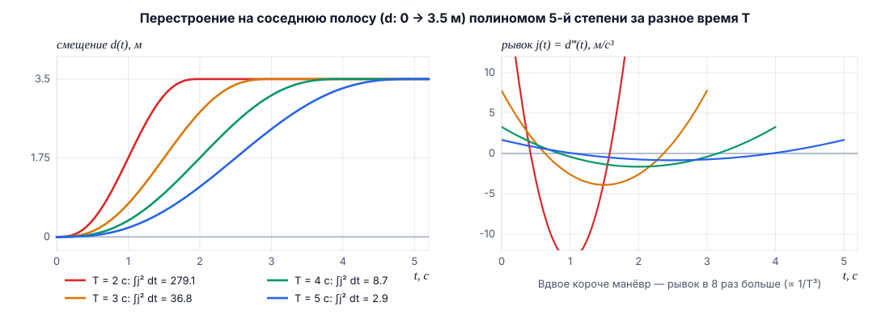

**Термин: краевые условия.** В начале и в конце манёвра заданы смещение, скорость и ускорение: $d(0), \dot d(0), \ddot d(0)$ и $d(T), \dot d(T), \ddot d(T)$ — шесть чисел. Полином $d(t) = c_0 + c_1 t + \dots + c_5 t^5$ имеет шесть коэффициентов: система из шести линейных уравнений.

**Почему именно 5-я степень.** Из всех кривых с этими краевыми условиями она имеет наименьший $\int_0^T \dddot{d}^{\,2} dt$ — самое плавное движение (Flash, Hogan, 1985). Короче манёвр — резче: $\int j^2 \propto 1/T^5$, а пик рывка $\propto 1/T^3$.

---

## Продольное движение: держать скорость 37–39 мин

### Два независимых движения
- **Поперечное** $d(t)$: полином 5-й степени, цель — смещение $d_T$ (своя полоса, соседняя, объезд).
- **Продольное** $s(t)$: цель — не точка, а **скорость** $v_T$. Где именно окажемся, не важно.

### Полином 4-й степени для $s(t)$
Известны $s(0), \dot s(0), \ddot s(0)$, а в конце только $\dot s(T) = v_T$ и $\ddot s(T) = 0$. Пять условий — пять коэффициентов: $s(t) = c_0 + \dots + c_4 t^4$.

### Сборка траектории
Для каждого момента $t$ берём $s(t)$ и $d(t)$ и переводим в $(x, y)$ по опорной линии:
$$P = r(s) + d \cdot n(s),$$
где $n(s)$ — единичный вектор влево от линии. Получается траектория на плоскости с известным временем в каждой точке.

Варианты продольной цели: держать скорость, ехать за машиной на заданной дистанции, остановиться у стоп-линии (тогда снова полином 5-й степени).

---

## Веер вариантов и выбор лучшего 39–43 мин

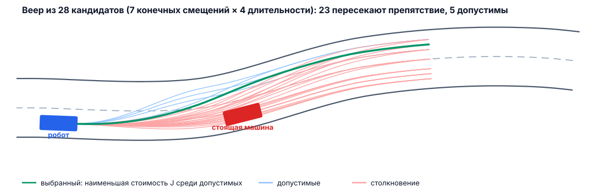

**Термин: веер кандидатов.** Перебираем конечное смещение $d_T$, время $T$ и скорость $v_T$; каждая комбинация — своя траектория. Как DWA (лекция 04), только варианты — гладкие полиномы на несколько секунд.

**Стоимость** $J = k_j \int j^2 dt + k_t T + k_d d_T^2 + k_v (v_{des} - v_T)^2$: плавность, быстрота, близость к середине полосы, желаемая скорость. Выбираем допустимый вариант с наименьшим $J$.

---

## Проверка вариантов и цикл перепланирования 43–46 мин

### Вариант отбрасывается, если
1. Превышена скорость или ускорение (как в части 1).
2. Кривизна больше, чем позволяет руль.
3. Выезд за край дороги.
4. **Столкновение во времени:** в момент $t$ робот и другая машина, **где она будет в момент $t$**, ближе безопасного расстояния.

### Термин: прогноз движения участников
Предположение, где будут другие машины через $t$ секунд. Простейший — «едут с постоянной скоростью». Ошибки прогноза исправляются частым пересчётом.

### Цикл
Каждые 0.1 с: измерить состояние → построить веер (десятки–сотни вариантов) → отбросить недопустимые → выбрать лучший → исполнить начало. Это **скользящий горизонт**, как у MPC в лекции 05.

---

## Интерактивная модель: планировщик Френе 46–49 мин

<i class="interactive-dot"></i> Веер полиномов на дороге, пересчёт 10 раз в секунду
Сценарии: стоящая машина, медленная машина, занятая левая полоса, слалом. Щелчок по дороге добавляет препятствие

<iframe src="http://localhost:5599/widgets/frenet-planner/index.html" class="interactive-frame"></iframe>

---

## Френе среди других методов 49–50 мин

<!-- _class: compact -->

| | Френе (веер полиномов) | Решётка состояний, Hybrid A* | MPC |
| :--- | :--- | :--- | :--- |
| Что ищется | лучший из сотен полиномов | путь по сетке манёвров | оптимум гладкой задачи |
| Нужна опорная линия | да | нет | желательна |
| Сильная сторона | быстро, плавно, время учтено явно | любые развороты, парковка | точные ограничения модели |
| Слабая сторона | крутые повороты, перекрёстки | грубая по времени | локальный минимум, нужен хороший старт |
| Где применяют | шоссе, полосы склада | парковки, узкие места | следование выбранной траектории |

На практике их сочетают: веер Френе выбирает **манёвр** (обгон или торможение), MPC (лекция 05) аккуратно его **исполняет**.

---

## Часть 3. Обучение по демонстрациям 50–53 мин

### Когда формулы не помогают
Разложить посуду, проехать по людному коридору, открыть дверь. Записать стоимость $J$ (часть 2) или награду (лекция 06) для таких задач очень трудно. Зато человек легко **покажет**, как надо.

### Термин: демонстрация
Запись того, как человек управлял роботом: пары «наблюдение $o$ — действие $a$» на каждом такте. Набор демонстраций — обучающие данные.

### Термин: поведенческое клонирование (BC)
Обучить нейросеть-политику $\pi_\theta(o)$ повторять действия человека, как в обычной задаче регрессии:
$$\min_\theta \sum_i \| a_i - \pi_\theta(o_i) \|^2.$$
Первый пример — ALVINN (1989): сеть вела автомобиль по изображению с камеры.

**Отличие от RL (лекция 06):** нет награды и проб и ошибок. Есть только примеры правильного поведения.

---

## Проблема 1: накопление ошибок 53–56 мин

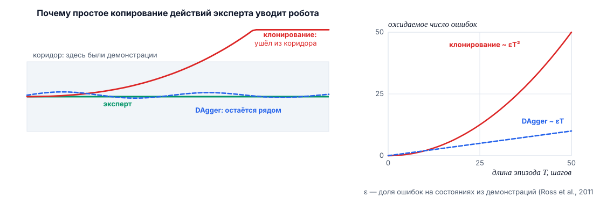

**Термин: сдвиг распределения.** Политика ошиблась немного → попала в состояние, которого не было в демонстрациях (эксперт туда не заезжал) → там ошибается сильнее. Ошибки складываются: $\sim \varepsilon T^2$ за эпизод длины $T$.

**Термин: DAgger** (Ross и др., 2011). Пустить обученную политику, а эксперта попросить подписать **правильные действия в посещённых ею состояниях**. Добавить в данные, переобучить. Рост ошибок становится линейным, $\sim \varepsilon T$.

---

## Проблема 2: несколько правильных ответов 56–59 мин

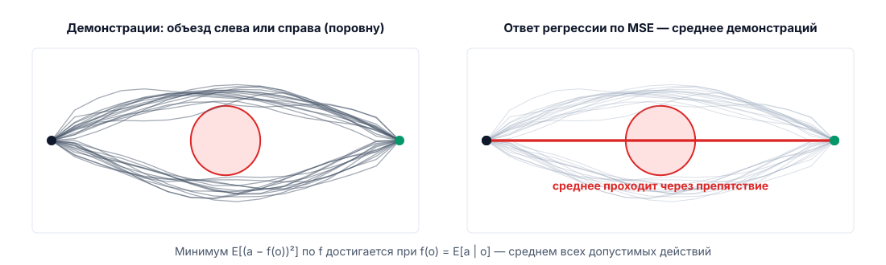

**Термин: многомодальное распределение.** У задачи несколько разных правильных ответов (моды): объехать слева или справа. Демонстрации содержат оба.

**Почему регрессия ломается.** Минимум средней квадратичной ошибки — это **среднее** всех ответов. Среднее двух объездов — прямо в препятствие. Нужна модель, которая выдаёт **один** вариант из нескольких.

---

## Идея генеративной модели 59–61 мин

### Термин: генеративная модель
Модель, которая не предсказывает одно число, а **выдаёт случайные примеры**, похожие на обучающие данные: $a \sim p(a \mid o)$. Каждый запуск — свой вариант. Так генерируют изображения по тексту.

### Термин: нормальное распределение $\mathcal{N}(0, I)$
«Чистый шум»: каждое число случайно, около нуля, с разбросом 1. Сгенерировать его компьютер умеет легко.

### План
Научиться превращать шум $\mathcal{N}(0, I)$ в правдоподобное действие. Если шум разный — получаем разные варианты: то объезд слева, то справа, но никогда не их среднее.

**Диффузионная модель** делает это не за один шаг, а за $K$ маленьких шагов очистки от шума (Ho, Jain, Abbeel, 2020).

---

## Прямой процесс: портим данные шумом 61–64 мин

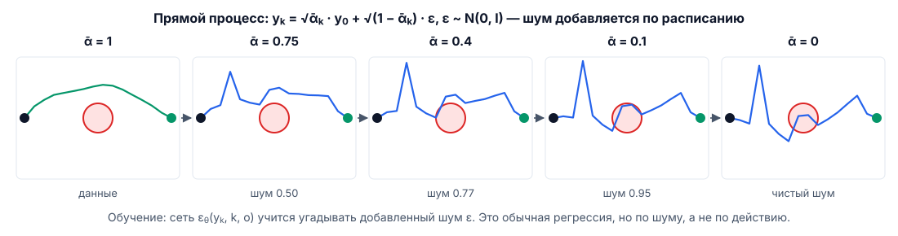

**Термин: прямой процесс.** Берём траекторию $y_0$ из демонстрации и подмешиваем шум: $y_k = \sqrt{\bar\alpha_k}\, y_0 + \sqrt{1 - \bar\alpha_k}\, \varepsilon$.

**Термин: расписание шума** $\bar\alpha_k$: от 1 (нет шума) до 0 (чистый шум) за $k = 1 \dots K$ шагов.

**Обучение.** Сеть $\varepsilon_\theta(y_k, k, o)$ угадывает, **какой шум** добавили. Ошибка — обычная MSE по шуму.

---

## Обратный процесс: шаг за шагом убираем шум 64–67 мин

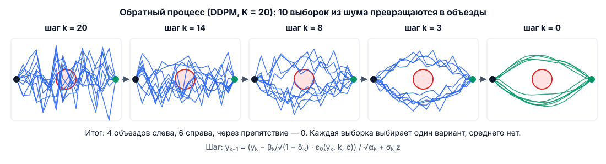

**Термин: обратный процесс.** Начинаем с шума $y_K$. На каждом шаге сеть оценивает шум, мы вычитаем его часть и добавляем немного нового ($\sigma_k z$). После $K$ шагов — правдоподобная траектория.

**Почему нет среднего.** Ранние шаги «выбирают сторону» случайно; дальше каждый шаг только уточняет выбранный вариант. Здесь 4 объезда слева, 6 справа, через препятствие — ни одного.

---

## Диффузионная политика 67–70 мин

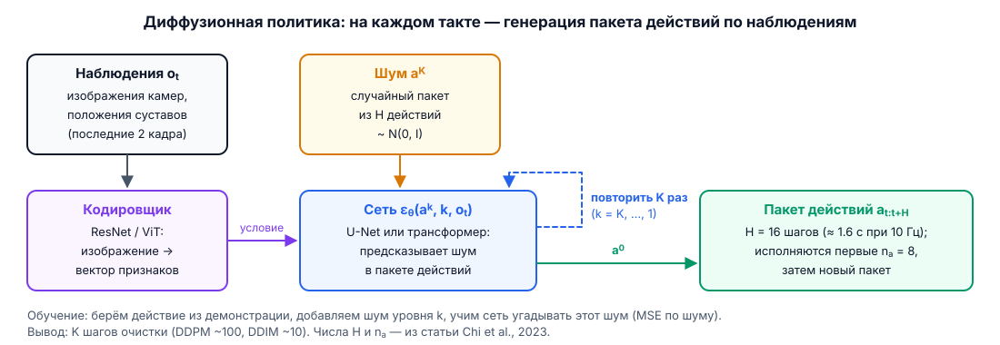

**Термин: диффузионная политика** (Diffusion Policy; Chi и др., 2023). Диффузионная модель, которая генерирует не картинку, а **последовательность действий** робота. Условие — наблюдения $o$: кадры камеры и положение робота за 2 последних такта.

**Устройство.** Сеть — одномерная U-Net по времени; наблюдения подмешиваются в каждый её слой. При обучении $K = 100$ шагов шума, при работе часто 10 шагов ускоренной схемой (DDIM), чтобы успевать за такт управления.

---

## Пакеты действий 70–72 мин

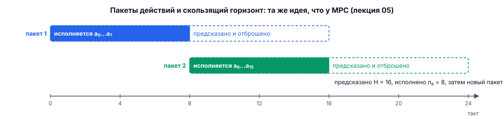

**Термин: пакет действий** (action chunk): сразу $H = 16$ будущих действий, из них исполняются первые $n_a = 8$.

**Зачем.** Внутри пакета движение согласовано: робот не «передумывает» каждый такт между левым и правым объездом.

**Связь с MPC.** Предсказать на горизонт, исполнить начало, пересчитать: та же схема, что в лекции 05 и в части 2.

---

## Согласование потоков: меньше шагов 72–74 мин

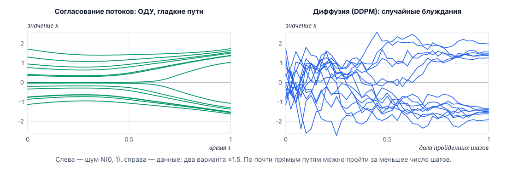

**Термин: согласование потоков** (flow matching; Lipman и др., 2023). Сеть учит **поле скоростей** $v_\theta(y, \tau)$: куда двигать точку, чтобы из шума ($\tau = 0$) прийти в данные ($\tau = 1$). Генерация — решение дифференциального уравнения $\dot y = v_\theta$ без случайности.

**Плюс.** Пути почти прямые, поэтому хватает нескольких шагов (5–10 вместо 100). Этот способ используют современные модели «зрение–язык–действие» (лекция 08).

---

## Наведение: учесть новое препятствие без переобучения 74–75 мин

### Термин: наведение (guidance)
На каждом шаге обратного процесса добавить к шагу сети сдвиг **против градиента стоимости** $c(y)$:
$$y \leftarrow y_{\text{шаг сети}} - \lambda \nabla c(y).$$
Стоимость — штраф за близость к препятствию, которого не было в демонстрациях.

### Что получаем
Модель знает, **как** обычно ездят (из демонстраций), а стоимость говорит, **что сейчас** нельзя. Траектории остаются похожими на человеческие, но обходят новое препятствие (идея Diffuser, Janner и др., 2022).

Слишком большой $\lambda$ выталкивает траекторию из области данных: она становится «нечеловеческой» и может нарушать ограничения робота.

---

## Интерактивная модель: диффузионная политика объезда 75–78 мин

<i class="interactive-dot"></i> MSE, диффузия (DDPM) и согласование потоков на одних данных
Меняйте долю левых объездов, число шагов K и силу наведения λ; перетащите жёлтое препятствие

<iframe src="http://localhost:5599/widgets/diffusion-policy-interactive/index.html" class="interactive-frame"></iframe>

---

## Часть 4. Навигация по изображениям: топологическая карта 78–80 мин

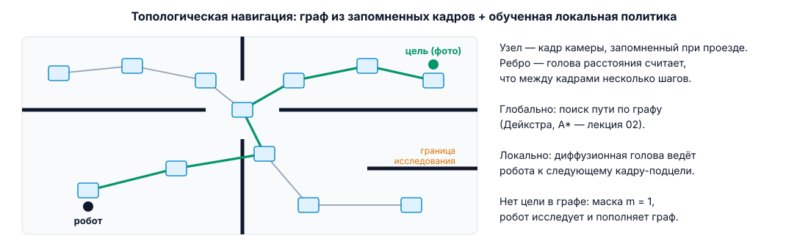

**Термин: топологическая карта.** Граф без точных координат: узел — запомненный кадр камеры, ребро — «от этого кадра можно доехать до того». Путь по графу ищется $A^*$ из лекции 02.

**Термин: цель-изображение.** Цель задаётся фотографией места, а не координатами. Робот едет «туда, где выглядит вот так».

---

## NoMaD: одна сеть для цели и для исследования 80–83 мин

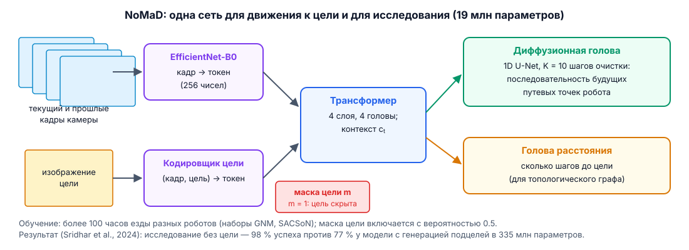

**Кодировщик.** EfficientNet-B0 сжимает каждый кадр в вектор; трансформер объединяет текущий, прошлые кадры и цель.

**Термин: маска цели.** При $m = 1$ цель скрыта, и сеть генерирует **разведку**: любые безопасные движения. При обучении маска включается с вероятностью 0.5.

**Действия** генерирует диффузия, как в части 3. Объезд слева и справа — разные выборки, а не их среднее.

---

## NoMaD: результаты и пределы 83–85 мин

### Что показали авторы (Sridhar, Shah, Glossop, Levine, 2024)
- Обучение на **более чем 100 часах** записей разных роботов (наборы GNM и SACSoN): одна политика для разных платформ.
- Сеть на 19 млн параметров работает на бортовом компьютере робота.
- В исследовании незнакомых помещений: успех 98 % против 77 % у схемы «генерация промежуточного изображения-цели + политика», где одна генеративная модель имеет 335 млн параметров.

### Пределы
- Нет гарантий: безопасность проверена экспериментами, а не доказана.
- Качество зависит от данных: в непохожей среде (другая высота камеры, освещение) поведение ухудшается.
- Нет метрической карты: точно встать в заданную точку трудно.

**Как применяют.** Обучаемая политика внутри классической системы: глобальный граф, фильтр безопасности (лекция 06), ограничение скоростей (часть 1).

---

## Сводка методов лекции 85–87 мин

<!-- _class: compact -->

| Метод | Что на входе | Что на выходе | Когда применять |
| :--- | :--- | :--- | :--- |
| Два прохода | путь, $v_{\max}$, $a_{t,\max}$, $a_{n,\max}$ | быстрейший профиль $v(s)$ | всегда после глобального планировщика |
| S-профиль | профиль скорости, $j_{\max}$ | плавный профиль | груз, люди рядом, точные приводы |
| Френе | опорная линия, участники движения | манёвр на 2–5 с | дороги, полосы, коридоры склада |
| Клонирование (BC) | демонстрации | политика | одна мода, много данных |
| Диффузионная политика | демонстрации, наблюдения | пакет действий | несколько способов решения, манипуляция |
| Согласование потоков | то же | то же за меньшее число шагов | нужна высокая частота |
| NoMaD | кадры камеры, цель-фото | движение или разведка | навигация без метрической карты |

---

## Итоги лекции и контрольные вопросы 87–89 мин

### Итоги
- Путь — линия, траектория — линия со временем. Профиль скорости задаётся пределом $v_{lim}(s)$ и двумя проходами; это решение быстрейшее.
- Координаты Френе превращают дорогу в прямую полосу; манёвры — полиномы 5-й и 4-й степени; лучший выбирается из веера по стоимости.
- Клонирование страдает от накопления ошибок и усреднения мод.
- Диффузия и согласование потоков генерируют один правдоподобный вариант из нескольких.
- NoMaD — пример диффузионной политики для навигации по камере.

### Контрольные вопросы
1. Чем путь отличается от траектории?
2. Найдите $v_{lim}$ в повороте радиусом 2 м при $a_{n,\max} = 0.5$ м/с².
3. Зачем нужен обратный проход?
4. Почему для перестроения нужен полином именно 5-й степени?
5. Во сколько раз вырастет пик рывка, если манёвр сделать вдвое короче?
6. Почему регрессия по MSE ведёт в препятствие, а диффузия — нет?
7. Что делает маска цели в NoMaD?

---

## Словарь терминов лекции

<!-- _class: compact -->

### Профиль скорости
- **Путь**, **траектория**, **пройденная длина** $s$.
- **Временная параметризация** — выбор $s(t)$.
- **Кривизна** $\kappa$, **радиус** $R = 1/\kappa$, **B-сплайн**.
- **Касательное** и **нормальное ускорение**.
- **Предел скорости** $v_{lim}(s)$, **два прохода**.
- **Рывок**, **трапеция**, **S-профиль**.

### Координаты Френе
- **Опорная линия** $r(s)$, **координаты** $(s, d)$.
- **Краевые условия**, **полином 5-й степени**.
- **Продольное и поперечное движение**.
- **Веер кандидатов**, **стоимость** $J$.
- **Прогноз движения участников**.
- **Скользящий горизонт**.

### Обучение по демонстрациям
- **Демонстрация**, **поведенческое клонирование**.
- **Сдвиг распределения**, **DAgger**.
- **Многомодальное распределение**, **генеративная модель**.
- **Прямой и обратный процесс**, **расписание шума**.
- **Диффузионная политика**, **пакет действий**.
- **Согласование потоков**, **наведение**.
- **Топологическая карта**, **цель-изображение**, **маска цели**.

---

## Литература

<!-- _class: compact -->

### Профиль скорости и Френе
- Bobrow J. E., Dubowsky S., Gibson J. S. Time-optimal control of robotic manipulators along specified paths // IJRR. 1985. Vol. 4, № 3.
- Shin K. G., McKay N. D. Minimum-time control of robotic manipulators with geometric path constraints // IEEE TAC. 1985. Vol. 30, № 6.
- Pham H., Pham Q.-C. A new approach to time-optimal path parameterization based on reachability analysis // IEEE T-RO. 2018. Vol. 34, № 3.
- Flash T., Hogan N. The coordination of arm movements // J. Neuroscience. 1985. Vol. 5, № 7.
- Werling M., Ziegler J., Kammel S., Thrun S. Optimal trajectory generation for dynamic street scenarios in a Frenét frame // ICRA. 2010.
- Lynch K. M., Park F. C. *Modern Robotics.* — Cambridge University Press, 2017. Гл. 9.

### Обучение по демонстрациям и диффузия
- Pomerleau D. ALVINN: An autonomous land vehicle in a neural network // NIPS. 1989.
- Ross S., Gordon G., Bagnell J. A. A reduction of imitation learning and structured prediction to no-regret online learning // AISTATS. 2011.
- Ho J., Jain A., Abbeel P. Denoising diffusion probabilistic models // NeurIPS. 2020.
- Janner M. et al. Planning with diffusion for flexible behavior synthesis // ICML. 2022.
- Lipman Y. et al. Flow matching for generative modeling // ICLR. 2023.
- Chi C. et al. Diffusion Policy: Visuomotor policy learning via action diffusion // RSS. 2023.
- Shah D. et al. GNM: A general navigation model to drive any robot // ICRA. 2023.
- Sridhar A., Shah D., Glossop C., Levine S. NoMaD: Goal masked diffusion policies for navigation and exploration // ICRA. 2024.

