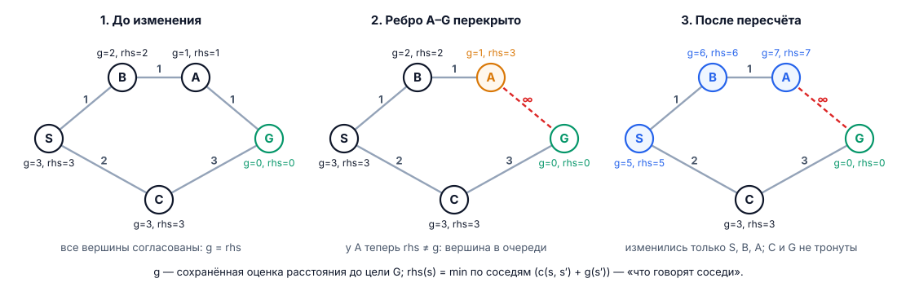
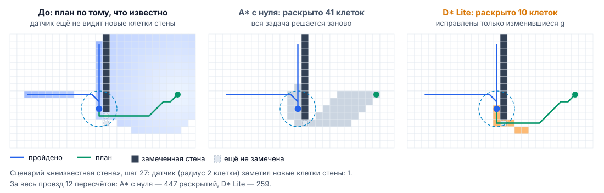
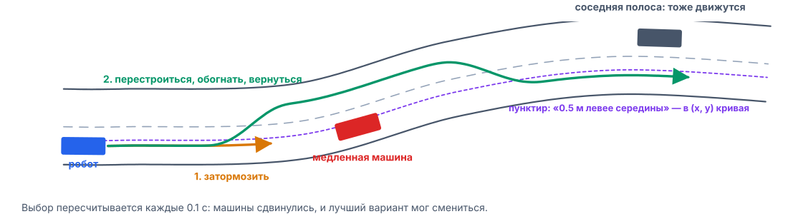
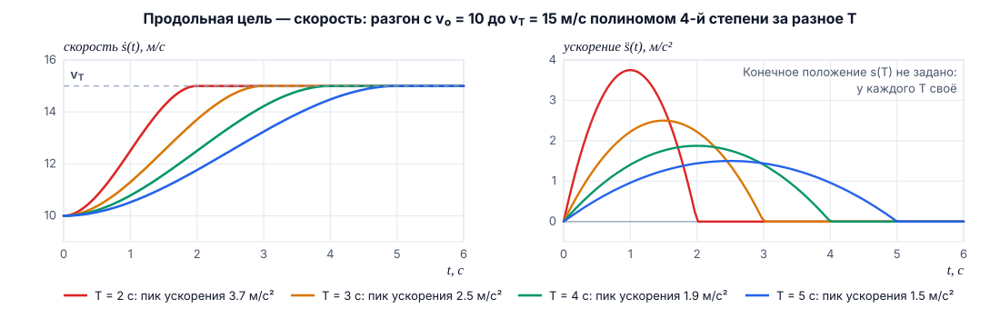
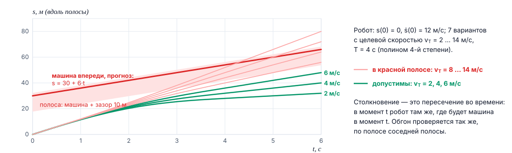
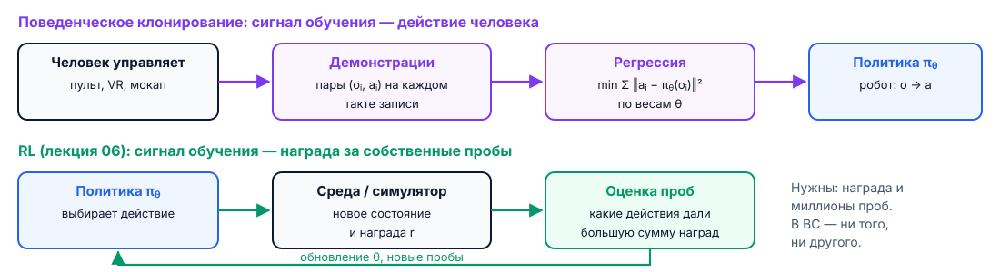
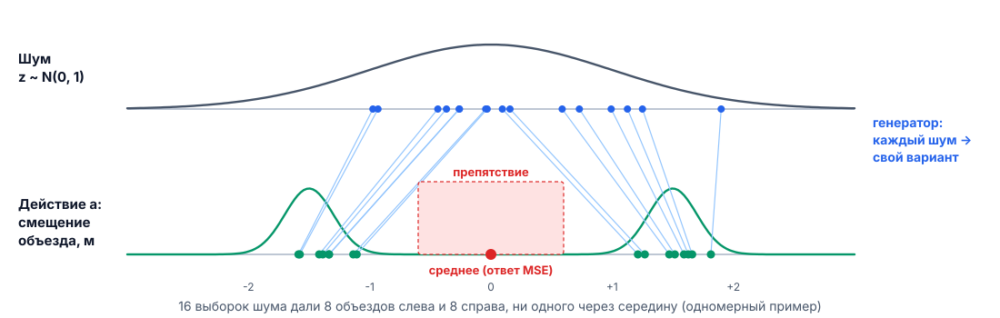
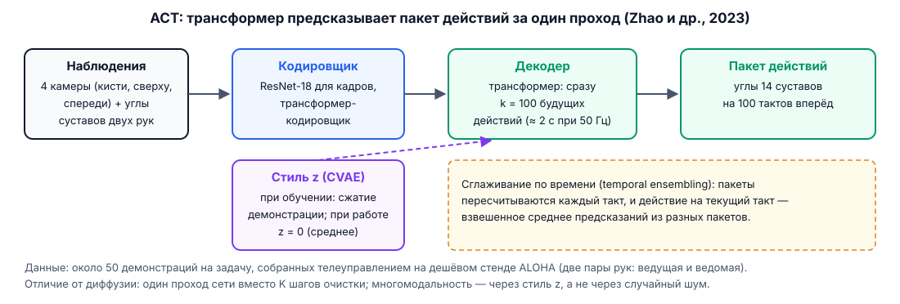
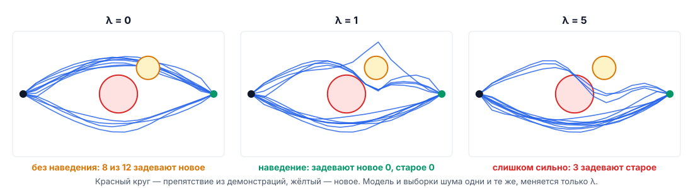

<!-- _class: lead -->
<!-- _header: "" -->
<!-- _footer: "" -->

# **Планирование движений мобильных роботов**
## Лекция 07: Продвинутые алгоритмы: D* Lite, планирование в координатах Френе, диффузионные политики и NoMaD

90 минут
Как перепланировать на ходу, планировать манёвры и учиться движению по примерам
D* Lite • координаты Френе • имитация • диффузия • ACT • NoMaD

---

## Место лекции в курсе 01–03 мин

**Что уже умеем.** Найти путь ($A^*$, RRT, лекции 02–04) и задать по нему профиль скорости (лекция 02), ехать с учётом модели (DWA, MPPI, лекция 04), оптимизировать движение (MPC, лекция 05), обучать политику пробами и ошибками (RL, лекция 06).

**Чего не хватает.** Как быстро перепланировать, когда карта меняется в пути? Как планировать манёвры среди движущихся машин: обгонять, перестраиваться? Как научить робота по **примерам** человека, а не по награде?

---

<!-- _class: fs-4 -->

## План лекции 03–05 мин

### Четыре части
1. **D\* Lite: перепланирование** (05–24 мин): как не искать путь заново, когда карта изменилась.
2. **Планирование в координатах Френе** (24–44 мин): дорога как прямая полоса, полиномы, веер вариантов.
3. **Обучение по демонстрациям и диффузия** (44–77 мин): почему копировать трудно, как генерировать действия из шума, ACT.
4. **NoMaD: навигация по изображениям** (77–85 мин): диффузионная политика на реальном роботе.

### Как читать слайды
Как и в лекциях 05–06, каждый новый термин вводится в фиолетовом блоке: смысл словами, формула, пример.

Части 1–2 — классические методы с точным расчётом. Части 3–4 — обучаемые методы последних лет.

### Три интерактивные модели
D\* Lite на сетке, планировщик Френе на дороге и диффузионная политика объезда препятствия. Все расчёты в них — точные, без заготовленных картинок.

---

<!-- _class: fs-4 -->

## Часть 1. Карта меняется в пути 05–08 мин

### Новая задача
В лекции 02 $A^*$ искал путь по **известной** карте. В жизни карта неполная: робот на складе видит закрытую дверь, только подъехав к ней; марсоход узнаёт о камне, когда камень попал в камеру. Каждое новое наблюдение меняет стоимость нескольких клеток, и путь нужно **перепланировать**.

### Термин: перепланирование
Поиск нового пути после того, как карта изменилась. Робот при этом уже стоит не в начале, а там, куда успел доехать.

### Простое решение и его цена
Запускать $A^*$ **с нуля** после каждого изменения. Это верно, но расточительно: изменилось 1–3 клетки, а алгоритм заново раскрывает сотни клеток, большая часть которых даёт те же числа, что и в прошлый раз.

### Идея инкрементального поиска
Сохранить результаты прошлого поиска и **исправить только то, что изменилось**. Так работают D\* (Stentz, 1994) и более простой D\* Lite (Koenig, Likhachev, 2002). Вариант этого семейства, Field D\*, планировал путь на борту марсоходов Spirit и Opportunity.

---

## Два числа в каждой вершине: g и rhs 08–12 мин

**Термин: $g(s)$** — запомненная оценка расстояния от вершины $s$ **до цели**. Поиск идёт от цели к роботу (обратный поиск), поэтому значения не портятся, когда робот едет.

**Термин: $rhs(s)$** — что «говорят соседи»: $rhs(s) = \min_{s'} \big(c(s, s') + g(s')\big)$. Для цели $rhs = 0$. Это один шаг формулы Беллмана из лекции 02.

**Термин: согласованная вершина** — та, у которой $g = rhs$. Несогласованные вершины ставятся в очередь и исправляются; согласованные не трогаются.

---

<!-- _class: fs-4 -->

## Алгоритм D* Lite по шагам 12–15 мин

### Цикл работы
1. **Первый поиск** от цели: как $A^*$ в обратную сторону. Все вершины на пути согласованы.
2. **Робот едет** по вершинам с наименьшим $c(s, s') + g(s')$.
3. **Датчик заметил изменение**: пересчитать $rhs$ у изменившихся клеток и их соседей; несогласованные — в очередь.
4. **Исправлять** вершины из очереди, пока в ней есть ключи меньше ключа робота или сама вершина робота несогласована. Вернуться к шагу 2.

### Термин: ключ вершины
Порядок в очереди, как $f = g + h$ у $A^*$:
$$k(s) = \big[\min(g, rhs) + h(s_{\text{робот}}, s) + k_m;\ \min(g, rhs)\big].$$
Эвристика $h$ считается до **робота**, потому что поиск идёт от цели к нему.

**Поправка $k_m$.** Робот сдвинулся, и старые ключи в очереди посчитаны от прежней точки. Вместо пересчёта всей очереди к ключам прибавляют $k_m \mathrel{+}= h(s_{\text{было}}, s_{\text{стало}})$.

---

## Пример: A* с нуля и D* Lite 15–18 мин

**Что видно.** Путь после пересчёта у обоих одинаковый: D\* Lite находит тот же кратчайший путь. Но $A^*$ раскрыл 41 клетку, а D\* Lite — 10: только те, чьё расстояние до цели действительно изменилось.

**За весь проезд** 12 пересчётов: 447 раскрытий у $A^*$ против 259 у D\* Lite (первый поиск, общий для обоих, не считаем). Числа печатает генератор схем; ту же задачу можно прогнать в модели на следующем слайде.

---

## Интерактивная модель: D* Lite 18–22 мин

<i class="interactive-dot"></i> Робот с датчиком едет по неизвестной карте и перепланирует
Пять сценариев; щелчок по клетке ставит или убирает препятствие

<iframe src="http://localhost:5599/widgets/dstar-lite/index.html" class="interactive-frame"></iframe>

---

<!-- _class: fs-4 -->

## Когда D* Lite выгоден, а когда нет 22–24 мин

### Выгоден
- Изменения **мелкие и рядом с роботом**: датчик видит клетку-две за раз (сценарии 1–3 модели: в 1.6–2.3 раза меньше раскрытий).
- Карта большая, а перепланировать нужно часто.
- Поиск идёт от цели, поэтому движение робота само по себе ничего не портит.

### Не выгоден
- Перекрыт **единственный проход** (сценарий 5 «закрытая дверь»): меняется расстояние до цели почти у всех вершин, и D\* Lite раскрывает **больше**, чем $A^*$ с нуля (185 против 96).
- Карта известна заранее (сценарий 4): пересчётов нет, выигрыша нет.
- Нужна память на $g$ и $rhs$ для всех вершин.

**В навигационных пакетах** (например, ROS 2 Nav2) глобальный путь чаще просто пересчитывают с нуля на небольшой сетке; инкрементальный поиск нужен, когда карта велика, а вычислитель слаб.

---

## Часть 2. Задача: движение по дороге 24–26 мин

**Новая задача.** Робот-автомобиль едет по полосе, впереди медленная или стоящая машина. Решить: тормозить, перестроиться, вернуться в полосу. Решение пересчитывается **10 раз в секунду**: другие участники движутся.

**Почему в $(x, y)$ неудобно.** Дорога изгибается. Фраза «держись в 0.5 м левее середины полосы» в $(x, y)$ — сложная кривая, своя на каждом повороте (фиолетовый пунктир).

**Идея.** Координаты, **привязанные к дороге**: сколько проехали вдоль неё и насколько сместились вбок. Любая дорога становится прямой полосой, а «перестроиться» — изменением одного числа (Werling, Ziegler, Kammel, Thrun, 2010).

---

## Координаты Френе 26–29 мин

**Термин: опорная линия** $r(s)$ — середина полосы, заданная картой. Параметр $s$ — длина вдоль неё.

**Термин: координаты Френе** $(s, d)$: $s$ — продольная координата, $d$ — поперечное смещение со знаком (влево $d > 0$).

**Ограничение.** При $d = 1/\kappa_r$ (центр кривизны опорной линии) переход вырождается: точка $(x, y)$ перестаёт однозначно проецироваться на линию, а в формуле кривизны траектории появляется деление на $1 - \kappa_r d = 0$. На крутых поворотах и парковках метод неудобен.

---

## Полином 5-й степени для перестроения 29–33 мин

**Термин: краевые условия.** В начале и в конце манёвра заданы смещение, скорость и ускорение: $d(0), \dot d(0), \ddot d(0)$ и $d(T), \dot d(T), \ddot d(T)$ — шесть чисел. Полином $d(t) = c_0 + c_1 t + \dots + c_5 t^5$ имеет шесть коэффициентов: система из шести линейных уравнений.

**Почему именно 5-я степень.** Из всех кривых с этими краевыми условиями она имеет наименьший $\int_0^T \dddot{d}^{\,2} dt$ — самое плавное движение (Flash, Hogan, 1985). Здесь $j = \dddot{d}$ — **рывок**, скорость изменения ускорения (м/с³). Короче манёвр — резче: $\int j^2 \propto 1/T^5$, а пик рывка $\propto 1/T^3$.

---

## Продольное движение: держать скорость 33–35 мин

**Два независимых движения.** Поперечное $d(t)$ — полином 5-й степени к смещению $d_T$ (своя полоса, соседняя, объезд). Продольное $s(t)$ — к **скорости** $v_T$; где именно окажемся, не важно.

**Полином 4-й степени для $s(t)$.** Известны $s(0), \dot s(0), \ddot s(0)$, а в конце только $\dot s(T) = v_T$ и $\ddot s(T) = 0$. Пять условий — пять коэффициентов. Цели «ехать за машиной» и «встать у стоп-линии» снова дают 5-ю степень.

**Сборка траектории.** Для каждого $t$ берём $s(t)$, $d(t)$ и переводим в $(x, y)$: $P = r(s) + d \cdot n(s)$, где $n(s)$ — единичный вектор влево от линии. Время известно в каждой точке.

---

## Веер вариантов и выбор лучшего 35–38 мин

**Термин: веер кандидатов.** Перебираем конечное смещение $d_T$, время $T$ и скорость $v_T$; каждая комбинация — своя траектория. Как DWA (лекция 04), только варианты — гладкие полиномы на несколько секунд.

**Стоимость** $J = k_j \int j^2 dt + k_t T + k_d d_T^2 + k_v (v_{des} - v_T)^2$: плавность, быстрота, близость к середине полосы, желаемая скорость. Рывок штрафуют и для поперечного $d(t)$, и для продольного $s(t)$ полинома, затем стоимости складывают. Выбираем допустимый вариант с наименьшим $J$.

---

## Проверка вариантов и цикл перепланирования 38–40 мин

**Вариант отбрасывается,** если превышены скорость или ускорение ($v_{lim}$ из лекции 02), кривизна больше, чем позволяет руль, есть выезд за край дороги или **столкновение во времени** (рисунок).

**Термин: прогноз движения участников.** Предположение, где будут другие машины через $t$ секунд. Простейший — «едут с постоянной скоростью». Ошибки прогноза исправляются частым пересчётом.

**Цикл.** Каждые 0.1 с: измерить состояние → построить веер (десятки–сотни вариантов) → отбросить недопустимые → выбрать лучший → исполнить начало. Это **скользящий горизонт**, как у MPC в лекции 05.

---

## Интерактивная модель: планировщик Френе 40–43 мин

<i class="interactive-dot"></i> Веер полиномов на дороге, пересчёт 10 раз в секунду
Сценарии: стоящая машина, медленная машина, занятая левая полоса, слалом. Щелчок по дороге добавляет препятствие

<iframe src="http://localhost:5599/widgets/frenet-planner/index.html" class="interactive-frame"></iframe>

---

## Френе среди других методов 43–44 мин

<!-- _class: fs-4 -->

| | Френе (веер полиномов) | Решётка состояний, Hybrid A* | MPC |
| :--- | :--- | :--- | :--- |
| Что ищется | лучший из сотен полиномов | путь по сетке манёвров | оптимум гладкой задачи |
| Нужна опорная линия | да | нет | желательна |
| Сильная сторона | быстро, плавно, время учтено явно | любые развороты, парковка | точные ограничения модели |
| Слабая сторона | крутые повороты, перекрёстки | грубая по времени | локальный минимум, нужен хороший старт |
| Где применяют | шоссе, полосы склада | парковки, узкие места | следование выбранной траектории |

На практике их сочетают: веер Френе выбирает **манёвр** (обгон или торможение), MPC (лекция 05) аккуратно его **исполняет**.

---

## Часть 3. Обучение по демонстрациям 44–47 мин

**Когда формулы не помогают.** Разложить посуду, проехать по людному коридору, открыть дверь: записать стоимость $J$ (часть 2) или награду (лекция 06) трудно. Зато человек легко **покажет**, как надо.

**Термин: демонстрация.** Запись того, как человек управлял роботом: пары «наблюдение $o$ — действие $a$» на каждом такте. Набор демонстраций — обучающие данные.

**Термин: поведенческое клонирование (BC).** Обучить политику $\pi_\theta(o)$ повторять действия человека, как в регрессии: $\min_\theta \sum_i \| a_i - \pi_\theta(o_i) \|^2$. Первый пример — ALVINN (1989): сеть вела автомобиль по изображению с камеры.

---

## Проблема 1: накопление ошибок 47–50 мин

**Термин: сдвиг распределения.** Политика ошиблась немного → попала в состояние, которого не было в демонстрациях (эксперт туда не заезжал) → там ошибается сильнее. Ошибки складываются: $\sim \varepsilon T^2$ за эпизод длины $T$.

**Термин: DAgger** (Ross и др., 2011). Пустить обученную политику, а эксперта попросить подписать **правильные действия в посещённых ею состояниях**. Добавить в данные, переобучить. Рост ошибок становится линейным, $\sim \varepsilon T$.

---

## Проблема 2: несколько правильных ответов 50–52 мин

**Термин: многомодальное распределение.** У задачи несколько разных правильных ответов (моды): объехать слева или справа. Демонстрации содержат оба.

**Почему регрессия ломается.** Минимум средней квадратичной ошибки — это **среднее** всех ответов. Среднее двух объездов — прямо в препятствие. Нужна модель, которая выдаёт **один** вариант из нескольких.

---

## Идея генеративной модели 52–54 мин

**Термин: генеративная модель.** Не предсказывает одно число, а **выдаёт случайные примеры**, похожие на обучающие данные: $a \sim p(a \mid o)$. Каждый запуск — свой вариант. Так генерируют изображения по тексту.

**Термин: нормальное распределение $\mathcal{N}(0, I)$.** «Чистый шум»: каждое число случайно, около нуля, с разбросом 1. Сгенерировать его компьютер умеет легко.

**План.** Научиться превращать шум в правдоподобное действие: разный шум — то объезд слева, то справа, но не их среднее. **Диффузионная модель** делает это за $K$ маленьких шагов очистки от шума (Ho, Jain, Abbeel, 2020).

---

## Прямой процесс: портим данные шумом 54–57 мин

**Термин: прямой процесс.** Берём траекторию $y_0$ из демонстрации и подмешиваем шум: $y_k = \sqrt{\bar\alpha_k}\, y_0 + \sqrt{1 - \bar\alpha_k}\, \varepsilon$.

**Термин: расписание шума** $\bar\alpha_k$: от 1 (нет шума) до 0 (чистый шум) за $k = 1 \dots K$ шагов.

**Обучение.** Сеть $\varepsilon_\theta(y_k, k, o)$ угадывает, **какой шум** добавили. Ошибка — обычная MSE по шуму.

---

## Обратный процесс: шаг за шагом убираем шум 57–60 мин

**Термин: обратный процесс.** Начинаем с шума $y_K$. На каждом шаге сеть оценивает шум, мы вычитаем его часть и добавляем немного нового ($\sigma_k z$). После $K$ шагов — правдоподобная траектория.

**Почему нет среднего.** Ранние шаги «выбирают сторону» случайно; дальше каждый шаг только уточняет выбранный вариант. Здесь 4 объезда слева, 6 справа, через препятствие — ни одного.

---

## Диффузионная политика 60–63 мин

**Термин: диффузионная политика** (Diffusion Policy; Chi и др., 2023). Диффузионная модель, которая генерирует не картинку, а **последовательность действий** робота. Условие — наблюдения $o$: кадры камеры и положение робота за 2 последних такта.

**Устройство.** Сеть — одномерная U-Net по времени; наблюдения подмешиваются в каждый её слой. При обучении $K = 100$ шагов шума, при работе часто 10 шагов ускоренной схемой (DDIM), чтобы успевать за такт управления.

---

## Пакеты действий 63–65 мин

**Термин: пакет действий** (action chunk): сразу $H = 16$ будущих действий, из них исполняются первые $n_a = 8$.

**Зачем.** Внутри пакета движение согласовано: робот не «передумывает» каждый такт между левым и правым объездом.

**Связь с MPC.** Предсказать на горизонт, исполнить начало, пересчитать: та же схема, что в лекции 05 и в части 2.

---

## ACT: пакет действий без диффузии 65–68 мин

**Термин: ACT** (Action Chunking with Transformers; Zhao, Kumar, Levine, Finn, 2023). Трансформер по кадрам камер сразу выдаёт пакет из $k = 100$ действий. Один проход сети вместо $K$ шагов очистки.

**Термин: стиль $z$** (из CVAE, условного вариационного автокодировщика). При обучении $z$ кодирует «манеру» конкретной демонстрации (например, объезд слева или справа). Различия между демонстрациями уходят в $z$, поэтому декодер при заданном $z$ решает почти одномодальную задачу и не усредняет моды. При работе $z = 0$.

**Термин: сглаживание по времени** (temporal ensembling). Пакет пересчитывают каждый такт; действие на текущий такт — взвешенное среднее предсказаний из перекрывающихся пакетов. **Результат:** на стенде ALOHA за 50 демонстраций — тонкие задачи двумя руками (вставить батарейку, открыть крышку стаканчика).

---

## Согласование потоков: меньше шагов 68–70 мин

**Термин: согласование потоков** (flow matching; Lipman и др., 2023). Сеть учит **поле скоростей** $v_\theta(y, \tau)$: куда двигать точку, чтобы из шума ($\tau = 0$) прийти в данные ($\tau = 1$). Генерация — решение дифференциального уравнения $\dot y = v_\theta$ без случайности.

**Плюс.** Пути почти прямые, поэтому хватает нескольких шагов (5–10 вместо 100). Этот способ используют современные модели «зрение–язык–действие» (лекция 08).

---

## Наведение: учесть новое препятствие без переобучения 70–72 мин

**Термин: наведение (guidance).** На каждом шаге обратного процесса добавить к шагу сети сдвиг **против градиента стоимости** $c(y)$: $\;y \leftarrow y_{\text{шаг сети}} - \lambda \nabla c(y)$. Стоимость — штраф за близость к препятствию, которого не было в демонстрациях.

**Что получаем.** Модель знает, **как** обычно ездят (из демонстраций), а стоимость говорит, **что сейчас** нельзя. Траектории похожи на человеческие, но обходят новое препятствие (идея Diffuser, Janner и др., 2022).

**Слишком большой $\lambda$** выталкивает траекторию из области данных: она становится «нечеловеческой» и может нарушить то, что модель знала, — на рисунке справа выборки задевают старое препятствие.

---

## Интерактивная модель: диффузионная политика объезда 72–77 мин

<i class="interactive-dot"></i> MSE, диффузия (DDPM) и согласование потоков на одних данных
Меняйте долю левых объездов, число шагов K и силу наведения λ; перетащите жёлтое препятствие

<iframe src="http://localhost:5599/widgets/diffusion-policy-interactive/index.html" class="interactive-frame"></iframe>

---

## Часть 4. Навигация по изображениям: топологическая карта 77–79 мин

**Термин: топологическая карта.** Граф без точных координат: узел — запомненный кадр камеры, ребро — «от этого кадра можно доехать до того». Путь по графу ищется $A^*$ из лекции 02.

**Термин: цель-изображение.** Цель задаётся фотографией места, а не координатами. Робот едет «туда, где выглядит вот так».

---

## NoMaD: одна сеть для цели и для исследования 79–82 мин

**Кодировщик.** EfficientNet-B0 сжимает каждый кадр в вектор. Цель подаётся вместе с текущим кадром: два изображения складывают по каналам до отдельного кодировщика цели, чтобы сеть видела их взаимное расположение. Трансформер объединяет все векторы.

**Термин: маска цели.** При $m = 1$ цель скрыта, и сеть генерирует **разведку**: любые безопасные движения. При обучении маска включается с вероятностью 0.5.

**Действия** генерирует диффузия, как в части 3. Объезд слева и справа — разные выборки, а не их среднее.

---

<!-- _class: fs-4 -->

## NoMaD: результаты и пределы 82–85 мин

### Что показали авторы (Sridhar, Shah, Glossop, Levine, 2024)
- Обучение на **более чем 100 часах** записей разных роботов (наборы GNM и SACSoN): одна политика для разных платформ.
- Сеть на 19 млн параметров работает на бортовом компьютере робота.
- В исследовании незнакомых помещений: успех 98 % против 77 % у схемы «генерация промежуточного изображения-цели + политика», где одна генеративная модель имеет 335 млн параметров.

### Пределы
- Нет гарантий: безопасность проверена экспериментами, а не доказана.
- Качество зависит от данных: в непохожей среде (другая высота камеры, освещение) поведение ухудшается.
- Нет метрической карты: точно встать в заданную точку трудно.

**Как применяют.** Обучаемая политика внутри классической системы: глобальный граф, фильтр безопасности (лекция 06), ограничение скоростей (лекция 02).

---

## Сводка методов лекции 85–87 мин

<!-- _class: fs-4 -->

| Метод | Что на входе | Что на выходе | Когда применять |
| :--- | :--- | :--- | :--- |
| D\* Lite | сетка, изменения карты от датчика | кратчайший путь после каждого изменения | карта неизвестна заранее, частые мелкие изменения |
| Френе | опорная линия, участники движения | манёвр на 2–5 с | дороги, полосы, коридоры склада |
| Клонирование (BC) | демонстрации | политика | одна мода, много данных |
| Диффузионная политика | демонстрации, наблюдения | пакет действий | несколько способов решения, манипуляция |
| ACT | демонстрации, кадры камер | пакет из 100 действий за один проход | манипуляция двумя руками, мало данных |
| Согласование потоков | то же | то же за меньшее число шагов | нужна высокая частота |
| NoMaD | кадры камеры, цель-фото | движение или разведка | навигация без метрической карты |

---

<!-- _class: fs-3 -->

## Итоги лекции и контрольные вопросы 87–89 мин

### Итоги
- D\* Lite хранит $g$ и $rhs$ и при изменении карты исправляет только несогласованные вершины.
- Координаты Френе превращают дорогу в прямую полосу; манёвры — полиномы 5-й и 4-й степени; лучший выбирается из веера по стоимости.
- Клонирование страдает от накопления ошибок и усреднения мод.
- Диффузия и согласование потоков генерируют один правдоподобный вариант из нескольких; ACT выдаёт пакет действий за один проход.
- NoMaD — пример диффузионной политики для навигации по камере.

### Контрольные вопросы
1. Почему D\* Lite ищет от цели к роботу, а не наоборот?
2. Когда D\* Lite раскрывает больше вершин, чем $A^*$ с нуля?
3. Зачем переходить от координат $(x, y)$ к координатам Френе?
4. Почему для перестроения нужен полином именно 5-й степени?
5. Почему проверять столкновения нужно во времени, а не только по форме пути?
6. Почему регрессия по MSE ведёт в препятствие, а диффузия — нет?
7. Что делает маска цели в NoMaD?

---

## Словарь терминов лекции

<!-- _class: fs-2 -->

### Перепланирование и Френе
- **Перепланирование**, **инкрементальный поиск**.
- **$g$**, **$rhs$**, **согласованная вершина**, **ключ**, **$k_m$**.
- **Опорная линия** $r(s)$, **координаты** $(s, d)$.
- **Краевые условия**, **полином 5-й степени**, **рывок**.
- **Продольное и поперечное движение**.
- **Веер кандидатов**, **стоимость** $J$.
- **Прогноз движения участников**.
- **Скользящий горизонт**.

### Обучение по демонстрациям
- **Демонстрация**, **поведенческое клонирование**.
- **Сдвиг распределения**, **DAgger**.
- **Многомодальное распределение**.
- **ACT**, **стиль $z$ (CVAE)**, **сглаживание по времени**.

### Генеративные политики и NoMaD
- **Генеративная модель**, **нормальное распределение**.
- **Прямой и обратный процесс**, **расписание шума**.
- **Диффузионная политика**, **пакет действий**.
- **Согласование потоков**, **наведение**.
- **Топологическая карта**, **цель-изображение**, **маска цели**.

---

## Литература

<!-- _class: compact fs-3 -->

### Перепланирование
- Stentz A. Optimal and efficient path planning for partially-known environments // ICRA. 1994.
- Koenig S., Likhachev M. D\* Lite // AAAI. 2002.
- Koenig S., Likhachev M., Furcy D. Lifelong Planning A* // Artificial Intelligence. 2004. Vol. 155.
- Carsten J., Rankin A., Ferguson D., Stentz A. Global path planning on board the Mars Exploration Rovers // IEEE Aerospace Conference. 2007.

### Координаты Френе
- Flash T., Hogan N. The coordination of arm movements // J. Neuroscience. 1985. Vol. 5, № 7.
- Werling M., Ziegler J., Kammel S., Thrun S. Optimal trajectory generation for dynamic street scenarios in a Frenét frame // ICRA. 2010.
- Lynch K. M., Park F. C. *Modern Robotics.* — Cambridge University Press, 2017. Гл. 9.

### Обучение по демонстрациям и диффузия
- Pomerleau D. ALVINN: An autonomous land vehicle in a neural network // NIPS. 1989.
- Ross S., Gordon G., Bagnell J. A. A reduction of imitation learning and structured prediction to no-regret online learning // AISTATS. 2011.
- Ho J., Jain A., Abbeel P. Denoising diffusion probabilistic models // NeurIPS. 2020.
- Janner M. et al. Planning with diffusion for flexible behavior synthesis // ICML. 2022.
- Lipman Y. et al. Flow matching for generative modeling // ICLR. 2023.
- Chi C. et al. Diffusion Policy: Visuomotor policy learning via action diffusion // RSS. 2023.
- Zhao T. Z., Kumar V., Levine S., Finn C. Learning fine-grained bimanual manipulation with low-cost hardware (ACT) // RSS. 2023.
- Shah D. et al. GNM: A general navigation model to drive any robot // ICRA. 2023.
- Sridhar A., Shah D., Glossop C., Levine S. NoMaD: Goal masked diffusion policies for navigation and exploration // ICRA. 2024.

