<!-- _class: lead -->
<!-- _header: "" -->
<!-- _footer: "" -->

# **Планирование движений мобильных роботов**
## Лекция 08: Антропоморфные роботы: от точки нулевого момента до моделей «зрение–язык–действие»

90 минут
Как научили ходить машину на двух ногах и что умеют гуманоиды сегодня
ZMP • точка захвата • WBC • обучение по движениям человека • Helix • VLA • WAM • компании и Россия

---

## Место лекции в курсе 01–03 мин

### Что уже умеем
- Найти путь и место для шагов (лекции 02–03).
- Учесть модель движения и выбрать управление (лекции 04–05).
- Обучить политику наградой (лекция 06) и по демонстрациям (лекция 07).

### Вопрос этой лекции
Человекоподобный робот — самый трудный мобильный робот: он **неустойчив сам по себе** и у него десятки суставов. Как с ним справлялись раньше, к чему пришли сейчас и какие задачи остаются открытыми?

### Термин: антропоморфный робот (гуманоид)
Робот с телом, похожим на человеческое: две ноги, корпус, две руки, голова с камерами.

### Термин: степень свободы
Одно независимое движение, например поворот в одном суставе. У современных гуманоидов 25–45 степеней свободы; у человека — больше 200.

---

## План лекции 03–04 мин

### Пять частей
1. **Как научили ходить** (04–27 мин): устойчивость, ZMP, модель перевёрнутого маятника, точка захвата.
2. **Путь Boston Dynamics и модельное управление** (27–40 мин): прыгающие роботы, DARPA, полнотельное управление.
3. **Обучение** (40–60 мин): RL по движениям человека, Helix, VLA, модели мира.
4. **Компании и Россия** (60–80 мин): кто что делает, честная оценка.
5. **Открытые проблемы и итоги** (80–90 мин).

### Как читать слайды
Как и раньше, новые термины — в фиолетовых блоках. Модели в первой части выводятся из школьной механики.

### Осторожно с новостями
Во второй половине лекции много сведений от компаний. Мы будем отмечать, где **измерено независимо**, а где **заявлено компанией**, и обсудим, как отличить автономию от телеуправления.

---

## Зачем роботу человеческое тело 04–06 мин

### Доводы «за»
- **Мир устроен под человека:** лестницы, двери, полки, инструменты, кабины машин. Колёсный робот там застревает.
- **Данные:** миллионы часов видео, где люди что-то делают. Тело, похожее на человеческое, проще учить по этим примерам (часть 3).
- **Одна платформа — много задач:** вместо отдельного станка для каждой операции.

### Доводы «против»
- **Неустойчивость:** стоит выключить управление — робот падает. Колёсный робот просто остановится.
- **Сложность:** десятки суставов, у каждого привод, датчики, нагрев.
- **Цена и надёжность:** для одной операции на конвейере дешевле обычный манипулятор.

Где именно гуманоид окупится — главный открытый вопрос отрасли (часть 5).

---

## Пять десятилетий гуманоидов 06–08 мин

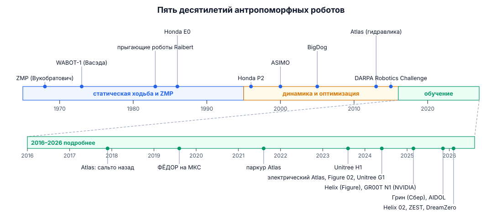

**1970–1995: статическая ходьба и ZMP.** WABOT-1 (Университет Васэда, 1973) шагал медленно, перенося вес полностью на одну ногу.

**1995–2015: динамика и оптимизация.** Honda P2 (1996), ASIMO (2000), DARPA Robotics Challenge (2015).

**С 2016: обучение.** RL в симуляторе, движения людей, большие модели «зрение–язык–действие».

---

## Часть 1. Статическая и динамическая устойчивость 08–12 мин

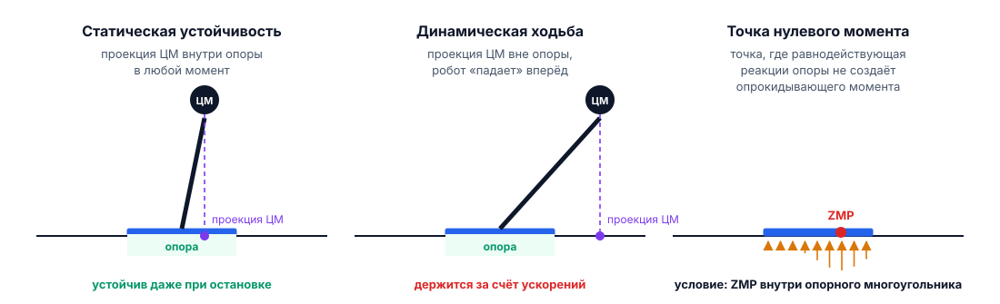

**Термин: опорный многоугольник** — фигура, натянутая на точки касания стоп с полом. **Статическая устойчивость:** проекция центра масс (ЦМ) внутри него.

**Термин: точка нулевого момента (ZMP)** — точка на полу, где сила реакции не создаёт опрокидывающего момента. Предложена М. Вукобратовичем (1968–1972).

**Условие ZMP:** при движении ЦМ может выходить из опоры, лишь бы ZMP оставался **строго внутри** стопы. Тогда стопа не опрокидывается.

---

## Модель перевёрнутого маятника (LIPM) 12–16 мин

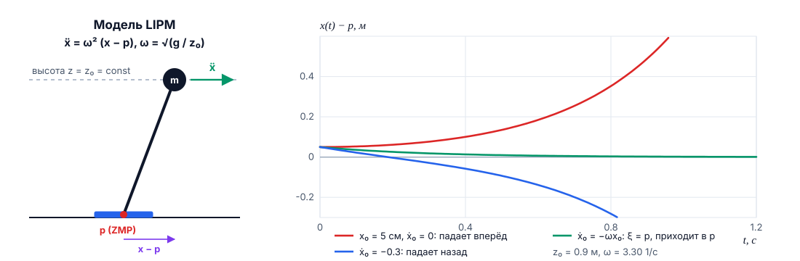

**Термин: линейный перевёрнутый маятник (LIPM).** Вся масса $m$ — в точке на **постоянной** высоте $z_0$, ноги невесомы (Kajita, 1991–2001).

**Вывод у доски.** Сила опоры направлена из ZMP $p$ в ЦМ; её горизонтальная часть относится к $mg$ как $(x - p)$ к $z_0$: $\ddot{x} = \omega^2 (x - p)$, $\omega = \sqrt{g/z_0}$. При $z_0 = 0.9$ м $\omega = 3.30$ 1/с.

**Смысл.** ЦМ «отталкивается» от ZMP: если $x > p$, робот ускоряется вперёд. Сдвигая $p$ голеностопом, им управляют, но только в пределах стопы.

---

## Ходьба как цепочка маятников 16–19 мин

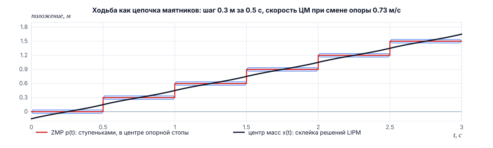

**Термин: шаговый цикл.** ZMP стоит в опорной стопе, ЦМ «перекатывается» над ней; в момент смены опоры ZMP скачком переходит в новую стопу. Решения LIPM на каждом шаге склеиваются: здесь шаг 0.3 м за 0.5 с.

**Как планировали ходьбу (Kajita, 2003).** Задать ZMP ступеньками по плану шагов и найти ЦМ, который их обеспечивает, с **прогнозом** на 1–2 шага вперёд. Это MPC из лекции 05 для простой модели. Так ходил ASIMO.

---

## Точка захвата: куда шагнуть, чтобы остановиться 19–22 мин

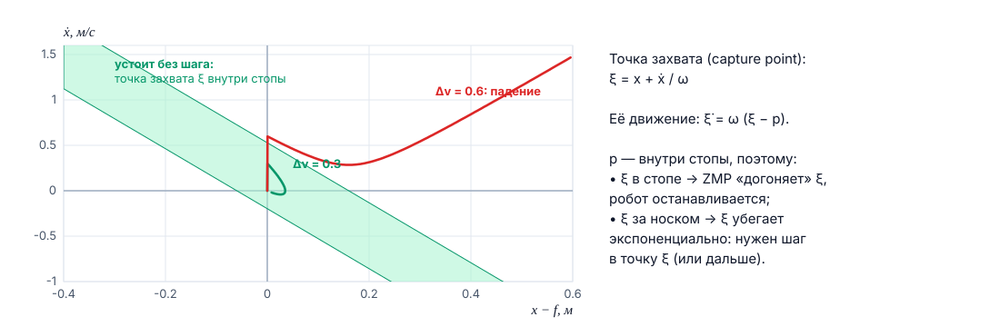

**Термин: точка захвата** (capture point; Pratt и др., 2006): $\xi = x + \dot{x}/\omega$. Место на полу, куда надо поставить ZMP, чтобы маятник **остановился** ровно над ним.

**Почему она главная.** Из LIPM: $\dot{\xi} = \omega(\xi - p)$. ZMP «притягивает» $\xi$ только изнутри стопы. Если $\xi$ ушла за носок, устоять без шага **нельзя**: новая стопа должна накрыть $\xi$.

---

## Интерактивная модель: толчок и шаг в точку захвата 22–25 мин

<i class="interactive-dot"></i> LIPM: голеностоп, шаг в точку захвата, шаг фиксированной длины
Сценарии: слабый толчок, сильный без шага, шаг в ξ, серия шагов, «неправильный» шаг

<iframe src="http://localhost:5599/widgets/lipm-capture-point/index.html" class="interactive-frame"></iframe>

---

## Почему классические гуманоиды ходили «на полусогнутых» 25–27 мин

### Цена простой модели
- **Постоянная высота ЦМ** в LIPM: колени всегда согнуты, ходьба неестественная и энергозатратная.
- **Плоская стопа и ровный пол:** ZMP требует полного касания стопой; ступенька, рыхлый грунт или скольжение ломают предпосылки модели.
- **Жёсткие приводы с большим передаточным числом:** точно отрабатывают углы, но не «пружинят» при неожиданном ударе.

### Что сделали дальше
- Учли высоту и вращение корпуса: **центроидная динамика** — модель движения ЦМ и момента импульса всего тела.
- Обобщили точку захвата в 3D: **дивергентная компонента движения** (DCM, Englsberger и др., 2015).
- Перешли к приводам с малым передаточным числом и измерением момента: удар отдаётся в мотор, а не ломает редуктор.

---

## Часть 2. Raibert: прыжок вместо медленного шага 27–30 мин

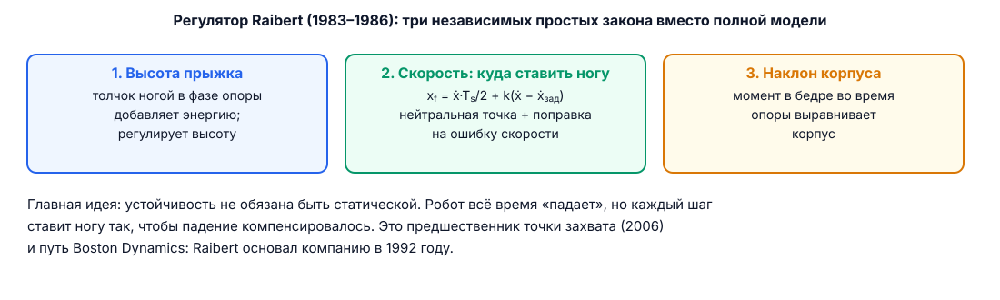

**Термин: динамическая устойчивость.** Робот устойчив **в движении**, а не в каждый момент: он всё время падает и ловит себя ногой. Одноногий прыгающий робот М. Рейберта (Университет Карнеги–Меллон, затем MIT, 1983–1986) не мог стоять вообще, но прыгал часами.

**Три простых закона** вместо полной модели: высота прыжка — толчком ноги; скорость — местом постановки ноги (по сути, точка захвата); наклон корпуса — моментом в бедре в фазе опоры. В 1992 г. Рейберт основал Boston Dynamics.

---

## Путь Boston Dynamics 30–32 мин

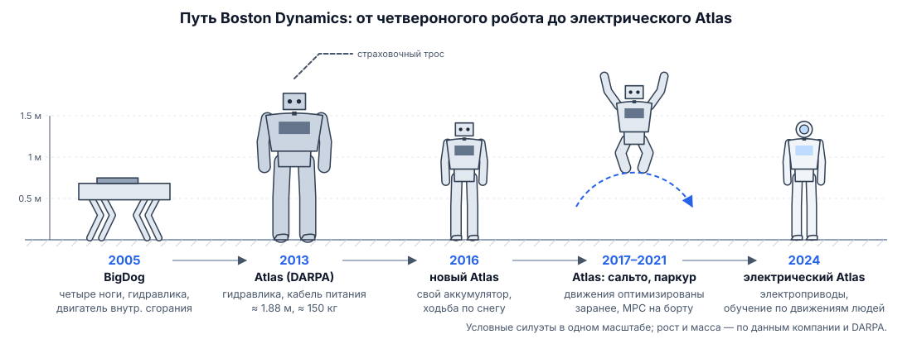

**Подход BD до 2022 г.:** точная модель + оптимизация траекторий заранее + MPC на роботе. Эффектные трюки, но каждое новое движение требовало долгой работы инженеров.

**Дальше:** в 2021 г. компанию купила Hyundai; в 2024 г. гидравлику заменили электроприводами, и компания тоже перешла к обучению (часть 3).

---

## Урок DARPA Robotics Challenge 2015 32–34 мин

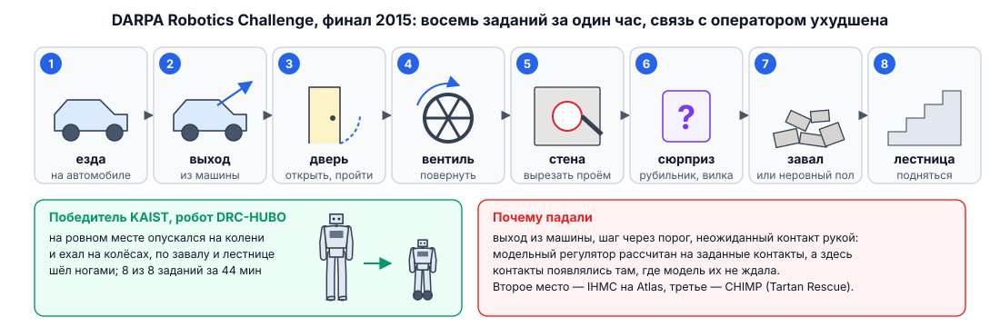

**Зачем.** Соревнование устроили после аварии на АЭС «Фукусима» (2011): робот должен работать там, где опасно человеку. Операторы управляли почти каждым движением; подборка падений стала знаменитым видео.

**Вывод:** ходьба по ровному полу — решённая задача, а работа в неизвестной обстановке с контактами — нет. Модельные методы «ломаются» на неожиданностях.

---

## Классическая модельная схема управления 34–37 мин

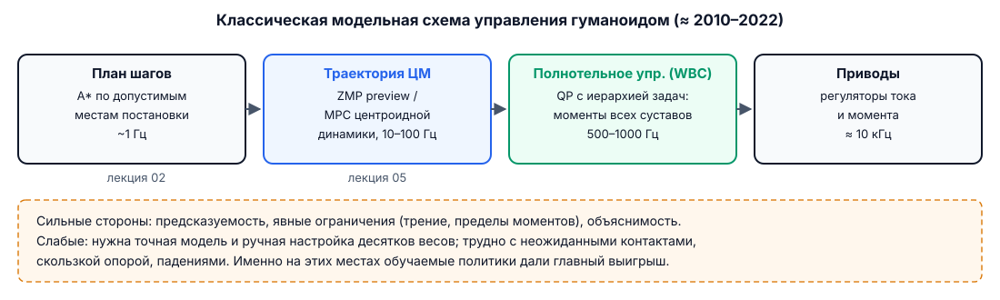

**Термин: иерархия управления.** Верхние уровни решают редко и грубо (куда ставить ноги, ~1 Гц), нижние — часто и точно (моменты в суставах, 500–1000 Гц). Каждый уровень опирается на свою упрощённую модель — так же устроен навигационный стек мобильного робота (лекции 02–05).

---

## Полнотельное управление (WBC) 37–40 мин

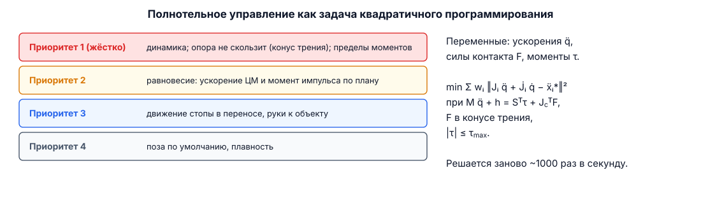

**Термин: полнотельное управление (WBC).** Расчёт моментов **всех** суставов сразу так, чтобы выполнить несколько задач: устоять, переставить ногу, дотянуться рукой.

**Термин: конус трения.** Сила от опоры не может быть слишком «косой», иначе стопа поскользнётся: $|F_t| \le \mu F_n$.

**Термин: квадратичное программирование (QP).** Минимум квадратичной функции при линейных ограничениях. Решается за доли миллисекунды (лекция 05, SQP).

---

## Часть 3. Почему перешли к обучению 40–42 мин

### Три причины
1. **Симуляторы на GPU:** тысячи копий робота учатся одновременно; годы опыта за часы.
2. **Перенос из симулятора** (лекция 06): случайные масса, трение, задержки в обучении делают политику устойчивой к ошибкам модели.
3. **Дешёвые надёжные приводы:** электрические двигатели с малым передаточным числом выдерживают падения и ошибки обучения.

### Что получили
Обученные регуляторы ходьбы оказались **устойчивее** модельных: на траве, гравии, лестницах, после толчков. С 2023 г. почти все новые гуманоиды (Unitree, Agility, Figure, Boston Dynamics) ходят на RL-политиках.

**Но:** награду для каждого нового движения подбирать долго, а результат часто выглядит неестественно. Решение — учиться у людей.

---

## Обучение по движениям человека 42–45 мин

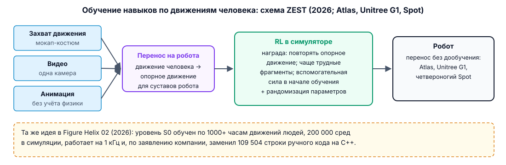

**Термин: захват движения (мокап).** Запись движений человека датчиками или камерами в виде углов суставов во времени.

**Термин: перенос движения (ретаргетинг).** Пересчёт движения человека на тело робота с другими длинами звеньев и пределами суставов.

**Термин: отслеживание движения.** RL-политика, награда которой — повторять опорное движение и не падать.

---

## ZEST: один рецепт для разных роботов 45–47 мин

### Что предложили авторы (Sleiman и др., 2026)
- Источник движения — мокап, **видео с одной камеры** или анимация; все три с ошибками и нарушениями физики.
- Обучение только в симуляторе, затем **перенос без дообучения** на Atlas, Unitree G1 и четвероногий Spot.
- Получены сложные движения всем телом, а не только ходьба.

### Термин: адаптивная выборка
Фрагменты движения, на которых политика чаще ошибается, показываются в обучении чаще. Так трудный прыжок не теряется среди лёгкой ходьбы.

### Термин: учебный план (curriculum)
Сначала задача облегчается: в симуляторе робота поддерживает **вспомогательная сила**. Затем её постепенно убирают.

---

## Большие модели: от языка к действию 47–50 мин

### Термин: языковая модель (LLM)
Нейросеть, обученная на огромном объёме текста продолжать текст. Умеет разбирать команды: «убери посуду в посудомойку».

### Термин: модель «зрение–язык» (VLM)
Языковая модель, которая принимает ещё и изображения: «что на столе?», «где ручка двери?».

### Термин: модель «зрение–язык–действие» (VLA)
VLM, к которой добавлен выход **действий робота**. Вход: кадры камер, команда, состояние робота. Выход: пакет действий (лекция 07).

**Примеры.** RT-2 (Google DeepMind, 2023) — действия как «слова»; OpenVLA (2024) — открытая модель; $\pi_0$ (Physical Intelligence, 2024) — действия генерирует **согласование потоков** из лекции 07.

---

## Figure Helix: две системы и уровень тела 50–53 мин

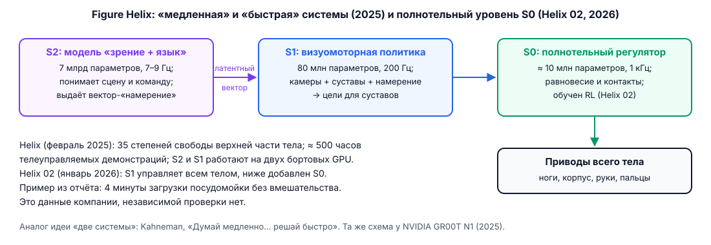

**S2 (думает медленно).** VLM на 7 млрд параметров, 7–9 Гц: понимает сцену и команду, передаёт вниз **латентный вектор** — числовое «намерение».

**S1 (действует быстро).** Сеть на 80 млн параметров, 200 Гц: по камерам и вектору намерения управляет 35 степенями свободы верхней части тела.

**Данные:** около 500 часов телеуправления. Обе сети работают на бортовых GPU робота. Сведения — из публикаций компании (февраль 2025).

---

## Helix 02: обученный уровень всего тела 53–55 мин

### Что добавили (январь 2026, по данным Figure)
- **S0** — сеть около 10 млн параметров, 1 кГц: равновесие и движение всего тела.
- Обучена RL по более чем 1000 часам движений людей, перенесённых на робота, в более чем 200 000 параллельных средах симуляции.
- Заменила 109 504 строки ручного кода управления на C++.
- S1 теперь управляет всем телом (200 Гц), а не только руками.

### Как это связано с курсом
- S0 — отслеживание движения из предыдущих слайдов, как в ZEST.
- S1 — диффузионная или подобная ей политика по демонстрациям (лекция 07).
- S2 — «глобальный планировщик», только понимающий язык.

Демонстрация: робот четыре минуты разгружал и загружал посудомойку без вмешательства человека. Это **заявление компании**, независимой проверки нет.

---

## VLA и модель мира с действиями (WAM) 55–58 мин

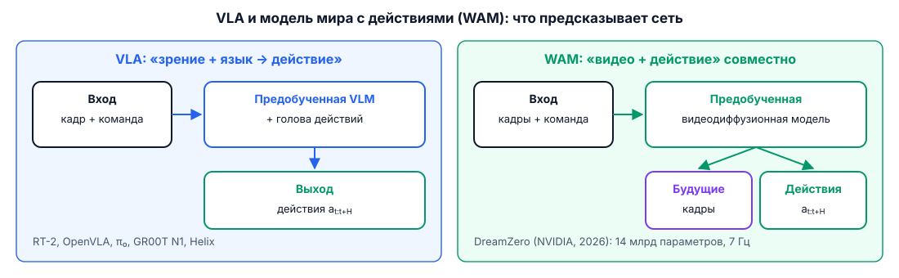

**Термин: модель мира.** Сеть, которая предсказывает, **как изменится сцена**: следующие кадры видео при данных действиях. Это та же «модель движения» $\dot x = f(x, u)$ из лекции 04, только состояние — изображение.

**Термин: модель мира с действиями (WAM).** Предсказывает **совместно** будущее видео и действия, которые к нему ведут. DreamZero (NVIDIA, 2026): 14 млрд параметров, 7 Гц; авторы показали выполнение новых задач без дообучения.

---

## Частоты уровней управления 58–60 мин

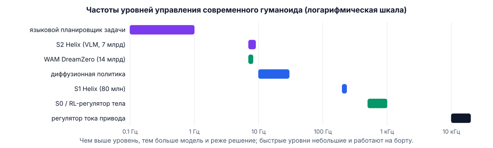

**Общий принцип.** Большая модель «думает» редко, маленькая — часто. Та же иерархия, что в классической схеме (слайд 15), но уровни теперь обучены. Так же устроены NVIDIA GR00T N1 (2025) и Helix.

**Почему нельзя одну большую сеть на 1 кГц.** Модель на миллиарды параметров отвечает за десятки–сотни миллисекунд; за это время падающий робот пролетит несколько сантиметров. Равновесию нужна реакция за 1–2 мс.

---

## Часть 4. Компании: США 60–62 мин

<!-- _class: compact -->

| Компания | Робот | Особенности |
| :--- | :--- | :--- |
| Boston Dynamics (принадлежит Hyundai) | электрический Atlas (2024) | пилотная работа на заводах Hyundai; обучение по движениям людей |
| Figure AI | Figure 02 (2024), Figure 03 (2025) | собственная модель Helix; пилот на заводе BMW |
| Tesla | Optimus (с 2022) | ставка на массовое производство и собственные приводы |
| Agility Robotics | Digit | ноги «как у птицы»; работа на складах (перекладка контейнеров) |
| Apptronik | Apollo | пилоты на автозаводах |
| 1X (Норвегия и США) | NEO | домашний робот с мягким корпусом; на первых порах часть задач — с удалённым оператором |
| NVIDIA | GR00T, Isaac | не делает роботов, а даёт модели, симуляторы и вычислители для всех |

Большая часть данных — из сообщений компаний. Число роботов, реально работающих на производстве, исчисляется единицами–десятками на компанию.

---

## Гуманоиды в одном масштабе 62–64 мин

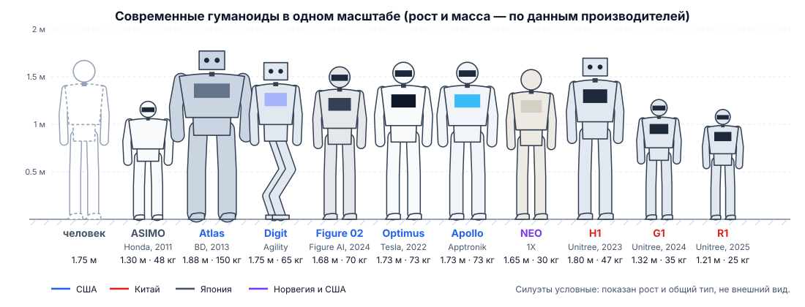

**Рост — как у человека.** Большинство роботов для заводов и складов — 1.65–1.8 м: им нужно доставать до тех же полок и проходить в те же двери.

**Масса упала вдвое.** Гидравлический Atlas 2013 г. весил около 150 кг; электрические роботы 2022–2025 гг. — 30–75 кг. Лёгкий робот безопаснее рядом с людьми и дольше работает от аккумулятора.

**Маленькие роботы** (G1, R1) дешевле и прочнее при падениях: на них учатся университеты.

---

## Компании: Китай и другие страны 64–66 мин

### Китай
- **Unitree:** H1 (2023), G1 (2024, от ~16 тыс. долларов), R1 (2025, от ~6 тыс.). Самые массовые исследовательские гуманоиды в мире.
- **UBTech** (Walker S), **AgiBot**, **Fourier**, **XPeng**, **Xiaomi** и десятки стартапов.
- Государственная поддержка, своя цепочка поставок приводов, редукторов, аккумуляторов. Публичные соревнования: полумарафон гуманоидов в Пекине (апрель 2025).

### Другие
- **Япония:** Honda (ASIMO, проект закрыт в 2018), Toyota, Kawasaki.
- **Южная Корея:** Rainbow Robotics (наследник HUBO), Hyundai как владелец Boston Dynamics.
- **Европа:** PAL Robotics (Испания), Neura Robotics (Германия), исследовательские центры (IIT, DLR, ETH).

**Тенденция:** цена исследовательского гуманоида упала примерно в десять раз за три года, и обучение стало доступно университетам.

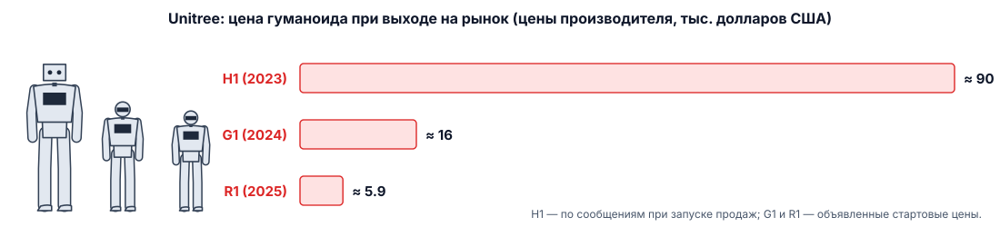

---

## Россия: ФЁДОР — гуманоид в космосе 66–69 мин

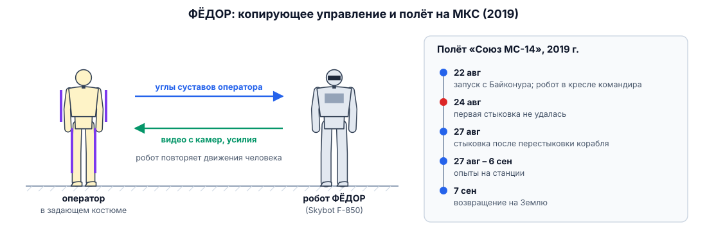

**Проект.** FEDOR (Final Experimental Demonstration Object Research), позднее Skybot F-850. НПО «Андроидная техника» по заказу Фонда перспективных исследований; первоначально — для МЧС.

**Термин: телеуправление (копирующее управление).** Оператор в задающем костюме двигается, робот повторяет. Плюс — сложные действия без автономии; минус — нужен человек и быстрая связь.

**Чему научил проект.** Работа гуманоида в невесомости и копирующее управление. Серийного продолжения и самостоятельной ходьбы уровня зарубежных роботов не последовало.

---

## Российские проекты на одной шкале 69–71 мин

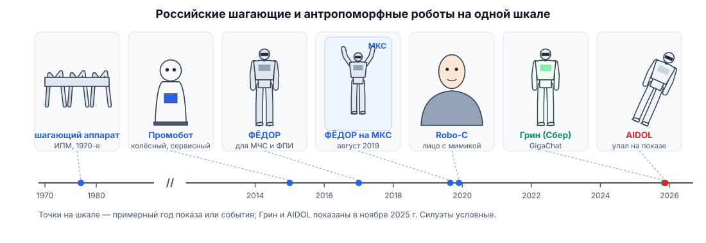

**Три разных типа.** Колёсный сервисный робот (Промобот), андроид с лицом без ходьбы (Robo-C) и шагающие гуманоиды (ФЁДОР, Грин, AIDOL). Задачи и трудности у них разные: «гуманоид» в новостях не всегда означает «ходит сам».

**Как читать шкалу.** Школа теории шагающих машин есть с 1970-х, но шагающих гуманоидов, показанных публично, — единицы. Подробности по каждому проекту — на следующем слайде.

---

## Россия: Промобот, Сбер, AIDOL 71–74 мин

### Промобот (Пермь, с 2015 г.)
- Сервисные колёсные роботы для приёма посетителей; по данным компании, поставлены в десятки стран.
- Андроид **Robo-C** (2019): реалистичное лицо, мимика; сидячий, без ходьбы.
- Сильная сторона — взаимодействие с людьми и серийное производство сервисных роботов.

### Сбер: Грин (ноябрь 2025)
- Показан на конференции AI Journey.
- Работает с языковой моделью GigaChat; 10 камер и датчиков зрения, датчики силы и инерциальные.
- Целевые задачи: комплектация и сортировка, торговля, общепит, производство.
- В 2026 г. объявлено о линейке гуманоидов к осени 2026.

### AIDOL (ноябрь 2025)
- Шагающий вариант: около 95 кг, переносит до 10 кг; настольный вариант с 19 приводами лица.
- По заявлению разработчиков, 77 % российских компонентов (с планом до 93 %).
- Показан в Москве; при выходе на сцену **упал**.

---

## Разбор случая: падение на презентации 74–77 мин

### Что произошло
Робот AIDOL сделал несколько шагов по сцене и упал. Разработчики объяснили это освещением и калибровкой стереокамер.

### Как рассуждать инженеру
- Ходьба **зависела от зрения**: значит, равновесие не было отделено от восприятия. В схемах слайдов 15 и 24 нижний уровень держит равновесие по датчикам самого тела (энкодеры, ИНС, датчики силы), независимо от камер.
- Сцена — новая обстановка (свет, покрытие). Нужны испытания в «плохих» условиях и рандомизация в обучении (лекция 06).

### Падать — нормально
В DARPA 2015 падали роботы лучших команд мира. Boston Dynamics публикует ролики с неудачными дублями. Падение на показе — повод проверить архитектуру, а не довод «гуманоиды в России невозможны».

**Вопрос аудитории:** какие проверки вы бы провели перед публичным показом? (Ответ в методических указаниях.)

---

## Честная оценка: где Россия сейчас 77–80 мин

### Есть
- Сильная школа теории управления и механики: шагающие аппараты Д. Е. Охоцимского в ИПМ им. М. В. Келдыша (1970–1980-е), книга Вукобратовича издана на русском в 1976 г.
- Опыт сервисной робототехники (Промобот) и крупные компании с собственными языковыми моделями (Сбер, Яндекс).
- Космический опыт копирующего управления (ФЁДОР).

### Не хватает (наша оценка по открытым данным)
- **Компонентов:** компактные приводы с измерением момента, редукторы, вычислители для работы на борту.
- **Данных:** тысяч часов телеуправления и записей движений.
- **Масштаба:** сотен роботов для испытаний; у лидеров их уже сотни и тысячи.
- **Открытых публикаций** с измерениями, а не только презентаций.

Для студента это означает спрос: специалисты по управлению, обучению и приводам нужны и здесь, и в мире.

---

## Часть 5. Как отличить автономию от телеуправления 80–82 мин

### Признаки, требующие проверки
- Подпись к видео не говорит **«автономно»** или говорит «под управлением».
- Видео **ускорено** (2×, 4×, 10×) — часто указано мелким шрифтом.
- Монтажные склейки: сколько попыток было до удачной?
- Рядом человек в костюме, с пультом или VR-шлемом.
- Робот «разговаривает» слишком естественно и без задержек.

### Термины
- **Автономия:** решения принимает программа робота.
- **Телеуправление:** решения принимает человек на расстоянии.
- **Общая автономия:** робот делает простое сам, человек помогает в трудном.

**Пример.** По сообщениям СМИ, роботы Optimus, общавшиеся с гостями на презентации Tesla в октябре 2024 г., частично управлялись операторами. Для сбора данных телеуправление нормально — плохо выдавать его за автономию.

---

## Открытые проблемы 82–85 мин

### Данные и обобщение
Для языковых моделей есть интернет текста; для действий роботов таких данных нет. Телеуправление дорого, видео людей не содержит сил и моментов.

### Руки
Кисть человека — около 20 степеней свободы и тысячи датчиков касания. Ловкие и прочные кисти с осязанием остаются нерешённой задачей.

### Энергия и надёжность
Работа от аккумулятора — несколько часов; время между отказами — далеко от промышленных требований.

### Безопасность рядом с людьми
Падающий 60–90-килограммовый робот опасен. Нужны гарантии (фильтры безопасности, лекция 06) и стандарты.

### Проверка обученных моделей
Как доказать, что сеть на миллиарды параметров не сделает опасного действия в новой ситуации? Ответа пока нет.

### Экономика
Где гуманоид дешевле человека или обычного манипулятора — пока подтверждено лишь на отдельных пилотах.

---

## Гуманоид как сумма курса 85–87 мин

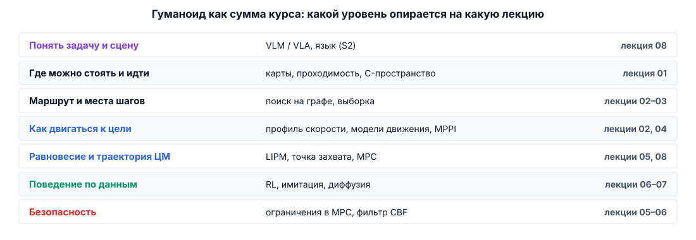

Каждый уровень управления гуманоидом опирается на лекции курса: поиск пути и мест для шагов, модели движения, оптимальное управление и MPC, обучение с подкреплением, обучение по демонстрациям.

---

## Итоги лекции и контрольные вопросы 87–89 мин

### Итоги
- Классическая ходьба: ZMP в стопе, LIPM $\ddot x = \omega^2(x - p)$, точка захвата $\xi = x + \dot x/\omega$.
- Boston Dynamics прошла путь от прыгающих роботов к модельному управлению с MPC и затем к обучению.
- WBC — QP по моментам всех суставов с приоритетами задач.
- Сейчас: RL по движениям людей (ZEST, Helix S0), VLA и модели мира, иерархия частот.
- Отрасль быстро растёт, но многое — заявления компаний; учитесь проверять.

### Контрольные вопросы
1. Чем статическая устойчивость отличается от динамической?
2. Найдите $\omega$ для робота с $z_0 = 0.6$ м.
3. ЦМ в 0.05 м перед ZMP, скорость 0.5 м/с, $\omega = 3.3$ 1/с. Где точка захвата? Устоит ли робот без шага, если носок в 0.16 м?
4. Зачем в WBC конус трения?
5. Почему S0 Helix работает на 1 кГц, а S2 — на 7–9 Гц?
6. Чем WAM отличается от VLA?
7. Назовите три признака того, что видео робота может быть телеуправлением.

---

## Словарь терминов лекции

<!-- _class: compact -->

### Классическая ходьба
- **Антропоморфный робот**, **степень свободы**.
- **Опорный многоугольник**, **центр масс**.
- **Статическая и динамическая устойчивость**.
- **ZMP**, **LIPM**, $\omega = \sqrt{g/z_0}$.
- **Шаговый цикл**, **точка захвата**, **DCM**.
- **Центроидная динамика**.

### Модельное управление и обучение
- **Иерархия управления**, **WBC**.
- **Конус трения**, **QP**.
- **Захват движения**, **ретаргетинг**.
- **Отслеживание движения**, **адаптивная выборка**.
- **Учебный план (curriculum)**, **перенос без дообучения**.

### Большие модели и практика
- **LLM**, **VLM**, **VLA**.
- **Латентный вектор**, **S2 / S1 / S0**.
- **Модель мира**, **WAM**.
- **Телеуправление**, **копирующее управление**.
- **Автономия**, **общая автономия**.

---

## Литература

<!-- _class: compact -->

### Классическая ходьба и управление
- Вукобратович М. *Шагающие роботы и антропоморфные механизмы.* — М.: Мир, 1976.
- Kajita S. et al. Biped walking pattern generation by using preview control of zero-moment point // ICRA. 2003.
- Kajita S., Hirukawa H., Harada K., Yokoi K. *Introduction to Humanoid Robotics.* — Springer, 2014.
- Raibert M. H. *Legged Robots That Balance.* — MIT Press, 1986.
- Pratt J. et al. Capture point: A step toward humanoid push recovery // Humanoids. 2006.
- Englsberger J., Ott C., Albu-Schäffer A. Three-dimensional bipedal walking control based on divergent component of motion // IEEE T-RO. 2015.
- Wensing P. M. et al. Optimization-based control for dynamic legged robots // IEEE T-RO. 2024.

### Обучение и большие модели
- Peng X. B. et al. DeepMimic: Example-guided deep reinforcement learning of physics-based character skills // ACM TOG. 2018.
- Sleiman J.-P. et al. ZEST. arXiv:2602.00401. 2026.
- Brohan A. et al. RT-2: Vision-language-action models transfer web knowledge to robotic control // CoRL. 2023.
- Black K. et al. $\pi_0$: A vision-language-action flow model for general robot control. arXiv:2410.24164. 2024.
- NVIDIA. GR00T N1: An open foundation model for generalist humanoid robots. arXiv:2503.14734. 2025.
- Figure AI. Helix: A vision-language-action model for generalist humanoid control. 2025; Helix 02. 2026 (публикации компании).
- World action models are zero-shot policies (DreamZero). arXiv:2602.15922. 2026.

